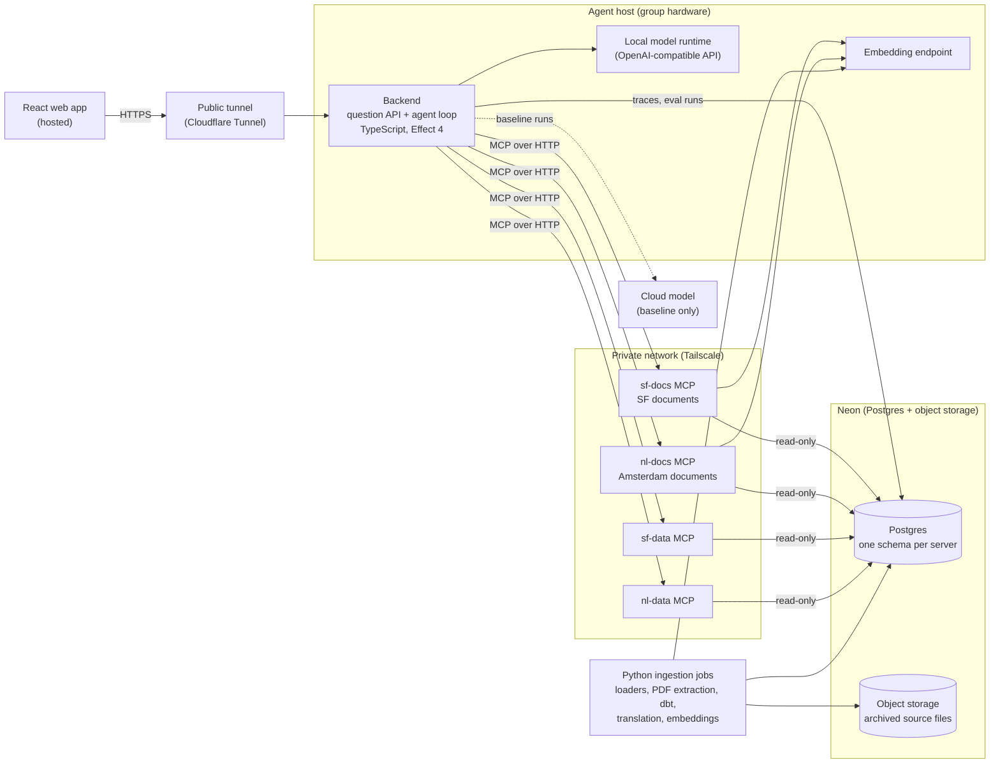

# PolicyHuis

PolicyHuis - Climatebase Fellowship

An AI agent that answers questions about housing policy in **San Francisco** and **Amsterdam** in plain language, citing the law, policy or dataset behind every claim. It runs an open-weight model on the group's own hardware and reaches its knowledge through independent [Model Context Protocol (MCP)](https://modelcontextprotocol.io/) servers. Climate risk is a first-class topic alongside housing.

> **Status: discovery.** The design is a draft and open to revision as user research and the spikes report back. No application code exists yet. Final demo: November 30, 2026.

## What it answers

| Question type | Example | Answered from |
|---|---|---|
| Rule | Which units are covered by rent control under Chapter 37 of the Administrative Code? | Legal text |
| Ground | How many eviction notices were filed in the Mission last year, and for what reasons? | City data |
| Rule + data | Which grounds for eviction in the rent ordinance account for the most notices, and which are rising? | Both |
| Climate | Which neighborhoods with planned housing face high heat stress or flood risk? | City data, sometimes legal text |
| Cross-city | How do Amsterdam and San Francisco each decide who qualifies for affordable housing? | Both cities' servers |

It **declines** legal advice and causal conclusions ("did rent control reduce evictions?"), pointing to the San Francisco Rent Board or the Huurcommissie, and says when the data can't answer a question. The examples come from the [provisional questions](./docs/plans/provisional-questions.md), pending confirmation from the research team.

## How it works



- **One agent, several MCP servers.** A single reasoning loop calls tools on independent servers. A server's specialization is its data and tools, not its model, so each can run on hardware owned by the group responsible for that data.
- **Documents servers.** One per city (`sf-docs`), for laws, ordinances and policy documents, since each city's documents need their own structure and tools; each city's documents ingestion builds its corpus. Search is vector search over passages split along each document's own structure, with versions and effective dates, as [spike S4](./docs/plans/spikes/s4-embeddings.md#decision) decided.
- **Data servers.** One per city (`sf-data`), with housing, demographic and climate data (flood and sea-level-rise zones, heat stress, energy labels, building age), queried with tested code so numbers come from data, not from the model.
- **Citations by convention.** Every tool result carries the citations behind it, in a shape every server follows without sharing code. The backend reads them and streams them to the browser app, so each claim in an answer links to its source.
- **Dutch sources.** Amsterdam's laws are translated to English once, at load time. Both texts are stored; citations quote the Dutch original and label translations as machine translation.
- **Group-hosted.** The agent and its model run on a team laptop; the hosted web app reaches it through a Cloudflare Tunnel, and the agent reaches the servers over a Tailscale private network.
- **Measured, not asserted.** Accuracy (checked by the research team's policy expert), latency and energy per query are compared across three configurations: the local model, the same open-weight model in the cloud, and a frontier model. Local energy is measured; cloud energy is estimated with [EcoLogits](https://ecologits.ai/latest/methodology/) and reported with its uncertainty.
- **Reproducible.** Every number, citation and passage traces back to an archived source file through checked-in code.

The full design, including the spikes, milestones and open questions, is in the [MVP Technical Plan](./docs/plans/mvp-technical-plan.md).

## Repository layout

Code is organized by deployable unit, then by domain. Each city has ingestion projects, which run as scheduled jobs that write their schemas, and MCP servers, which run as long-lived services that only read them; the two are never deployed together, and each node can run on its own device. Shared code is plumbing that nodes install as libraries, never a contract between them. Directories are created as the work starts.

```
backend/                            the question API and the agent loop
browser-app/                        web app (React)
protocol/                           API between the backend and the browser app, including the citation schema
shared/node-config/                 TypeScript library: configuration files and .env for every node
shared/ingest/                      Python library: fetch, archive and load sources; run dbt
san-francisco/ingest/data/          SF data sources, raw_sf_data migrations, sf_data dbt models
san-francisco/ingest/documents/     SF documents, passage pipeline, raw_sf_docs and sf_docs migrations
san-francisco/mcp-servers/data/     sf-data MCP server
san-francisco/mcp-servers/documents/   sf-docs MCP server
netherlands/                        the Dutch nodes, same shape
evaluation/                         question set and expected answers
scripts/                            repo tooling: yarn dev
docs/                               plans, architecture and style guides
```

## Running locally

San Francisco's two MCP servers (`sf-data` and `sf-docs`), the backend and the browser app run as four processes, with the model served by Ollama or a cloud provider. Requires Node 26, Corepack, the loaded `sf-data` database (see [`san-francisco/ingest/data/`](./san-francisco/ingest/data/README.md)) and, for the docs server, the loaded and embedded `sf-docs` corpus (see [`san-francisco/ingest/documents/`](./san-francisco/ingest/documents/README.md)).

1. **Install** from the repo root: `corepack enable && yarn install`.
2. **Configure the MCP servers:**
   - `cp san-francisco/mcp-servers/data/.env.example san-francisco/mcp-servers/data/.env`, then set `SF_DATA_READER_DATABASE_URL` (the read-only `sf_data_reader` connection string) and `SF_DATA_PORT` (for example `8081`);
   - `cp san-francisco/mcp-servers/documents/.env.example san-francisco/mcp-servers/documents/.env`, then set `SF_DOCS_READER_DATABASE_URL` (the read-only `sf_docs_reader` connection string) and `SF_DOCS_PORT` (for example `8082`).
3. **Configure the backend:** `cp backend/.env.example backend/.env`, then set:
   - `APP_DATABASE_URL`: the owner connection string of the `app` Neon project; the backend creates the `app` schema on first start;
   - `BACKEND_PORT`: the port for the question API (for example `8080`);
   - the API key of the model configuration selected in `backend/config/agent.yaml` (`FRONTIER_API_KEY` for `frontier`); the `local` configuration needs none.

   Check that the `sf-data` and `sf-docs` URLs in `backend/config/servers.yaml` use the servers' ports.
4. **Serve the model.** `model.configuration` in `backend/config/agent.yaml` selects it. For `local`, the model runs in [Ollama](https://ollama.com/download/mac), installed as a Mac app, with models stored outside the repo in `~/.ollama/models`:
   1. Download the model named by the `local` configuration's `modelId`: `ollama pull gpt-oss:20b`.
   2. Set Ollama's context length to the configuration's `contextTokens`. Ollama defaults to 4,096 tokens and drops the start of a longer prompt without failing ([FAQ](https://docs.ollama.com/faq)), so this is required. The Mac app reads it from `launchctl`, so run `launchctl setenv OLLAMA_CONTEXT_LENGTH 32000`, then quit and reopen Ollama. The setting is lost on restart, so set it again after rebooting.
   3. Check it answers: `ollama run gpt-oss:20b "hello"`. The backend calls it at `http://localhost:11434/v1`.
   4. Download the embedding model that document search uses: `ollama pull qwen3-embedding:4b`, and check with `ollama list` that its ID is `df5bd2e3c74c`, the build [spike S4](./docs/plans/spikes/s4-embeddings.md#decision) chose and `san-francisco/ingest/documents/config/search.yaml` pins. The same Ollama serves it alongside the chat model, loading each on its first request; see [`san-francisco/ingest/documents/`](./san-francisco/ingest/documents/README.md#embedding-model).

   Ollama answers one request at a time by default (`OLLAMA_NUM_PARALLEL`), which is why the `local` configuration's `maxConcurrentQuestions` is 1; raise both together.
5. **Configure the browser app:** `cp browser-app/.env.example browser-app/.env`, then set `BACKEND_URL` to the backend's address (for example `http://localhost:8080`). The app's dev server proxies `/api` to it.
6. **Start everything**, from the repo root:
   - `yarn dev --include san-francisco` runs San Francisco's two MCP servers, the backend and the browser app in one terminal, with their logs interleaved. `yarn dev` alone runs only the backend and the browser app; `--include` takes one or more groups (`--include san-francisco netherlands`), and `--all` starts every group. A group is a top-level directory, other than `shared/`, holding a workspace with a `start` script; an unknown group is refused with the list of groups;
   - or each in its own terminal: `yarn workspace @policyhuis/sf-data-server start`, `yarn workspace @policyhuis/sf-docs-server start`, `yarn workspace @policyhuis/backend start` and `yarn workspace @policyhuis/browser-app start`.

   They can start in any order: the backend retries a server it cannot reach and offers its tools once it connects, and the browser app shows the agent host as offline until the backend is up.
7. **Ask a question** in the browser at the URL the app's dev server prints (`http://localhost:5173` by default), or from the command line:

   ```sh
   curl -N -X POST http://localhost:8080/api/v1/questions \
     -H 'content-type: application/json' \
     -d '{"question": "How many affordable units are in the development pipeline, by status?"}'
   ```

   The answer streams back as server-sent events: one `LookupStarted` and `LookupEnded` per tool call, a `Sources` event with the citations each result carries, the answer in `TextChunk`s, and `Complete` last. Each question's trace is written to `app.requests` and `app.tool_calls`.

## Tooling

| Area | Tooling |
|---|---|
| Agent and MCP servers | TypeScript, Effect 4, yarn workspaces, ESLint + Prettier, `@effect/vitest` |
| Data pipelines | Python with uv, ruff and pytest; Alembic (raw SQL) for raw schemas; dbt for city data models |
| Database | Postgres with pgvector on Neon, one schema per server; archived source files in Neon object storage |
| Models | Any OpenAI-compatible runtime (Ollama, LM Studio, llama.cpp, `mlx_lm.server`) through `@effect/ai-openai-compat`; the runtime is chosen in spike S1 |
| Network | Cloudflare Tunnel (web app → agent), Tailscale (agent → servers) |

## Team

San Francisco work (sources, ingestion, corpus, `sf-data` and `sf-docs`) is owned by Molly; Amsterdam work (sources, pipelines, corpus, `nl-data` and `nl-docs`) by Martin. A research team, including a policy expert, checks the evaluation answers.

## Documentation

- [MVP Technical Plan](./docs/plans/mvp-technical-plan.md): the backend design
- [Provisional Questions](./docs/plans/provisional-questions.md): the draft question set
- [San Francisco Plan](./docs/plans/sf-plan.md): San Francisco phases, sources, tools, contracts and schemas
- [Agent Loop Plan](./docs/plans/agent-loop.md): the backend's agent loop, question API and `app` schema, shared by every city
- [Browser App Plan](./docs/plans/browser-app.md): the browser app's Phase 1 prototype: the streamed answer, tool calls and citations, shared by every city
- [Netherlands Ingestion and Tools Plan](./docs/plans/netherlands-ingestion.md): loading the Dutch sources and designing the Dutch data server's tools
- [Restructuring Plan](./docs/plans/restructure.md): the layout by deployable unit, the `sf-data` and `sf-docs` names, and the citation and lookup contracts
- [Domain-Driven Design and Hexagonal Architecture](./docs/domain-driven-design.md): where code belongs and why
- [Working Agreement](./docs/working-agreement.md): the rules we hold each other to in review
- [Ubiquitous Language](./docs/ubiquitous-language.md): the vocabulary
- [Effect Style](./docs/effect-style.md): Effect 4 patterns for TypeScript
- [Front-end Code Style](./docs/front-end-code-style.md): React conventions for the web app
- [CLAUDE.md](./CLAUDE.md): rules for AI coding assistants, including data provenance

## License

Not yet chosen; see open question 10 in the [plan](./docs/plans/mvp-technical-plan.md#open-questions).
