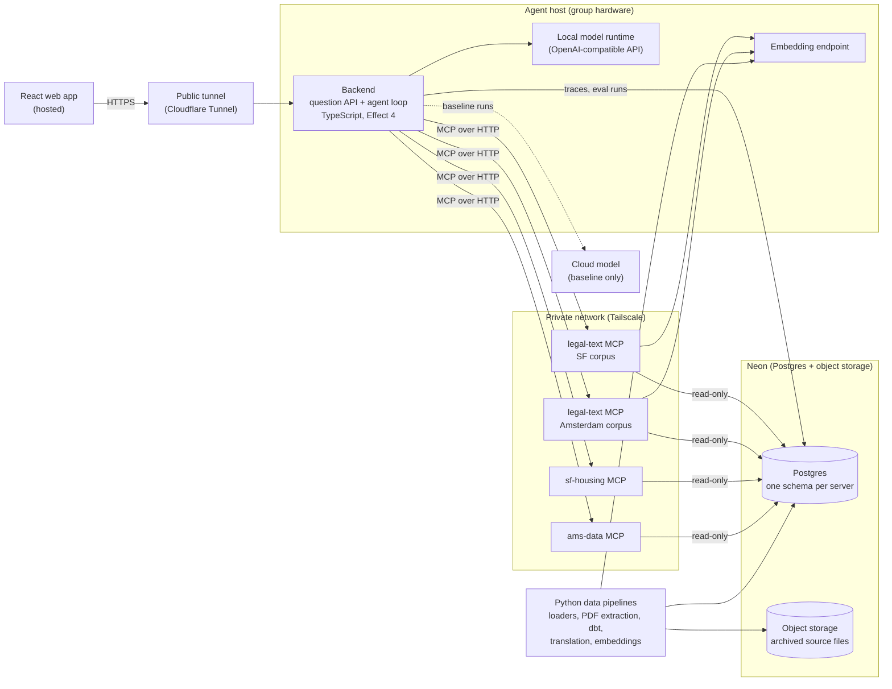

# PolicyHuis

PolicyHuis - Climatebase Fellowship

An AI agent that answers questions about housing policy in **San Francisco** and **Amsterdam** in plain language, citing the law, policy or dataset behind every claim. It runs an open-weight model on the group's own hardware and reaches its knowledge through independent [Model Context Protocol (MCP)](https://modelcontextprotocol.io/) servers. Climate risk is a first-class topic alongside housing.

> **Status: discovery.** The design is a draft and open to revision as user research and the spikes report back. No application code exists yet. Final demo: November 30, 2026.

## What it answers

| Question type | Example | Answered from |
|---|---|---|
| Rule | Which units are covered by rent control under Chapter 37 of the Administrative Code? | Legal text |
| Ground | How many eviction notices were filed in the Mission last year, and for what reasons? | City data |
| Rule + data | Which grounds for eviction in the rent ordinance account for the most notices, and which are rising? | Both |
| Climate | Which neighborhoods with planned housing face high heat stress or flood risk? | City data, sometimes legal text |
| Cross-city | How do Amsterdam and San Francisco each decide who qualifies for affordable housing? | Both cities' servers |

It **declines** legal advice and causal conclusions ("did rent control reduce evictions?"), pointing to the San Francisco Rent Board or the Huurcommissie, and says when the data can't answer a question. The examples come from the [provisional questions](./docs/plans/provisional-questions.md), pending confirmation from the research team.

## How it works



- **One agent, several MCP servers.** A single reasoning loop calls tools on independent servers. A server's specialization is its data and tools, not its model, so each can run on hardware owned by the group responsible for that data.
- **Legal-text server.** One codebase, run once per city's corpus. Hybrid search (vector and keyword, combined by reciprocal rank fusion) over passages split along each document's own structure, with versions and effective dates.
- **City data servers.** One per city, with housing, demographic and climate data (flood and sea-level-rise zones, heat stress, energy labels, building age), queried with tested code so numbers come from data, not from the model.
- **Dutch sources.** Amsterdam's laws are translated to English once, at load time. Both texts are stored; citations quote the Dutch original and label translations as machine translation.
- **Group-hosted.** The agent and its model run on a team laptop; the hosted web app reaches it through a Cloudflare Tunnel, and the agent reaches the servers over a Tailscale private network.
- **Measured, not asserted.** Accuracy (checked by the research team's policy expert), latency and energy per query are compared across three configurations: the local model, the same open-weight model in the cloud, and a frontier model. Local energy is measured; cloud energy is estimated with [EcoLogits](https://ecologits.ai/latest/methodology/) and reported with its uncertainty.
- **Reproducible.** Every number, citation and passage traces back to an archived source file through checked-in code.

The full design, including the spikes, milestones and open questions, is in the [MVP Technical Plan](./docs/plans/mvp-technical-plan.md).

## Repository layout

Each node (the agent, each city's servers) can run on its own device. Shared code is libraries that each node installs, never code a node calls at runtime. City-specific sources, migrations and models live in the city's directory. Directories are created as the work starts; `shared/ingest/` and `san-francisco/ingest/` exist now.

```
backend/                 the question API and the agent loop
browser-app/             web app (React)
protocol/                API between the backend and the browser app, including the citation schema
shared/mcp-kit/          optional MCP server helpers: formats, errors, citation IDs, database access
shared/ingest/           Python library: fetch, archive and load sources; run dbt
shared/legal-text/       legal-text MCP server and passage pipeline (one codebase, run per corpus)
san-francisco/housing-server/   sf-housing MCP server
san-francisco/ingest/    SF sources, raw_sf migrations, sf dbt models
san-francisco/legal-text/       SF corpus and deploy settings for its legal-text instance
netherlands/             the Dutch nodes, same shape
evaluation/              question set and expected answers
docs/                    plans, architecture and style guides
```

## Running locally

The San Francisco data server, the backend and the browser app run as three processes. Requires Node 26, Corepack and the loaded `sf-housing` database (see [`san-francisco/ingest/`](./san-francisco/ingest/README.md)).

1. **Install** from the repo root: `corepack enable && yarn install`.
2. **Configure the data server:** `cp san-francisco/housing-server/.env.example san-francisco/housing-server/.env`, then set `SF_HOUSING_READER_DATABASE_URL` (the read-only `sf_housing_reader` connection string) and `SF_HOUSING_PORT` (for example `8081`).
3. **Configure the backend:** `cp backend/.env.example backend/.env`, then set:
   - `APP_DATABASE_URL`: the owner connection string of the `app` Neon project; the backend creates the `app` schema on first start;
   - `BACKEND_PORT`: the port for the question API (for example `8080`);
   - the API key of the model configuration selected in `backend/config/agent.yaml` (`FRONTIER_API_KEY` for `frontier`).

   Check that the `sf-housing` URL in `backend/config/servers.yaml` uses the data server's port.
4. **Configure the browser app:** `cp browser-app/.env.example browser-app/.env`, then set `BACKEND_URL` to the backend's address (for example `http://localhost:8080`). The app's dev server proxies `/api` to it.
5. **Start everything**, from the repo root:
   - in one terminal, `yarn dev`, which runs the data server, the backend and the browser app and interleaves their logs;
   - or in separate terminals, `yarn workspace @policyhuis/sf-housing-server start`, `yarn workspace @policyhuis/backend start` and `yarn workspace @policyhuis/browser-app start`.

   They can start in any order: the backend retries a data server it cannot reach and offers its tools once it connects, and the browser app shows the agent host as offline until the backend is up.
6. **Ask a question** in the browser at the URL the app's dev server prints (`http://localhost:5173` by default), or from the command line:

   ```sh
   curl -N -X POST http://localhost:8080/api/v1/questions \
     -H 'content-type: application/json' \
     -d '{"question": "How many affordable units are in the development pipeline, by status?"}'
   ```

   The answer streams back as server-sent events: one `ToolStart` and `ToolEnd` per tool call, the answer in `TextChunk`s, and `Complete` last. Each question's trace is written to `app.requests` and `app.tool_calls`.

## Tooling

| Area | Tooling |
|---|---|
| Agent and MCP servers | TypeScript, Effect 4, yarn workspaces, ESLint + Prettier, `@effect/vitest` |
| Data pipelines | Python with uv, ruff and pytest; Alembic (raw SQL) for raw schemas; dbt for city data models |
| Database | Postgres with pgvector on Neon, one schema per server; archived source files in Neon object storage |
| Models | Any OpenAI-compatible runtime (Ollama, LM Studio, llama.cpp, `mlx_lm.server`) through `@effect/ai-openai-compat`; the runtime is chosen in spike S1 |
| Network | Cloudflare Tunnel (web app → agent), Tailscale (agent → servers) |

## Team

San Francisco work (sources, ingestion, corpus, `sf-housing`) is owned by Molly; Amsterdam work (sources, pipelines, corpus, `ams-data`) by Martin. A research team, including a policy expert, checks the evaluation answers.

## Documentation

- [MVP Technical Plan](./docs/plans/mvp-technical-plan.md): the backend design
- [Provisional Questions](./docs/plans/provisional-questions.md): the draft question set
- [San Francisco Plan](./docs/plans/sf-plan.md): San Francisco phases, sources, tools, contracts and schemas
- [Agent Loop Plan](./docs/plans/agent-loop.md): the backend's agent loop, question API and `app` schema, shared by every city
- [Browser App Plan](./docs/plans/browser-app.md): the browser app's Phase 1 prototype: the streamed answer, tool calls and citations, shared by every city
- [Netherlands Ingestion and Tools Plan](./docs/plans/netherlands-ingestion.md): loading the Dutch sources and designing the Dutch data server's tools
- [Domain-Driven Design and Hexagonal Architecture](./docs/domain-driven-design.md): where code belongs and why
- [Working Agreement](./docs/working-agreement.md): the rules we hold each other to in review
- [Ubiquitous Language](./docs/ubiquitous-language.md): the vocabulary
- [Effect Style](./docs/effect-style.md): Effect 4 patterns for TypeScript
- [Front-end Code Style](./docs/front-end-code-style.md): React conventions for the web app
- [CLAUDE.md](./CLAUDE.md): rules for AI coding assistants, including data provenance

## License

Not yet chosen; see open question 10 in the [plan](./docs/plans/mvp-technical-plan.md#open-questions).
