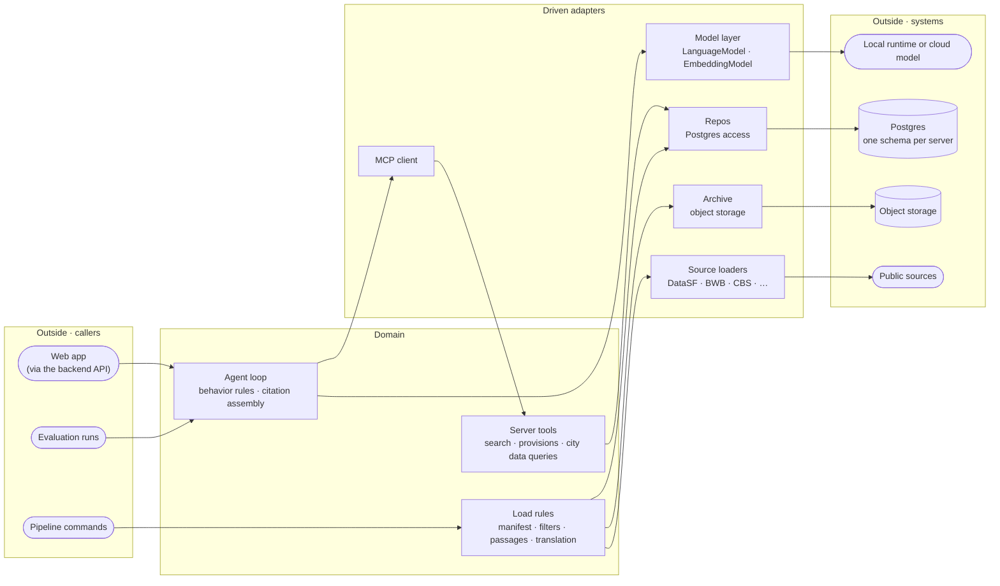

# Domain-Driven Design and Hexagonal Architecture

- **Status:** working agreement for PolicyHuis
- **Companions:** [Working Agreement](./working-agreement.md) (the rules in citable form), [Ubiquitous Language](./ubiquitous-language.md) (the vocabulary), [MVP Technical Plan](./plans/mvp-technical-plan.md) (the components these rules apply to)

Where each kind of code belongs, and why the boundaries are drawn where they are. We borrow from domain-driven design selectively: hexagonal architecture plus the few DDD ideas that pay for themselves at our size. DDD is a toolkit, not a checklist.

---

## The shape

Read it left to right: **outside → adapter → domain → adapter → outside.** Every arrow points into the domain from callers and out of it toward infrastructure, never back. The agent loop knows nothing about HTTP or server-sent events on its left, or about which model runtime answers on its right. That one-way property is the architecture.

The MCP client is the one place the picture folds: to the agent, an MCP server is a driven adapter; to the MCP server, the agent is a driving caller. Each server is its own hexagon, with its tool handlers as the domain and its repo as the driven adapter.

The acceptance test comes from Alistair Cockburn's [Ports and Adapters](https://alistair.cockburn.us/hexagonal-architecture/): the application should be equally drivable by a user, a test, or a script, and equally able to run against real infrastructure or a stub. For us that means:

- **The agent loop runs against a stub model and stub tools** in a test, with no runtime, network or database.
- **Every configuration (local, same model in the cloud, frontier) is one layer swap.** The loop, prompts and tools don't change; only the layer that provides `LanguageModel` does.
- **An MCP server's tool handlers run against a test database** without the agent, so each tool's numbers are tested on their own.
- **Loaders are testable with an in-memory archive and recorded HTTP responses.**

If a piece of logic can only be reached through a request handler, a live model or a live database, the boundary isn't real.

---

## Quick reference

| Term | Means |
|---|---|
| **Port** | A contract: what can be asked, with no commitment to how it's answered |
| **Adapter** | An implementation of a port against one specific technology |
| **Driving** | The outside calls in (the backend API, an evaluation run, a pipeline command, an MCP request) |
| **Driven** | We call out (a model runtime, an MCP server, Postgres, object storage, a public source) |

**Where does this code go?**

1. Does it translate an HTTP request, an evaluation run, a CLI command or an MCP request into a domain call? → **driving adapter** (the `HttpApi` handlers, the MCP tool registration, the pipeline CLI). No business rules.
2. Is it a rule about answers, citations, retrieval or the data (cite every claim, RRF ranking, load filters, passage splitting)? → **domain**.
3. Does it talk to a model, an MCP server, a database, a bucket or an external source? → **driven adapter** (the model layer, the MCP client, repos, the archive, source loaders).
4. None of the above and no substitution needed? → a plain function. Don't add a layer.

---

## Bounded contexts

A bounded context is a boundary within which a term means exactly one thing. Ours, and the contract each publishes:

| Context | Language | Writes | Reads | Published contract |
|---|---|---|---|---|
| **Data pipelines** (`pipelines/`) | Python, dbt | `raw_sf`, `raw_ams`, `sf`, `ams`, `policy_text_sf`, `policy_text_ams` | Public sources | The city data and passage schemas |
| **Legal-text server** (`mcp/legal-text/`) | TypeScript, Effect | Nothing | Its corpus's `policy_text_*` schema | Its MCP tools |
| **City data servers** (`mcp/sf-data/`, `mcp/ams-data/`) | TypeScript, Effect | Nothing | Its city's `sf` or `ams` schema | Its MCP tools |
| **Agent service** (`apps/agent/`) | TypeScript, Effect | `app` | MCP tools only | The backend API |
| **Evaluation** (`evaluation/`) | YAML, Python | Results through the agent service | `app` | The question-set file format |

**Contexts communicate through published contracts, never by importing each other's code.** The agent doesn't read `policy_text_*`; it calls the legal-text server's tools. A data server doesn't read another city's schema. Python and TypeScript share only database schemas. A change to a published contract (a schema another context reads, an MCP tool's input or output, the backend API) is a contract change and gets reviewed as one.

**The shared contract package is the one exception, and it holds only schemas.** `packages/contract/` defines the tool naming rule, the citation object, the tool error shape and the backend API as Effect `Schema`. The agent and every server import it so both sides of each boundary decode the same shapes. It holds no logic and no database access.

Isolation extends to credentials: each MCP server connects with a database role that can only read its own schema, so the grants enforce the boundary rather than convention alone. No server reads another server's schema, so moving a server to its own database is a connection-string change.

---

## Patterns worth naming

### Anti-corruption layer

An anti-corruption layer stops another system's model from leaking into ours. We have three kinds:

- **Source loaders.** Each loader maps a source's columns, by name, into typed rows and fails the load on a value it can't parse. DataSF can add a column or the BWB can change its XML; the blast radius is one parser.
- **Model output.** Tool-call arguments from the model are decoded through the tool's input schema before a handler runs. A small model can produce malformed arguments; they fail at the boundary and go back to the model as a typed error.
- **Tool results.** The agent decodes every tool result through the shared contract before it reaches the loop or the answer.

**Rule:** every upstream response is decoded through a parser or schema we own. Raw JSON never crosses into domain code. In Python that's typed parsing (pydantic, explicit conversion); in TypeScript it's Effect `Schema`.

### Numbers come from data, not from the model

Every number in an answer comes from a tool result, and every tool result comes from a tested query over loaded data. The model chooses tools and writes the explanation; it never computes a count, share or trend itself. If an answer needs a number no tool returns, add or extend a tool on the data server, with a test pinning it to known cases. Letting the model do arithmetic over tool output creates a second, untested answer to one question.

### Citations are part of the result, not decoration

Every tool result carries the citation objects behind it (source, title, provision or table, version or effective date, source URL, archived file hash, language). The agent assembles citations from those objects; it never writes a citation from the model's text. A claim with no citation object behind it is not made.

### Tool errors are results

A tool that finds nothing, or can't answer, returns a typed error as its result rather than failing the transport. The model then says "no data" instead of guessing. Transport failures (a server unreachable on the private network) are a different thing, reported as such to the caller and in the trace.

### Transactions are consistency boundaries

A load's manifest row and its data rows are one fact, so they're written in one transaction. The same holds for a passage and its translation and embedding. If you want a transaction that spans two contexts, you've found a boundary error, not a transaction problem.

### Plain data, rules at the boundary

Our models are plain data with rules in functions, which looks like Martin Fowler's [AnemicDomainModel](https://martinfowler.com/bliki/AnemicDomainModel.html) anti-pattern. The critique assumes encapsulation is the only way to guarantee an invariant; types and decoding are the other way. A value that fails a schema never gets past the boundary, so nothing downstream has to re-check it. Scott Wlaschin's [_Domain Modeling Made Functional_](https://pragprog.com/titles/swdddf/domain-modeling-made-functional/) is the long version.

### Separate wire and storage types

An MCP tool's output schema and the repo's row type describe overlapping data and stay separate types on purpose. The same holds for the backend API and the `app` tables. Collapsing them couples the contract to the tables: the day you add a column you don't want to publish, the shared type breaks. Map between them explicitly at the repo boundary.

### Ubiquitous language

The vocabulary lives in [Ubiquitous Language](./ubiquitous-language.md). If a term is in that table, the code spells it that way; if the code needs a new term, add it there in the same PR. Housing law in two countries uses different concepts for similar things, so the vocabulary has to be written down and defended rather than discovered.

---

## Troubleshooting

**Symptom:** A tool handler or the agent loop imports a Postgres client, an HTTP client or a model SDK directly.
**Fix:** Move the access into an adapter (a repo, the MCP client, the model layer) and depend on its service. The domain should run in a test with stubs.

**Symptom:** An `HttpApi` handler or an MCP tool registration is growing conditionals and defaults.
**Fix:** Those are business rules. Move them into the domain call; the adapter only translates.

**Symptom:** The agent needs a number no tool returns.
**Fix:** Add or extend a tool on the city's data server, backed by a tested query. Don't compute it in the agent or ask the model to.

**Symptom:** A server wants to read another server's schema, or the agent wants to query a schema directly.
**Fix:** Call that server's tool instead. If no tool fits, the tool design is incomplete.

**Symptom:** Two contexts need the same logic and importing feels easier.
**Fix:** Either it belongs to one context and the other calls its published contract, or it's a schema that belongs in the shared contract package. "It was easier to import" isn't a third option.

---

## Reading list

1. Martin Fowler, [DomainDrivenDesign](https://martinfowler.com/bliki/DomainDrivenDesign.html) and [UbiquitousLanguage](https://martinfowler.com/bliki/UbiquitousLanguage.html): ten minutes, and they frame everything else.
2. Alistair Cockburn, [Hexagonal Architecture (Ports and Adapters)](https://alistair.cockburn.us/hexagonal-architecture/): the original, and short.
3. Netflix, [Ready for changes with Hexagonal Architecture](https://netflixtechblog.com/ready-for-changes-with-hexagonal-architecture-b315ec967749): the same idea with a worked example.
4. Scott Wlaschin, [_Domain Modeling Made Functional_](https://pragprog.com/titles/swdddf/domain-modeling-made-functional/): DDD without objects, the closest match to how we use schemas.
5. Eric Evans, [_Domain-Driven Design_](https://www.domainlanguage.com/ddd/) (2003) and Vaughn Vernon, _Implementing Domain-Driven Design_ (2013): the sources, when the short versions stop answering your question.
