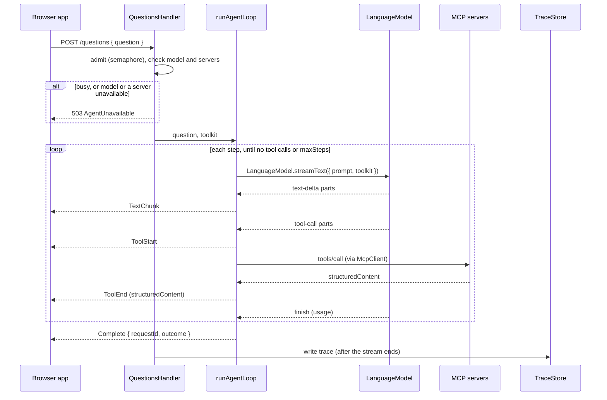

# PolicyHuis: Agent Loop Plan

Draft, November 5, 2026.

The backend (`backend/`) answers one question per request by running a custom multi-step loop: call the model, run the tools it asks for, call the model again with the results, and stop when it answers. Effect's `LanguageModel.streamText` resolves one round of tool calls per call and has no step limit or loop of its own, so the loop is ours.

The loop is not specific to any city: it is the same backend for every deployment, and knows a city only through the servers in its directory. San Francisco is the first deployment; its servers and tools are in the [San Francisco Plan](sf-plan.md).

This plan is the technical design for that loop and the service around it. It builds on the [MVP Technical Plan](mvp-technical-plan.md). Effect APIs named here were checked against the `effect` 4.1.2 type declarations and source on November 5, 2026; anything still to confirm is marked **(verify)**.

## Scope

The backend:

- accepts a question over `POST /questions` and streams the answer back as server-sent events;
- runs the loop against one model, chosen by configuration, with the tools of every MCP server in its directory;
- passes each tool result's `structuredContent` to the browser app unchanged (see [Citations in answers](#citations-in-answers));
- writes one trace per request to the `app` schema.

It does not:

- read, check or rewrite citations; the browser shows them and the evaluation checks them;
- keep conversations: every request starts from the system prompt and the question, and its prompt is discarded when it ends (see [The request's prompt](#the-requests-prompt));
- contain anything specific to a city: city rules are in each server's tool descriptions;
- read any server's database: it only calls tools.

## Where the code lives

| Module (`backend/src/`) | Responsibility |
|---|---|
| `main.ts` | Launches the server layer with `NodeRuntime.runMain` |
| `Server.ts` | Composes the layers: configuration, model, MCP connections, trace store, HTTP |
| `config/AgentConfig.ts` | Decodes `backend/config/agent.yaml` with a `Schema`; fails at startup if any field is missing or invalid |
| `config/ServerDirectory.ts` | Decodes `backend/config/servers.yaml`: each server's name, URL and tool prefix |
| `model/ModelLayer.ts` | Builds the `LanguageModel` layer for the configured model configuration (Local, Same model in the cloud, Frontier) through `@effect/ai-openai-compat`; the only module that imports a provider package |
| `tools/McpConnections.ts` | One long-lived `McpClient` per server; health; cached tool descriptors |
| `tools/TurnToolkit.ts` | Builds the merged toolkit for a request from the connections, with the result guard applied |
| `tools/ResultGuard.ts` | Turns handler defects into failed results; replaces oversized results |
| `loop/AgentLoop.ts` | `runAgentLoop`: the step loop, returning a `Stream` of `AgentStreamEvent` |
| `loop/TurnState.ts` | The per-request state service (`Ref`) |
| `loop/Failures.ts` | Classifies loop and admission failures and gives each its message for the user |
| `loop/SystemPrompt.ts` | Loads the versioned system prompt file named in config |
| `api/QuestionsHandler.ts` | Implements the `protocol/` `QuestionsApi` group: admission, turn setup, the event stream |
| `trace/TraceStore.ts` | Writes the trace rows to `app` in one transaction |
| `migrations/` | `effect/sql` Migrator migrations for the `app` schema |

`protocol/` gains the `QuestionsApi` `HttpApiGroup`, so the browser app can call it with `HttpApiClient`.

## Configuration

Declared choices live in `backend/config/agent.yaml`, reviewed by pull request; secrets live only in `backend/.env`. Values marked "from S1/S2" are set from the spikes' results, not chosen in advance.

| Field | Meaning | Value |
|---|---|---|
| `model.configuration` | Which configuration provides `LanguageModel`: `local`, `same_model_cloud` or `frontier` | Set per run |
| `model.configurations.<key>` | Base URL and model ID for each configuration (no keys) | From S1 |
| `loop.maxSteps` | Model turns with tools per question; one final turn without tools follows when the limit is reached | From S2 |
| `loop.stepTimeout` | Longest one model turn may take, including its tool calls | From S1 (local generation takes 10–30 seconds per answer) |
| `loop.modelRetries` | Retries of a model call that failed before streaming any output | To decide |
| `loop.toolConcurrency` | Tool calls run at once when the model asks for several in one turn | To decide |
| `tools.callTimeout` | Longest one MCP tool call may take | To decide |
| `tools.resultByteLimit` | Largest tool result passed to the model | To decide; servers should cap list sizes themselves, as `sf-housing` does |
| `api.maxConcurrentQuestions` | Questions answered at once | From S1: no more than the requests the model runtime serves in parallel (see [Admission](#admission)) |
| `prompt.file`, `prompt.version` | The system prompt file and its version, recorded in every trace | `backend/prompts/system.v1.md`, `v1` |

`backend/config/servers.yaml` is the server directory, and the only place a deployment names its cities: for each server, its `name` (for example `sf-housing`), `url` (`http://<host>:<port>/mcp`) and tool `prefix` (`sf_`). `backend/.env` holds the `app` database URL and any cloud model API keys.

## Startup

1. Decode `agent.yaml` and `servers.yaml`; any error stops the process with the field that failed.
2. Run the `app` migrations with the `effect/sql` Migrator.
3. Build the `LanguageModel` layer for `model.configuration`.
4. For each server in the directory, open an `McpClient` with the Streamable HTTP transport (`McpClient.make` with `McpClient.http`, in the application scope), initialize it, list its tools and cache the descriptors. A server that cannot be reached is marked unavailable and retried in the background; startup continues.
5. Serve `QuestionsApi` over HTTP.

## Request lifecycle



## Admission

`POST /questions` takes a permit from a semaphore sized `api.maxConcurrentQuestions` with `Semaphore.withPermitsIfAvailable`. If none is free, or the model or any directory server is marked unavailable, it returns `503 AgentUnavailable` before the stream starts, so a stream that starts always ends with `Complete`. The permit is held until the stream ends.

**The limit is the model runtime's, not the backend's.** Effect runs any number of requests concurrently, so the backend is not what limits answering several questions at once; the model runtime is. Each candidate runtime has its own parallel setting and queues requests beyond it:

| Runtime | Parallel requests | Beyond the limit |
|---|---|---|
| Ollama | `OLLAMA_NUM_PARALLEL`, default 1; "Required RAM will scale by `OLLAMA_NUM_PARALLEL * OLLAMA_CONTEXT_LENGTH`" ([FAQ](https://docs.ollama.com/faq)) | Queued |
| llama.cpp server | `--parallel` slots, default auto, with continuous batching on by default ([server README](https://github.com/ggml-org/llama.cpp/blob/master/tools/server/README.md)) | Queued |
| LM Studio | "Max Concurrent Predictions", default 4, since 0.4.0; not in its MLX engine ([docs](https://lmstudio.ai/docs/app/advanced/parallel-requests), [0.4.0 notes](https://lmstudio.ai/blog/0.4.0)) | Queued |
| `mlx_lm.server` | Unconfirmed; third-party reports say sequential by default | To check in S1 |

Parallel requests on one machine share its memory and compute: each needs its own context (KV cache), and each answers more slowly than it would alone. An agent's prompt grows with every tool result, so context memory, not the backend, sets how many questions fit. S1 measures, for the chosen runtime and model, the time per answer at one, two and four parallel requests and the memory each uses; `api.maxConcurrentQuestions` is set from that and the runtime's parallel setting is set to match. The backend never admits more questions than the runtime serves in parallel: a question the runtime queued would wait silently and could reach the step timeout before it started. A question beyond the limit gets `503` with the `busy` message, not a queue.

## Building the turn

For each request:

1. **Request ID**: a UUID, sent in `Complete` and used as the trace's key.
2. **Per-request state**: a fresh `TurnState` (see [Per-request state](#per-request-state)).
3. **Prompt**: `Prompt.make` with the system prompt (a system message) and the question (a user message). Nothing is carried over from earlier requests.
4. **Toolkit**: for each available server, `McpClient.toolkit(client, { prefix, tools: cachedDescriptors, resultMode: "complete", failureMode: "return", timeout: tools.callTimeout })`, merged with `Toolkit.merge`, then wrapped by the result guard.
   - `tools: cachedDescriptors` avoids a `tools/list` round trip per request.
   - `resultMode: "complete"` gives the loop each full MCP result, `structuredContent` included, while the model reads it as text.
   - `failureMode: "return"` hands MCP and transport errors to the model as failed tool results instead of failing the step.

## Tool results and the result guard

Every handler in the merged toolkit is wrapped so that:

- a defect in a handler becomes a failed tool result the model can read, instead of failing the step;
- a result larger than `tools.resultByteLimit` is replaced with a failed result saying it was too large and how to narrow the request. Results are never cut in half, since a truncated table looks complete;
- the result the model reads is the same `structuredContent` the browser app receives.

**(verify)** Whether the guard is best written by wrapping the toolkit's `handle` or with `McpClient.toolkit`'s `transformTool` option is settled in the first implementation step; the behavior above is fixed either way.

## `runAgentLoop`

An `Effect.fn("AgentLoop.run")` that takes the initial prompt and the toolkit, and returns `Stream<AgentStreamEvent>`. A sketch of its shape, not compiled code:

```
runAgentLoop(initialPrompt, toolkit):
  queue  = Queue.unbounded<AgentStreamEvent, LoopError>()
  fork into the request scope (Effect.forkScoped):
    prompt = initialPrompt; step = 0; outcome = "answered"; failure = null
    while true:
      if step == maxSteps:
        outcome = "step_limit"; failure = StepLimit
        finalTurn(Prompt.concat(prompt, stepLimitPrompt), toolChoice: "none")   // streams text; same timeout
        break
      parts = []; stepHadToolCalls = false
      result = LanguageModel.streamText({ prompt, toolkit, concurrency: toolConcurrency })
                 |> retry the call while no part has arrived (modelRetries)
                 |> Stream.runForEach(part -> parts.push(part); handlePart(part))   // emits events, updates TurnState
                 |> Effect.timeoutOrElse(stepTimeout -> fail StepTimedOut)
                 |> capture the error, if any
      if result failed:
        outcome = "failed"; failure = classify(error); break
      prompt = Prompt.concat(prompt, Prompt.fromResponseParts(parts))
      if not stepHadToolCalls: break                           // the model has answered
      step++
    on defect: outcome = "failed"; failure = Internal
    ensuring:  offer Complete { requestId, outcome, message: messageFor(failure) }   // every exit path
    ensuring:  Queue.end(queue)
  return Stream.fromQueue(queue)
```

- **One step** is one `LanguageModel.streamText` call: one model turn plus the resolution of the tool calls it makes.
- **The next step's prompt** is this step's prompt plus this step's output: `Prompt.fromResponseParts` turns the step's parts into an assistant message (its text and tool calls) and a tool message (the tool results).
- **The loop stops** when a step makes no tool calls (the model has answered), at `maxSteps`, or on an error.
- **At `maxSteps`, one final turn runs without tools.** The loop appends a fixed user message (the step limit was reached; answer from the results so far, with citations, and say what could not be checked) and calls the model with `toolChoice: "none"`. Its text streams like any other; the outcome stays `step_limit`, and `Complete` carries the "incomplete" message. If the final turn fails or times out, the outcome is `failed`. **(verify)** in S1 that the chosen runtime honors `toolChoice: "none"`; if it does not, the final turn is called with no toolkit.
- **A model call is retried only before it has streamed anything.** If the provider fails before the first part arrives, nothing has reached the browser or the prompt, so the call is retried up to `loop.modelRetries` times. Once any part has arrived, an error ends the request: the browser never has to take back what it showed.
- **The step timeout** covers the whole step, and ends the request rather than retrying it, because retrying a stalled turn usually stalls again.
- **The stream never fails.** Errors and defects become `Complete { outcome: "failed", message }`, and the stream ends normally, so the browser always receives a message to show rather than a dropped connection.

## The request's prompt

No conversation history is kept. Each request's prompt is an immutable `Prompt` value, local to `runAgentLoop`: the system prompt and the question, then each completed step's model output and tool results. A model working through several tool calls needs the earlier results of the same question, so the prompt grows within a request; it is discarded when the request ends. The only record kept is the trace, written for observability and the evaluation, and never read back into a prompt.

The loop calls `LanguageModel.streamText` directly rather than through Effect's `Chat`. `Chat` keeps its history in a `Ref` and appends a step's output when its stream is released, including when the stream fails, which adds nothing for a single request and would hold a failed step's partial output.

## Stream parts to events

| `Response` part | Action | Event to the browser |
|---|---|---|
| `text-delta` | Append to the answer text in `TurnState` | `TextChunk { text }` |
| `tool-call` | Mark the step as having tool calls; record the call (ID, name, params, start time) | `ToolStart { callId, tool, arguments }` |
| `tool-result` (not `preliminary`) | Record the result and latency; read `structuredContent` from the MCP result; `isFailure` sets the outcome | `ToolEnd { callId, tool, outcome, result }` |
| `finish` | Add `usage` to `TurnState` | None |
| `error` | Fail the step with the provider's error | None; the request ends with `Complete` |
| `reasoning-*`, `text-start`/`text-end`, `tool-params-*`, `response-metadata`, sources, files | Ignored | None |

## Errors

| Error | Where it comes from | Handling |
|---|---|---|
| Tool failure (the server returned an error result, such as `UnknownValue`) | MCP server | Not an error to the loop: the model reads it and corrects its call or explains |
| Tool arguments that fail the tool's parameter schema | `Toolkit` | A failed tool result naming the problem (`failureMode: "return"`); the model reads its own call and the error, and corrects it |
| MCP or transport error during a call | `McpClient` | A failed tool result (`failureMode: "return"`); the model reads it |
| Handler defect | Toolkit | A failed tool result (result guard) |
| A tool name the model invented, or arguments that are not valid JSON | Provider package | **(verify)** whether the provider package returns these as failed tool results or as an `AiError`; if an error, handled as the next row |
| Model or provider error before any output | `AiError` from the model | Retried up to `loop.modelRetries`; then `failed` |
| Model or provider error after output has streamed | `AiError` from the model | `failed` |
| Step timeout | `Effect.timeoutOrElse` | `failed` |
| `maxSteps` reached | Loop | One final turn without tools, then `step_limit` |
| Any other error or defect | Loop | `failed` |
| Busy, or the model or a server unreachable before the stream starts | Admission | `503 AgentUnavailable { reason, message }` |
| Trace write fails | `TraceStore` | Logged; the user's answer is unaffected |

### Messages for the user

Every outcome other than `answered` carries a `message` the browser app shows as it is; the browser decides nothing about errors beyond showing the message and marking the answer incomplete. Messages are fixed text in `loop/Failures.ts`, filled in with values from configuration, never the provider's raw error, which goes only to the trace (`app.requests.error_detail`) and the logs. Draft wording, settled with the browser app:

| Failure | `message` |
|---|---|
| Model unreachable, after retries | "The model could not be reached, so no answer was produced. Try again in a moment." |
| Model error after output | "The model stopped partway through, so this answer is incomplete. Try asking again." |
| Step timeout | "One step took longer than {stepTimeout} seconds, so the answer was stopped and is incomplete. Try a narrower question." |
| `maxSteps` reached | "This answer is incomplete: the question needed more than {maxSteps} rounds of data lookups, so it was answered from the data gathered so far. Try a narrower question." |
| Other error or defect | "Something went wrong while answering, so this answer is incomplete. Request ID: {requestId}." |
| `503`, busy | "Another question is being answered. Try again when it finishes." |
| `503`, model unreachable | "The model is not reachable right now." |
| `503`, server unreachable | "The {server} data server is not reachable right now." |

## Termination and cancellation

- **`Complete` is sent on every exit path**, from an `Effect.ensuring` around the loop, so the browser always learns the outcome and the trace is always written.
- **Errors and defects** end the loop with `Complete { outcome: "failed", message }`, so the stream always ends normally.
- **If the browser disconnects**, the response stream is interrupted, which closes the request scope and interrupts the loop's fiber, including any model stream and tool calls in flight. The trace is still written, with outcome `cancelled` (added to the `app.requests.outcome` check), from the per-request state.

## Per-request state

A `Context.Service` holding a `Ref`, provided fresh to each request:

| Field | Purpose |
|---|---|
| `requestId` | Trace key, sent in `Complete` |
| `answerText` | The text streamed so far |
| `toolCalls` | Each call: step, ID, tool, arguments, outcome, `structuredContent`, latency |
| `usage` | Input and output tokens summed across steps |
| `steps`, `modelRetries` | For the trace |
| `errorDetail` | The raw error, for the trace only |
| `outcome` | Set when the loop ends |

A `Ref` rather than fiber-local state, because tool handlers run on forked fibers when the model calls several tools at once.

## Events

| Event | Fields | The browser app uses it to |
|---|---|---|
| `TextChunk` | text | Append answer text |
| `ToolStart` | call ID, tool name, arguments | Show a status line for the call |
| `ToolEnd` | call ID, tool name, outcome, the result's `structuredContent` | Update the status, and keep the citations for linking |
| `Complete` | request ID, outcome, message (null when answered) | Show whether the answer is complete, and the message when it is not |

The events are `Schema` classes in `protocol/` (see [API contract](#api-contract)), so the backend's server-sent event stream and the browser app decode the same shapes.

## Citations in answers

The backend does not read, check or rewrite citations. Citations are for the user: each claim points to the exact source, and the user checks it there.

- **Servers** put the citations behind each result in the result's `structuredContent`, in the shape set by `protocol/`'s citation schema, and declare it in the tool's `outputSchema`.
- **The model** marks each claim with the `citationId` it rests on, in square brackets (for example `[sf.development_pipeline@2026-08-28#3f9a1c0e7b2d4a6f]`, with an illustrative query key), as the system prompt tells it to.
- **The backend** passes each tool result's `structuredContent` to the browser app in `ToolEnd`, unchanged, and stores it in the trace.
- **The browser app** links each marker to the citation with that `citationId` among the results it received, groups citations by `sourceId`, and shows a marker that matches no citation as unlinked.
- **The evaluation** checks citations offline, from the traces: whether each claim cites the right source and whether any marker matched nothing.

**Copying full IDs is tested, not assumed.** Spike S2 checks that the chosen local model copies `citationId`s exactly. Short aliases (`c1`, `c2`) are a fallback, added only if it does not; they would need the backend to map them, so they are avoided if possible.

## Streaming to the browser

`QuestionsApi` is an `HttpApiGroup` in `protocol/` with one endpoint, `POST /questions`, whose success response is `HttpApiSchema.StreamSse` of `AgentStreamEvent`. Effect's HTTP API encodes each event as one server-sent event, and `HttpApiClient` in the browser app decodes them with the same schema. The handler returns the loop's stream, with the trace write attached to its end (`Stream.ensuring`), so the response is not delayed by the write.

## Traces

When the stream ends, `TraceStore` writes the `app.requests` row and its `app.tool_calls` rows in one transaction, from the per-request state: the question, model configuration and model ID, prompt version, outcome, steps, model retries, the raw error if any, token usage, latency, the answer text, and each tool call with its arguments and `structuredContent`. The evaluation reads citations from those results and markers from the answer text. Energy samples are added with the evaluation work.

## The system prompt

A versioned Markdown file (`backend/prompts/system.v1.md`) whose version is recorded in every trace. It covers:

The prompt names no city, dataset or tool, so the same prompt serves every deployment. It covers:

- **Role and audience**: answer housing policy questions for policy makers and residents, in plain language, using the connected tools.
- **Answer only from tool results**, and say when the tools cannot answer a question, including a question about a place no tool covers.
- **Citing**: mark every claim with the `citationId` of the result it rests on, in square brackets, copied exactly.
- **Reading results**: follow each tool's description on how to read its results; give the date or version of the data an answer uses; prefer a tool that returns totals over adding numbers up.
- **Declines**: legal advice and causal claims, pointing to the right body.

Rules about a city's data live in that server's tool descriptions. San Francisco's (name the pipeline snapshot, never call a project stalled, MOHCD dates are estimates, zones are never combined, quote the publisher's description when asked how current the data is) are in `sf-housing`'s descriptions (see [Data server tools](sf-plan.md#data-server-tools)), so adding a city adds no prompt text.

The prompt's exact wording is drafted with the evaluation questions and tested in spike S2.

## Observability

Every function is an `Effect.fn` with a name, so each request produces a span tree: the request, each step, each tool call. Logs carry the request ID. Nothing logs a question's text outside the trace store.

## Testing

| Area | Test |
|---|---|
| Loop | `@effect/vitest` tests with a scripted `LanguageModel` (`LanguageModel.make` with a `streamText` that replays a list of parts per call): tool call then answer; two tool calls in one turn; a tool call with invalid arguments, then a corrected call; a provider error before any output, then success on retry; errors past `modelRetries`; a provider error after text has streamed, ending `failed` with its message; never answering, to hit `maxSteps`, checking that the final turn has tools disabled and its text streams before `Complete`; a stalled step, to hit the timeout. Each checks the event sequence, that `Complete` comes last with the expected outcome and message, and that the stream does not fail. |
| Tools | A small test server defined in `backend/test/` (`McpServer.toolkit` with a few synthetic tools that return `structuredContent`, failures and oversized results) through `McpTest.makeClient`, so the loop runs against real MCP without HTTP and without importing any city's server |
| Result guard | A handler that dies, and one that returns more than the byte limit |
| Admission | A second question while one is running returns `503`; an unavailable server returns `503` |
| API | `QuestionsApi` through `HttpApiClient` against the running handler, checking the server-sent events decode |
| Traces | Rows written for each outcome, including `cancelled`, against a Postgres testcontainer |

## API contract

One endpoint, in the `QuestionsApi` group defined in `protocol/` so the backend and the browser app share it (see [Streaming to the browser](#streaming-to-the-browser)). Requests are stateless: each question is answered on its own.

### `POST /questions`

| | |
|---|---|
| Request body | `QuestionRequest`: `{ "question": string }`, 1 to 2,000 characters |
| Success | `200`, `Content-Type: text/event-stream`: a stream of `AgentStreamEvent`s, always ending with `Complete` |
| `400` | The body failed to decode: `HttpApi`'s built-in decode error |
| `503` | `AgentUnavailable { reason, message }`: `reason` is `busy`, `model_unreachable` or `server_unreachable`, and `message` says which, for the browser app to show. Checked before the stream starts, so a stream that starts always ends with `Complete` |

**Wire format.** Each event is one server-sent event, encoded with `Sse` from `effect/encoding`: the event name is the event's `_tag`, and `data` is the event encoded as JSON with its own schema. The browser app decodes `data` with `AgentStreamEvent`, so both ends share one definition.

```
event: ToolStart
data: {"_tag":"ToolStart","callId":"call_1","tool":"sf_development_pipeline_summary","arguments":{"groupBy":"status"}}

event: ToolEnd
data: {"_tag":"ToolEnd","callId":"call_1","tool":"sf_development_pipeline_summary","outcome":"success","result":{"groups":[…],"snapshot":"2026 Q2","citations":[{"_tag":"DatasetCitation","sourceId":"sf.development_pipeline@2026-08-28","citationId":"sf.development_pipeline@2026-08-28#3f9a1c0e7b2d4a6f",…}]}}

event: TextChunk
data: {"_tag":"TextChunk","text":"… [sf.development_pipeline@2026-08-28#3f9a1c0e7b2d4a6f]"}

event: Complete
data: {"_tag":"Complete","requestId":"…","outcome":"answered","message":null}
```

The example's values are illustrative only, not data.

```ts
// protocol/src/QuestionsApi.ts
import { Schema } from "effect"

export class QuestionRequest extends Schema.Class<QuestionRequest>("QuestionRequest")({
  question: Schema.String.pipe(Schema.check(Schema.isMinLength(1), Schema.isMaxLength(2000)))
}) {}

export class TextChunk extends Schema.TaggedClass<TextChunk>()("TextChunk", {
  text: Schema.String
}) {}

export class ToolStart extends Schema.TaggedClass<ToolStart>()("ToolStart", {
  callId: Schema.String,
  tool: Schema.String,
  arguments: Schema.Unknown
}) {}

/** A tool call's outcome, with the tool's `structuredContent` passed through unchanged for the browser to render. */
export class ToolEnd extends Schema.TaggedClass<ToolEnd>()("ToolEnd", {
  callId: Schema.String,
  tool: Schema.String,
  outcome: Schema.Literals(["success", "failure"]),
  result: Schema.Unknown
}) {}

/** The last event of every stream; `message` explains, for the user, why an answer is incomplete, and is null when answered. */
export class Complete extends Schema.TaggedClass<Complete>()("Complete", {
  requestId: Schema.String.pipe(Schema.check(Schema.isUUID())),
  outcome: Schema.Literals(["answered", "step_limit", "failed"]),
  message: Schema.NullOr(Schema.String)
}) {}

export const AgentStreamEvent = Schema.Union([TextChunk, ToolStart, ToolEnd, Complete])
export type AgentStreamEvent = typeof AgentStreamEvent.Type

export class AgentUnavailable extends Schema.TaggedError<AgentUnavailable>()("AgentUnavailable", {
  reason: Schema.Literals(["busy", "model_unreachable", "server_unreachable"]),
  message: Schema.String
}) {}
```

| `Complete.outcome` | Meaning |
|---|---|
| `answered` | The model finished with no further tool calls |
| `step_limit` | `maxSteps` was reached first; a final turn without tools answered from the data gathered so far, and the browser app shows `message` saying the answer is incomplete |
| `failed` | The model failed, a step timed out, or the loop hit a defect after the stream started; the answer so far is incomplete, and the browser app shows `message` |

**No protocol version.** The backend and the browser app are built from this repo and released together, so `protocol/` carries no version. Changes still prefer additive ones (a new optional field, such as `audience`), and the browser app ignores event types it does not know.

**Not in the contract for now:** authentication (Cloudflare Access sits in front of the tunnel, per the MVP plan), conversation history, and cancellation beyond closing the connection, which ends the request's scope and with it the loop's fiber.

## The `app` schema

The backend's own Neon project and schema, written by the backend and migrated with the `effect/sql` Migrator. The evaluation reports read it.

```sql
CREATE TABLE app.requests (
    request_id      uuid PRIMARY KEY,
    received_at     timestamptz NOT NULL,
    question        text NOT NULL,
    model_config    text NOT NULL,          -- the configuration's key in config/agent.yaml
    model_id        text NOT NULL,
    prompt_version  text NOT NULL,
    outcome         text NOT NULL CHECK (outcome IN ('answered', 'step_limit', 'failed', 'cancelled')),
    steps           integer NOT NULL,
    model_retries   integer NOT NULL,
    error_detail    text,                   -- the raw error when outcome is failed; never sent to the browser
    input_tokens    integer NOT NULL,
    output_tokens   integer NOT NULL,
    latency_ms      integer NOT NULL,
    answer_text     text NOT NULL
);

CREATE TABLE app.tool_calls (
    request_id   uuid NOT NULL REFERENCES app.requests,
    call_id      text NOT NULL,
    step         integer NOT NULL,
    tool         text NOT NULL,
    arguments    jsonb NOT NULL,
    outcome      text NOT NULL CHECK (outcome IN ('success', 'failure')),
    result       jsonb NOT NULL,            -- the structuredContent, including its citations
    latency_ms   integer NOT NULL,
    PRIMARY KEY (request_id, call_id)
);
```

`model_config` names one of the three model configurations in [Ubiquitous Language](../ubiquitous-language.md) (Local, Same model in the cloud, Frontier); their keys are declared in `backend/config/agent.yaml`. The request row and its children are written in one transaction after `Complete`. Evaluation and energy tables are designed with the evaluation work (MVP plan, Evaluation and energy).

Traces store each question as asked, so the web app tells users that questions are logged.

## Decisions

Reviewed November 5, 2026:

1. **Outcome `cancelled`** for traces of disconnected requests.
2. **A timed-out step fails** rather than retrying.
3. **No queueing.** Questions beyond `api.maxConcurrentQuestions` get `503` with the `busy` message. The limit matches the model runtime's parallel requests, measured in S1 (see [Admission](#admission)).
4. **At `maxSteps`**, one final turn without tools, then `step_limit` with a message that the answer is incomplete.
5. **The messages' wording**, in [Messages for the user](#messages-for-the-user), as drafted.
