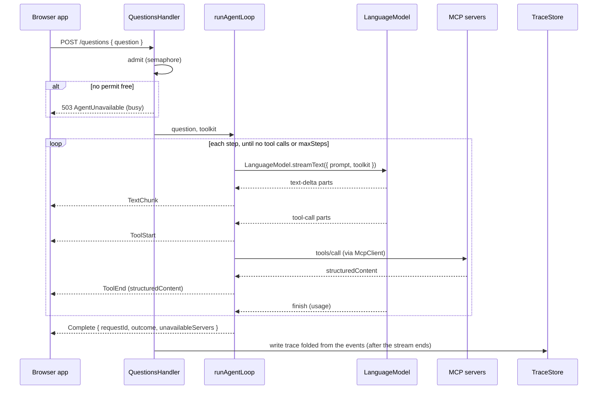

# PolicyHuis: Agent Loop Plan

Draft, November 5, 2026.

The backend (`backend/`) answers one question per request by running a custom multi-step loop: call the model, run the tools it asks for, call the model again with the results, and stop when it answers. Effect's `LanguageModel.streamText` resolves one round of tool calls per call and has no step limit or loop of its own, so the loop is ours.

The loop is not specific to any city: it is the same backend for every deployment, and knows a city only through the servers in its directory. San Francisco is the first deployment; its servers and tools are in the [San Francisco Plan](sf-plan.md).

This plan is the technical design for that loop and the service around it. It builds on the [MVP Technical Plan](mvp-technical-plan.md). Effect APIs named here were checked against the `effect` 4.1.2 type declarations and source on November 5, 2026; anything still to confirm is marked **(verify)**.

## Scope

The backend:

- accepts a question over `POST /questions` and streams the answer back as server-sent events;
- runs the loop against one model, chosen by configuration, with the tools of every MCP server in its directory;
- passes each tool result's `structuredContent` to the browser app unchanged, and gives the model a slimmer copy (see [Citations in answers](#citations-in-answers));
- answers with the servers that are reachable when one is not, and says which were not;
- writes one trace per request to the `app` schema.

It does not:

- check citations or change the copy the browser receives; the browser shows them and the evaluation checks them;
- keep conversations: every request starts from the system prompt and the question, and its prompt is discarded when it ends (see [The request's prompt](#the-requests-prompt));
- contain anything specific to a city: city rules are in each server's tool descriptions;
- read any server's database: it only calls tools.

## Where the code lives

| Module (`backend/src/`) | Responsibility |
|---|---|
| `main.ts` | Launches the server layer with `NodeRuntime.runMain` |
| `Server.ts` | Composes the layers: configuration, model, MCP connections, trace store, HTTP |
| `config/AgentConfig.ts` | Decodes `backend/config/agent.yaml` with a `Schema`; fails at startup if any field is missing or invalid |
| `config/ServerDirectory.ts` | Decodes `backend/config/servers.yaml`: each server's name, URL and tool prefix; fails at startup if two servers share a name or a prefix |
| `model/ModelLayer.ts` | Builds the `LanguageModel` layer for the configured model configuration (Local, Same model in the cloud, Frontier) through `@effect/ai-openai-compat`; the only module that imports a provider package |
| `tools/McpConnections.ts` | One `McpClient` per server on the sessionless MCP protocol, rebuilt when it closes; cached tool descriptors |
| `tools/TurnToolkit.ts` | Builds the merged toolkit for a request from the servers whose descriptors are cached, with the result guard applied |
| `tools/ResultGuard.ts` | Turns handler defects into failed results; replaces oversized results; slims the model's copy of each result |
| `loop/AgentLoop.ts` | `runAgentLoop`: the step loop, returning a `Stream` of `LoopEvent` |
| `loop/ContextBudget.ts` | Estimates the next step's prompt size and decides whether it fits |
| `loop/Failures.ts` | Classifies loop failures and gives each its message for the user |
| `loop/SystemPrompt.ts` | Loads the versioned system prompt file named in config |
| `api/QuestionsHandler.ts` | Implements the `protocol/` `QuestionsApi` group: admission, turn setup, the event stream, keepalives |
| `trace/Trace.ts` | Folds a request's `LoopEvent`s into its trace |
| `trace/TraceStore.ts` | Writes the trace rows to `app` in one transaction |
| `migrations/` | `effect/sql` Migrator migrations for the `app` schema |

`protocol/` gains the `QuestionsApi` `HttpApiGroup`, so the browser app can call it with `HttpApiClient`.

## Configuration

Declared choices live in `backend/config/agent.yaml`, reviewed by pull request; secrets live only in `backend/.env`. Values marked "from S1/S2" are set from the spikes' results, not chosen in advance.

| Field | Meaning | Value |
|---|---|---|
| `model.configuration` | Which configuration provides `LanguageModel`: `local`, `same_model_cloud` or `frontier` | Set per run |
| `model.configurations.<key>` | Base URL and model ID for each configuration (no keys) | From S1 |
| `loop.maxSteps` | Model turns with tools per question; one final turn without tools follows when the limit is reached | From S2 |
| `loop.stepTimeout` | Longest one model turn may take, including its tool calls | From S1 (local generation takes 10–30 seconds per answer) |
| `loop.requestTimeout` | Longest a whole question may take, across all steps and the final turn | From S1 |
| `loop.contextTokens` | The model's context length; the runtime is configured with the same value (Ollama's `num_ctx`, llama.cpp's `--ctx-size`) | From S1 |
| `loop.answerTokens` | Maximum output tokens per model turn, reserved from `contextTokens` for the answer | From S2 |
| `loop.bytesPerToken` | Conservative bytes-per-token ratio for estimating tool results' tokens before a step | From S1, measured on real tool results with the chosen model's tokenizer |
| `loop.modelRetries` | Retries of a model call that failed before streaming any output | To decide |
| `loop.modelRetryBaseDelay` | First delay of the exponential backoff between model retries | To decide |
| `loop.toolConcurrency` | Tool calls run at once when the model asks for several in one turn | To decide |
| `tools.callTimeout` | Longest one MCP tool call may take | To decide |
| `tools.resultByteLimit` | Largest tool result passed to the model | To decide; servers should cap list sizes themselves, as `sf-housing` does |
| `api.maxConcurrentQuestions` | Questions answered at once | From S1: no more than the requests the model runtime serves in parallel (see [Admission](#admission)) |
| `api.keepaliveInterval` | Longest the event stream goes without an event; a `Keepalive` is sent when nothing else has been | Below the shortest idle timeout between the browser and the backend (Cloudflare's, see [Streaming to the browser](#streaming-to-the-browser)) |
| `prompt.file`, `prompt.version` | The system prompt file and its version, recorded in every trace | `backend/prompts/system.v1.md`, `v1` |

`backend/config/servers.yaml` is the server directory, and the only place a deployment names its cities: for each server, its `name` (for example `sf-housing`), `url` (`http://<host>:<port>/mcp`) and tool `prefix` (`sf_`). `backend/.env` holds the `app` database URL and any cloud model API keys.

## Startup

1. Decode `agent.yaml` and `servers.yaml`; any error stops the process with the field that failed. Two servers with the same name or tool prefix are an error.
2. Run the `app` migrations with the `effect/sql` Migrator.
3. Build the `LanguageModel` layer for `model.configuration`.
4. For each server in the directory, open an `McpClient` with the Streamable HTTP transport (`McpClient.make` with `McpClient.http`), initialize it, list its tools and cache the descriptors. A server that cannot be reached is retried in the background with exponential backoff; startup continues.
5. Serve `QuestionsApi` over HTTP.

### MCP connections

**Sessionless protocol.** Every client and server uses MCP protocol version `2026-07-28`, which has no session. Under the earlier, sessionful versions, a server restart makes the server answer the client's session ID with `404`, and Effect's client then fails permanently with `ClosedError({ sessionExpired: true })` (`effect/src/ai/McpClient.ts`, 4.1.2), so one restart of `sf-housing` would cut it off until the backend restarted too. **(verify)** in S1 that `McpServer.layerHttp` and `McpClient.http` both negotiate `2026-07-28`.

**Rebuilt when closed.** `McpConnections` holds each server's client in a `SynchronizedRef`. A client that fails with `ClosedError` is replaced: the next request that needs that server opens, initializes and re-lists a new one, under the ref's lock so concurrent requests build only one. Requests already running keep the failed result they got. A `TransportError` (the request could not be sent, or the server is down) does not close a sessionless client (`McpClient.http` sets its closed state only for a `ClosedError`, 4.1.2), so the same client is used again once the server is back.

**Changed tools need a backend restart.** A server restarted between requests produces no error on a sessionless client, so nothing tells the backend its tools changed. After changing a server's tools, restart the backend to re-list them. A scheduled re-list is in [Next steps](#next-steps).

## Request lifecycle



## Admission

`POST /questions` takes a permit from a semaphore sized `api.maxConcurrentQuestions`. If none is free, it returns `503 AgentUnavailable { reason: "busy" }` before the stream starts, so a stream that starts always ends with `Complete`. Busy is the only reason for a `503`: an unreachable model ends the stream with `Complete { outcome: "failed" }` after its retries, and an unreachable server is reported in `Complete.unavailableServers` (see [Unavailable servers](#unavailable-servers)).

**The permit belongs to the response stream, not the handler.** `Semaphore.withPermitsIfAvailable` releases its permits when the wrapped effect completes (`effect/src/Semaphore.ts`, 4.1.2), and a handler's effect completes as soon as it returns the `Stream` value, before any event is sent. So the handler takes the permit with `Semaphore.takeIfAvailable` and, when it gets one, returns a stream with `Stream.ensuring(Semaphore.release(1))`, which releases it on every exit (completion, failure or the browser disconnecting). The take and the construction of the stream run uninterruptibly, so an interruption between them cannot leak a permit. **(verify)** that `HttpApiBuilder` runs, and so finalizes, every stream a handler returns, including when the client disconnects before the first byte. A test holds one question open and checks that a second gets `503`, and that a disconnected question frees its permit.

**The limit is the model runtime's, not the backend's.** Effect runs any number of requests concurrently, so the backend is not what limits answering several questions at once; the model runtime is. Each candidate runtime has its own parallel setting and queues requests beyond it:

| Runtime | Parallel requests | Beyond the limit |
|---|---|---|
| Ollama | `OLLAMA_NUM_PARALLEL`, default 1; "Required RAM will scale by `OLLAMA_NUM_PARALLEL * OLLAMA_CONTEXT_LENGTH`" ([FAQ](https://docs.ollama.com/faq)) | Queued |
| llama.cpp server | `--parallel` slots, default auto, with continuous batching on by default ([server README](https://github.com/ggml-org/llama.cpp/blob/master/tools/server/README.md)) | Queued |
| LM Studio | "Max Concurrent Predictions", default 4, since 0.4.0; not in its MLX engine ([docs](https://lmstudio.ai/docs/app/advanced/parallel-requests), [0.4.0 notes](https://lmstudio.ai/blog/0.4.0)) | Queued |
| `mlx_lm.server` | Unconfirmed; third-party reports say sequential by default | To check in S1 |

Parallel requests on one machine share its memory and compute: each needs its own context (KV cache), and each answers more slowly than it would alone. An agent's prompt grows with every tool result, so context memory, not the backend, sets how many questions fit. S1 measures, for the chosen runtime and model, the time per answer at one, two and four parallel requests and the memory each uses; `api.maxConcurrentQuestions` is set from that and the runtime's parallel setting is set to match. The backend never admits more questions than the runtime serves in parallel: a question the runtime queued would wait silently and could reach the step timeout before it started. A question beyond the limit gets `503` with the `busy` message, not a queue.

## Building the turn

For each request:

1. **Request ID**: a UUID, sent in `Complete` and used as the trace's key.
2. **Prompt**: `Prompt.make` with the system prompt (a system message), a second system message naming any [unavailable servers](#unavailable-servers), and the question (a user message). Nothing is carried over from earlier requests.
3. **Toolkit**: for each server whose descriptors are cached, `McpClient.toolkit(client, { prefix, tools: cachedDescriptors, resultMode: "complete", failureMode: "return", timeout: tools.callTimeout })`, merged with `Toolkit.merge`, then wrapped by the result guard.
   - `tools: cachedDescriptors` avoids a `tools/list` round trip per request.
   - `resultMode: "complete"` gives the loop each full MCP result, `structuredContent` included, while the model reads it as text.
   - `failureMode: "return"` hands MCP and transport errors to the model as failed tool results instead of failing the step.

## Unavailable servers

One server being down does not stop questions that other servers can answer.

- **Never reached since startup.** A server with no cached descriptors has no tools to offer, so it is left out of the toolkit. The prompt's second system message names it ("These data servers are unreachable for this question: `ams-data`"), so the model can say what it could not check rather than claim nothing exists.
- **Fails during the request.** A transport error on a call comes back to the model as a failed tool result (`failureMode: "return"`); the model may call the tool again, and later requests use the same client (see [MCP connections](#mcp-connections)). The server's tools stay in the toolkit, since a transport error is usually brief.
- **Reported to the user.** `Complete.unavailableServers` lists every server that was left out or had a call fail with a transport error, and the browser app shows that the answer may be missing their data. The outcome is unchanged: an answer without one server's data can still be `answered`.

## Tool results and the result guard

Every handler in the merged toolkit is wrapped so that:

- a defect in a handler becomes a failed tool result the model can read, instead of failing the step;
- a result larger than `tools.resultByteLimit` is replaced with a failed result saying it was too large and how to narrow the request. Results are never cut in half, since a truncated table looks complete;
- the model reads a slimmer copy of the result (below); the browser app and the trace receive the full `structuredContent`.

**The model's copy.** The model needs a citation's ID to cite it and enough to describe it, not the fields the browser uses to render it. The guard decodes the result's top-level `citations` with `protocol/`'s `Citation` schema and, in the model's copy only, keeps each citation's `_tag`, `citationId`, title (`title` or `documentTitle`), version (`sourceVersion` or `versionDate`) and, for documents, `documentType` and `provision`. It drops `sourceId`, `parameters`, `queryKey`, `publisher`, `sourceUrl` and `quote` (the passage text is already in the result). The rest of the result is unchanged. A result whose citations fail to decode becomes a failed tool result naming the decode error, since the browser could not link them either. `tools.resultByteLimit` applies to the model's copy.

**(verify)** Whether the guard is best written by wrapping the toolkit's `handle` or with `McpClient.toolkit`'s `transformTool` option, and how the model's copy is set apart from the `tool-result` part's `result` (for example through its encoded result), is settled in the first implementation step; the behavior above is fixed either way.

## `runAgentLoop`

A function that takes the initial prompt and the toolkit and returns `Stream<LoopEvent>`: the browser's `AgentStreamEvent`s plus internal events for the trace (see [Loop events and the trace](#loop-events-and-the-trace)). The loop is a stream throughout, with no queue and no forked fiber, so its lifetime is the response stream's: when the browser disconnects, the response stream is interrupted and so is everything the loop is running. A sketch of its shape, not compiled code:

```
runAgentLoop(initialPrompt, toolkit):
  steps(initialPrompt, 0)
    |> Stream.interruptWhen(sleep(requestTimeout) then fail RequestTimedOut)
    |> Stream.catchCause(cause -> Stream.make(Finished { outcome: "failed", failure: classify(cause) }))

steps(prompt, n):                                   // Stream<LoopEvent, LoopError>
  if n == maxSteps:
    finalTurn(prompt, stepLimitPrompt) ++ Finished { outcome: "step_limit" }
  else
    Stream.make(StepStarted { n })
    ++ step(prompt)                                  // the step's events, then StepEnded { parts, usage, finishReason }
       |> Stream.flatMap on StepEnded:
            next = Prompt.concat(prompt, Prompt.fromResponseParts(parts))
            if finishReason == "length":       Finished { outcome: "truncated" }
            else if no tool calls in parts:    Finished { outcome: "answered" }
            else if not fits(next, usage):     finalTurn(prompt, contextLimitPrompt) ++ Finished { outcome: "context_limit" }
            else:                              steps(next, n + 1)

step(prompt):
  LanguageModel.streamText({ prompt, toolkit, concurrency: toolConcurrency })
    |> retry while no part has arrived (modelRetries, exponential backoff from modelRetryBaseDelay)
    |> map each part to its events (see Stream parts to events)
    |> fail StepTimedOut if the step runs past stepTimeout

finalTurn(prompt, notice):
  LanguageModel.streamText({ prompt: Prompt.concat(prompt, notice), toolkit, toolChoice: "none" })
    |> same retry and timeout as a step; text-deltas become TextChunk
    |> if its finishReason is "length": Finished { outcome: "truncated" } replaces the caller's outcome
```

The handler then turns each `Finished` into `Complete { requestId, outcome, message, unavailableServers }`, drops internal events from what it sends, and merges in keepalives (see [Streaming to the browser](#streaming-to-the-browser)).

- **One step** is one `LanguageModel.streamText` call: one model turn plus the resolution of the tool calls it makes.
- **The next step's prompt** is this step's prompt plus this step's output: `Prompt.fromResponseParts` turns the step's parts into an assistant message (its text and tool calls) and a tool message (the tool results).
- **The loop stops** when a step makes no tool calls (the model has answered), at `maxSteps`, when the next prompt would not fit the context, when a turn is cut off, or on an error.
- **A turn cut off at `loop.answerTokens` ends the request as `truncated`.** The provider then finishes with reason `length`. Without this check, a cut-off turn with no tool calls would look like a finished answer, and one with tool calls would continue from a cut-off message: Effect resolves tool calls that never started with "interrupted" failure results. Any turn that finishes with `length`, including the final turn, ends the request with outcome `truncated` and its message.
- **At `maxSteps`, one final turn runs without tools.** The loop appends a fixed user message (the step limit was reached; answer from the results so far, with citations, and say what could not be checked) and calls the model with `toolChoice: "none"`. Its text streams like any other; the outcome stays `step_limit`, and `Complete` carries the "incomplete" message. If the final turn fails or times out, the outcome is `failed`. **(verify)** in S1 that the chosen runtime honors `toolChoice: "none"`; if it does not, the final turn is called with no toolkit, and S1 also checks that the runtime accepts a prompt holding tool calls and results when no tools are declared (some chat templates reject it).
- **A model call is retried only before it has streamed anything.** If the provider fails before the first part arrives, nothing has reached the browser or the prompt, so the call is retried up to `loop.modelRetries` times, with exponential backoff. Once any part has arrived, an error ends the request: the browser never has to take back what it showed.
- **The step timeout** covers the whole step, including its retries, and ends the request rather than retrying it, because retrying a stalled turn usually stalls again.
- **The request timeout** bounds the whole question, so the worst case is `loop.requestTimeout`, not `maxSteps × stepTimeout` plus the final turn.
- **The stream never fails.** Errors and defects become `Finished { outcome: "failed" }`, so the browser always receives `Complete` with a message rather than a dropped connection. Interruption is the one exit without `Complete`, because no one is left to receive it.

### The context budget

The prompt grows with every tool result, and a local runtime given more than its context length may drop the start of the prompt without failing (Ollama does), so the model would answer without results it is citing. The loop never sends a prompt that does not fit:

- **Before each step after the first**, `ContextBudget` estimates the next prompt's tokens as the previous step's reported input and output tokens plus the new tool results' bytes divided by `loop.bytesPerToken`. If that is more than `loop.contextTokens − loop.answerTokens`, the step does not run.
- **The final turn then runs on the last prompt that fit**, the one before the step whose results pushed it over, with a fixed message to answer from the results so far. The outcome is `context_limit`, with its own message. The dropped step's `ToolEnd` events have already reached the browser; their citations stay linkable but the answer does not use them.
- **The runtime is configured to the same context length** (`num_ctx` for Ollama, `--ctx-size` for llama.cpp), recorded with the S1 results, and the first step's prompt (system prompt and question) is checked against it at startup with the longest allowed question.
- **`tools.resultByteLimit` is set so one step's results fit**: at most `toolConcurrency` results of that size, converted with `bytesPerToken`, within the budget left after the system prompt.

## The request's prompt

No conversation history is kept. Each request's prompt is an immutable `Prompt` value, local to `runAgentLoop`: the system prompt and the question, then each completed step's model output and tool results. A model working through several tool calls needs the earlier results of the same question, so the prompt grows within a request; it is discarded when the request ends. The only record kept is the trace, written for observability and the evaluation, and never read back into a prompt.

The loop calls `LanguageModel.streamText` directly rather than through Effect's `Chat`. `Chat` keeps its history in a `Ref` and appends a step's output when its stream is released, including when the stream fails, which adds nothing for a single request and would hold a failed step's partial output.

## Stream parts to events

| `Response` part | Event | Sent to the browser |
|---|---|---|
| `text-delta` | `TextChunk { text }` | Yes |
| `tool-call` | `ToolStart { callId, tool, arguments }`, and `ToolTimed { callId, at }` | `ToolStart` only |
| `tool-result` (not `preliminary`) | `ToolEnd { callId, tool, outcome, result }`, with the full `structuredContent`, and `ToolTimed { callId, at }`; a transport error also adds the server to the request's unavailable servers | `ToolEnd` only |
| `finish` | `StepEnded { parts, usage, finishReason }` | No |
| `error` | Fails the step with the provider's error | No; the request ends with `Complete` |
| `reasoning-*`, `text-start`/`text-end`, `tool-params-*`, `response-metadata`, sources, files | None | No |

## Loop events and the trace

`LoopEvent` is the browser's `AgentStreamEvent` union plus internal events defined in the backend, never in `protocol/`: `StepStarted`, `StepEnded` (parts and usage), `ToolTimed`, `ModelRetried`, and `Finished` (outcome and, when failed, the raw error). The trace is a pure fold over these events (`trace/Trace.ts`: `(Trace, LoopEvent) => Trace`), so the events are the one record of what happened; there is no separate per-request state service.

The handler applies the fold as events pass (`Stream.tap` into a `Ref` local to the request) and writes the result in `Stream.ensuring`. A trace with no `Finished` event is written with outcome `cancelled`. Tools run on forked fibers when the model calls several at once, but their results reach the loop as stream parts, so nothing outside the stream needs to record them.

## Errors

| Error | Where it comes from | Handling |
|---|---|---|
| Tool failure (the server returned an error result, such as `UnknownValue`) | MCP server | Not an error to the loop: the model reads it and corrects its call or explains |
| Tool arguments that fail the tool's parameter schema | `Toolkit` | A failed tool result naming the problem (`failureMode: "return"`); the model reads its own call and the error, and corrects it |
| MCP or transport error during a call | `McpClient` | A failed tool result (`failureMode: "return"`); the model reads it; the server is listed in `Complete.unavailableServers` and its client is rebuilt |
| A server unreachable since startup | `McpConnections` | Its tools are left out, the prompt names it, and it is listed in `Complete.unavailableServers` |
| Tool citations that fail to decode | Result guard | A failed tool result naming the decode error |
| Handler defect | Toolkit | A failed tool result (result guard) |
| A tool name the model invented, or arguments that are not valid JSON | Provider package | **(verify)** whether the provider package returns these as failed tool results or as an `AiError`; if an error, handled as the next row |
| Model or provider error before any output | `AiError` from the model | Retried up to `loop.modelRetries`; then `failed` |
| Model or provider error after output has streamed | `AiError` from the model | `failed` |
| Step timeout | Loop | `failed` |
| Request timeout | `Stream.interruptWhen` | `failed` |
| `maxSteps` reached | Loop | One final turn without tools, then `step_limit` |
| Next prompt would not fit the context | `ContextBudget` | One final turn without tools on the last prompt that fit, then `context_limit` |
| A turn reaches `loop.answerTokens` (finish reason `length`) | Model | `truncated` |
| Any other error or defect | Loop | `failed` |
| No permit free | Admission | `503 AgentUnavailable { reason: "busy", message }` |
| Trace write fails | `TraceStore` | Logged; the user's answer is unaffected |

### Messages for the user

Every outcome other than `answered` carries a `message` the browser app shows as it is; the browser decides nothing about errors beyond showing the message and marking the answer incomplete. Messages are fixed text in `loop/Failures.ts`, filled in with values from configuration, never the provider's raw error, which goes only to the trace (`app.requests.error_detail`) and the logs. Draft wording, settled with the browser app:

| Failure | `message` |
|---|---|
| Model unreachable, after retries | "The model could not be reached, so no answer was produced. Try again in a moment." |
| Model error after output | "The model stopped partway through, so this answer is incomplete. Try asking again." |
| Step timeout | "One step took longer than {stepTimeout} seconds, so the answer was stopped and is incomplete. Try a narrower question." |
| Request timeout | "The answer took longer than {requestTimeout} seconds, so it was stopped and is incomplete. Try a narrower question." |
| `maxSteps` reached | "This answer is incomplete: the question needed more than {maxSteps} rounds of data lookups, so it was answered from the data gathered so far. Try a narrower question." |
| Context limit | "This answer is incomplete: the data looked up was more than the model can read at once, so it was answered from part of it. Try a narrower question." |
| Turn cut off | "This answer is incomplete: it reached the model's length limit and was cut off. Try a narrower question." |
| Other error or defect | "Something went wrong while answering, so this answer is incomplete. Request ID: {requestId}." |
| `503`, busy | "Another question is being answered. Try again when it finishes." |

Unavailable servers are not a `message`: the browser app shows them from `Complete.unavailableServers` ("The {server} data server could not be reached, so this answer may be missing its data."), whatever the outcome.

## Termination and cancellation

- **`Complete` ends every stream that is not interrupted.** Every non-interrupted exit emits `Finished`, which the handler turns into `Complete`, so the browser always learns the outcome.
- **Errors and defects** end the loop with `Finished { outcome: "failed" }` through `Stream.catchCause`, so the stream always ends normally.
- **If the browser disconnects**, the response stream is interrupted, and with it the model stream and any tool calls in flight, since the loop runs inside that stream. The permit is released and the trace is still written from the events folded so far, with outcome `cancelled`.

## Events

| Event | Fields | The browser app uses it to |
|---|---|---|
| `TextChunk` | text | Append answer text |
| `ToolStart` | call ID, tool name, arguments | Show a status line for the call |
| `ToolEnd` | call ID, tool name, outcome, the result's `structuredContent` | Update the status, and keep the citations for linking |
| `Keepalive` | none | Nothing; it keeps the connection open while the model works |
| `Complete` | request ID, outcome, message (null when answered), unavailable servers | Show whether the answer is complete, the message when it is not, and which servers could not be reached |

The events are `Schema` classes in `protocol/` (see [API contract](#api-contract)), so the backend's server-sent event stream and the browser app decode the same shapes.

## Citations in answers

The backend does not read, check or rewrite citations. Citations are for the user: each claim points to the exact source, and the user checks it there.

- **Servers** put the citations behind each result in the result's `structuredContent`, in the shape set by `protocol/`'s citation schema, and declare it in the tool's `outputSchema`.
- **The model** marks each claim with the `citationId` it rests on, in square brackets (for example `[sf.development_pipeline@2026-08-28#3f9a1c0e7b2d4a6f]`, with an illustrative query key), as the system prompt tells it to.
- **The backend** passes each tool result's `structuredContent` to the browser app in `ToolEnd`, unchanged, and stores it in the trace. The model reads a copy with each citation reduced to what it needs to cite (see [Tool results and the result guard](#tool-results-and-the-result-guard)); the `citationId` is identical in both.
- **The browser app** links each marker to the citation with that `citationId` among the results it received, groups citations by `sourceId`, and shows a marker that matches no citation as unlinked.
- **The evaluation** checks citations offline, from the traces: whether each claim cites the right source and whether any marker matched nothing.

**Copying full IDs is tested, not assumed.** Spike S2 checks that the chosen local model copies `citationId`s exactly. Short aliases (`c1`, `c2`) are a fallback, added only if it does not; they would need the backend to map them, so they are avoided if possible.

## Streaming to the browser

`QuestionsApi` is an `HttpApiGroup` in `protocol/` with one endpoint, `POST /questions`, whose success response is `HttpApiSchema.StreamSse` of `AgentStreamEvent`. Effect's HTTP API encodes each event as one server-sent event, and `HttpApiClient` in the browser app decodes them with the same schema. The handler returns the loop's stream with the internal events filtered out, the trace write and the permit release attached to its end (`Stream.ensuring`), so the response is not delayed by the write.

**Keepalives.** A local model reading a long prompt can send nothing for a long time, and the path to the browser (Cloudflare Tunnel, proxies) may close a connection that stays quiet. Cloudflare's documented limit is 100 seconds for an origin's response before it returns `524` **(verify)** whether it also applies between bytes of a streaming response. The handler merges in a `Keepalive` event whenever `api.keepaliveInterval` passes without another event. It is an event rather than an SSE comment line because `HttpApiBuilder`'s SSE encoder writes events only (4.1.2); the browser app ignores it.

## Traces

When the stream ends, `TraceStore` writes the `app.requests` row and its `app.tool_calls` rows in one transaction, from the folded events (see [Loop events and the trace](#loop-events-and-the-trace)): the question, model configuration and model ID, prompt version, outcome, steps, model retries, the raw error if any, unavailable servers, token usage, latency, the answer text, and each tool call with its arguments, `structuredContent` and latency. Tool latency is kept apart from model time, so a database waking from Neon's scale-to-zero shows up in the tool calls rather than as slower generation. The evaluation reads citations from those results and markers from the answer text. Energy samples are added with the evaluation work.

## The system prompt

A versioned Markdown file (`backend/prompts/system.v1.md`) whose version is recorded in every trace. The prompt names no city, dataset or tool, so the same prompt serves every deployment. It covers:

- **Role and audience**: answer housing policy questions for policy makers and residents, in plain language, using the connected tools.
- **Answer only from tool results**, and say when the tools cannot answer a question, including a question about a place no tool covers.
- **Citing**: mark every claim with the `citationId` of the result it rests on, in square brackets, copied exactly.
- **Reading results**: follow each tool's description on how to read its results; give the date or version of the data an answer uses; prefer a tool that returns totals over adding numbers up.
- **Declines**: legal advice and causal claims, pointing to the right body.

Rules about a city's data live in that server's tool descriptions. San Francisco's (name the pipeline snapshot, never call a project stalled, MOHCD dates are estimates, zones are never combined, quote the publisher's description when asked how current the data is) are in `sf-housing`'s descriptions (see [Data server tools](sf-plan.md#data-server-tools)), so adding a city adds no prompt text.

The prompt's exact wording is drafted with the evaluation questions and tested in spike S2.

## Observability

Every function is an `Effect.fn` with a name, so each request produces a span tree: the request, each step, each tool call. Logs carry the request ID. Nothing logs a question's text outside the trace store.

## Testing

| Area | Test |
|---|---|
| Loop | `@effect/vitest` tests with a scripted `LanguageModel` (`LanguageModel.make` with a `streamText` that replays a list of parts per call), on `TestClock` for timeouts and backoff: tool call then answer; two tool calls in one turn; a tool call with invalid arguments, then a corrected call; a provider error before any output, then success on retry after the backoff; errors past `modelRetries`; a provider error after text has streamed, ending `failed` with its message; never answering, to hit `maxSteps`, checking that the final turn has tools disabled and its text streams before `Complete`; a stalled step, to hit the step timeout; many fast steps, to hit the request timeout; a tool result that pushes the estimate over the budget, checking that the final turn runs on the earlier prompt and ends `context_limit`; a turn finishing with `length`, with and without tool calls, and a final turn finishing with `length`, each ending `truncated`. Each checks the event sequence, that `Complete` comes last with the expected outcome and message, and that the stream does not fail. |
| Trace fold | Pure tests of `(Trace, LoopEvent) => Trace` over recorded event sequences, including one with no `Finished` (`cancelled`) |
| Tools | A small test server defined in `backend/test/` (`McpServer.toolkit` with a few synthetic tools that return `structuredContent`, failures and oversized results) through `McpTest.makeClient`, so the loop runs against real MCP without HTTP and without importing any city's server |
| Connections | Over HTTP: the test server restarted between two questions, checking the second question's calls succeed on a rebuilt client; a server down at startup, checking its tools are left out, the prompt names it and `Complete.unavailableServers` lists it; two directory entries with one prefix, failing startup |
| Result guard | A handler that dies; one that returns more than the byte limit; the model's copy of a result with citations, checking the dropped fields; citations that fail to decode |
| Admission | A second question while one is streaming returns `503`; a disconnected question frees its permit |
| API | `QuestionsApi` through `HttpApiClient` against the running handler, checking the server-sent events decode and that `Keepalive` arrives during a stalled step |
| Traces | Rows written for each outcome, including `cancelled`, against a Postgres testcontainer |

## API contract

One endpoint, in the `QuestionsApi` group defined in `protocol/` so the backend and the browser app share it (see [Streaming to the browser](#streaming-to-the-browser)). Requests are stateless: each question is answered on its own.

### `POST /questions`

| | |
|---|---|
| Request body | `QuestionRequest`: `{ "question": string }`, 1 to 2,000 characters |
| Success | `200`, `Content-Type: text/event-stream`: a stream of `AgentStreamEvent`s, always ending with `Complete` |
| `400` | The body failed to decode: `HttpApi`'s built-in decode error |
| `503` | `AgentUnavailable { reason: "busy", message }`, for the browser app to show. Checked before the stream starts, so a stream that starts always ends with `Complete` |

**Wire format.** Each event is one server-sent event, encoded with `Sse` from `effect/encoding`: the event name is the event's `_tag`, and `data` is the event encoded as JSON with its own schema. The browser app decodes `data` with `AgentStreamEvent`, so both ends share one definition.

```
event: ToolStart
data: {"_tag":"ToolStart","callId":"call_1","tool":"sf_development_pipeline_summary","arguments":{"groupBy":"status"}}

event: ToolEnd
data: {"_tag":"ToolEnd","callId":"call_1","tool":"sf_development_pipeline_summary","outcome":"success","result":{"groups":[…],"snapshot":"2026 Q2","citations":[{"_tag":"DatasetCitation","sourceId":"sf.development_pipeline@2026-08-28","citationId":"sf.development_pipeline@2026-08-28#3f9a1c0e7b2d4a6f",…}]}}

event: TextChunk
data: {"_tag":"TextChunk","text":"… [sf.development_pipeline@2026-08-28#3f9a1c0e7b2d4a6f]"}

event: Complete
data: {"_tag":"Complete","requestId":"…","outcome":"answered","message":null,"unavailableServers":[]}
```

The example's values are illustrative only, not data.

```ts
// protocol/src/QuestionsApi.ts
import { Schema } from "effect"

export class QuestionRequest extends Schema.Class<QuestionRequest>("QuestionRequest")({
  question: Schema.String.pipe(Schema.check(Schema.isMinLength(1), Schema.isMaxLength(2000)))
}) {}

export class TextChunk extends Schema.TaggedClass<TextChunk>()("TextChunk", {
  text: Schema.String
}) {}

export class ToolStart extends Schema.TaggedClass<ToolStart>()("ToolStart", {
  callId: Schema.String,
  tool: Schema.String,
  arguments: Schema.Unknown
}) {}

/** A tool call's outcome, with the tool's `structuredContent` passed through unchanged for the browser to render. */
export class ToolEnd extends Schema.TaggedClass<ToolEnd>()("ToolEnd", {
  callId: Schema.String,
  tool: Schema.String,
  outcome: Schema.Literals(["success", "failure"]),
  result: Schema.Unknown
}) {}

/** Sent when nothing else has been for `api.keepaliveInterval`, so the connection stays open; the browser app ignores it. */
export class Keepalive extends Schema.TaggedClass<Keepalive>()("Keepalive", {}) {}

/**
 * The last event of every stream that is not interrupted. `message` explains, for the user, why an answer is
 * incomplete, and is null when answered; `unavailableServers` names the data servers that could not be reached.
 */
export class Complete extends Schema.TaggedClass<Complete>()("Complete", {
  requestId: Schema.String.pipe(Schema.check(Schema.isUUID())),
  outcome: Schema.Literals(["answered", "step_limit", "context_limit", "truncated", "failed"]),
  message: Schema.NullOr(Schema.String),
  unavailableServers: Schema.Array(Schema.String)
}) {}

export const AgentStreamEvent = Schema.Union([TextChunk, ToolStart, ToolEnd, Keepalive, Complete])
export type AgentStreamEvent = typeof AgentStreamEvent.Type

export class AgentUnavailable extends Schema.TaggedError<AgentUnavailable>()("AgentUnavailable", {
  reason: Schema.Literals(["busy"]),
  message: Schema.String
}) {}
```

| `Complete.outcome` | Meaning |
|---|---|
| `answered` | The model finished with no further tool calls |
| `step_limit` | `maxSteps` was reached first; a final turn without tools answered from the data gathered so far, and the browser app shows `message` saying the answer is incomplete |
| `context_limit` | The next step's prompt would not have fit the model's context; a final turn without tools answered from the results that fit, and the browser app shows `message` |
| `truncated` | A model turn reached `loop.answerTokens` and was cut off; the browser app shows `message` |
| `failed` | The model failed, a step or the request timed out, or the loop hit a defect after the stream started; the answer so far is incomplete, and the browser app shows `message` |

**No protocol version.** The backend and the browser app are built from this repo and released together, so `protocol/` carries no version. Changes still prefer additive ones (a new optional field, such as `audience`), and the browser app ignores event types it does not know.

**Not in the contract for now:** authentication (Cloudflare Access sits in front of the tunnel, per the MVP plan), conversation history, and cancellation beyond closing the connection, which ends the request's scope and with it the loop's fiber.

## The `app` schema

The backend's own Neon project and schema, written by the backend and migrated with the `effect/sql` Migrator. The evaluation reports read it.

```sql
CREATE TABLE app.requests (
    request_id      uuid PRIMARY KEY,
    received_at     timestamptz NOT NULL,
    question        text NOT NULL,
    model_config    text NOT NULL,          -- the configuration's key in config/agent.yaml
    model_id        text NOT NULL,
    prompt_version  text NOT NULL,
    outcome         text NOT NULL CHECK (outcome IN ('answered', 'step_limit', 'context_limit', 'truncated', 'failed', 'cancelled')),
    steps           integer NOT NULL,
    model_retries   integer NOT NULL,
    error_detail    text,                   -- the raw error when outcome is failed; never sent to the browser
    unavailable_servers text[] NOT NULL,
    input_tokens    integer NOT NULL,
    output_tokens   integer NOT NULL,
    latency_ms      integer NOT NULL,
    answer_text     text NOT NULL
);

CREATE TABLE app.tool_calls (
    request_id   uuid NOT NULL REFERENCES app.requests,
    call_id      text NOT NULL,
    step         integer NOT NULL,
    tool         text NOT NULL,
    arguments    jsonb NOT NULL,
    outcome      text NOT NULL CHECK (outcome IN ('success', 'failure')),
    result       jsonb NOT NULL,            -- the structuredContent, including its citations
    latency_ms   integer NOT NULL,
    PRIMARY KEY (request_id, call_id)
);
```

`model_config` names one of the three model configurations in [Ubiquitous Language](../ubiquitous-language.md) (Local, Same model in the cloud, Frontier); their keys are declared in `backend/config/agent.yaml`. The request row and its children are written in one transaction after `Complete`. Evaluation and energy tables are designed with the evaluation work (MVP plan, Evaluation and energy).

Traces store each question as asked, so the web app tells users that questions are logged.

## Decisions

Reviewed November 5, 2026:

1. **Outcome `cancelled`** for traces of disconnected requests.
2. **A timed-out step fails** rather than retrying.
3. **No queueing.** Questions beyond `api.maxConcurrentQuestions` get `503` with the `busy` message. The limit matches the model runtime's parallel requests, measured in S1 (see [Admission](#admission)).
4. **At `maxSteps`**, one final turn without tools, then `step_limit` with a message that the answer is incomplete.
5. **The messages' wording**, in [Messages for the user](#messages-for-the-user), as drafted.

Reviewed November 5, 2026, after a design review:

6. **An unreachable server degrades the answer instead of refusing it.** Its tools are left out or fail as tool results, and `Complete.unavailableServers` names it. `503` means busy only.
7. **The loop is a native `Stream`**, with no queue or forked fiber, and the trace is a fold over its events; the per-request state service is removed. The admission permit is released by the response stream, not by the handler's effect.
8. **MCP connections use the sessionless protocol `2026-07-28`** and are rebuilt when they close. Changed tools need a backend restart.
9. **A context budget** (`loop.contextTokens`, `loop.answerTokens`) is checked before each step, with outcome `context_limit`.
10. **A request timeout, exponential backoff between model retries, keepalive events and a unique-prefix check** are added.
11. **The model reads a slimmed copy of each result's citations**; the browser and the trace keep the full `structuredContent`.
12. **Evaluation runs never share the agent host with demo traffic**, and answer one question at a time, so each request's energy can be measured on its own (see the [MVP Technical Plan](mvp-technical-plan.md#evaluation-and-energy)).
13. **Outcome `truncated`** for any model turn cut off at `loop.answerTokens`.
14. **A server's tools stay listed after a transport error**, since such errors are usually brief; leaving them out is in [Next steps](#next-steps).

## Next steps

To make the system more robust once it works end to end:

- **Scheduled re-list.** `McpConnections` re-lists each server's tools on a fixed interval, so changed tools are picked up without restarting the backend, and a server whose re-list fails is treated like one never reached: its tools are left out and the prompt names it, until a re-list succeeds. This replaces the restart in [MCP connections](#mcp-connections) and keeps a server that is down from costing the model steps on calls that fail.
