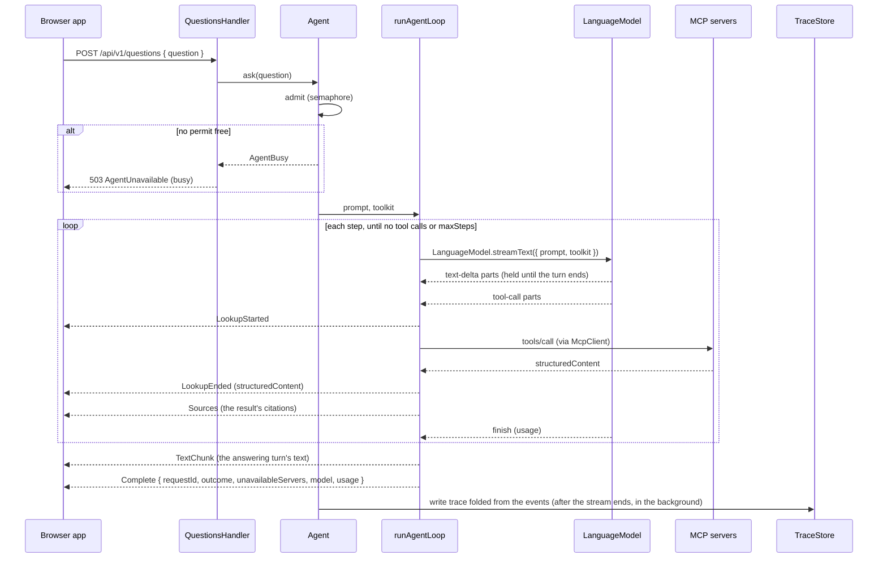

# PolicyHuis: Agent Loop Plan

The backend (`backend/`) answers one question per request by running a custom multi-step loop: call the model, run the tools it asks for, call the model again with the results, and stop when it answers. Effect's `LanguageModel.streamText` resolves one round of tool calls per call and has no step limit or loop of its own, so the loop is ours.

The loop is not specific to any city: it is the same backend for every deployment, and knows a city only through the servers in its directory. San Francisco is the first deployment; its servers and tools are in the [San Francisco Plan](sf-plan.md).

This plan is the technical design for that loop and the service around it. It builds on the [MVP Technical Plan](mvp-technical-plan.md). Effect APIs named here are those of `effect` 4.1.x; anything still to confirm is marked **(verify)**.

## Scope

The backend:

- accepts a question over `POST /api/v1/questions` and streams the answer back as server-sent events;
- runs the loop against one model, chosen by configuration, with the tools of every MCP server in its directory;
- passes each tool result's `structuredContent` to the browser app unchanged (see [Citations in answers](#citations-in-answers));
- answers with the servers that are reachable when one is not, and says which were not;
- writes one trace per request to the `app` schema.

It does not:

- check citations or change the copy the browser receives; the browser shows them and the evaluation checks them;
- keep conversations: every request starts from the system prompt and the question, and its prompt is discarded when it ends (see [The request's prompt](#the-requests-prompt));
- contain anything specific to a city: city rules are in each server's tool descriptions;
- read any server's database: it only calls tools.

## Where the code lives

| Module (`backend/src/`) | Responsibility |
|---|---|
| `main.ts` | Launches the server layer with `NodeRuntime.runMain` |
| `Server.ts` | Composes the layers once: configuration, model, MCP connections, trace store, the agent, HTTP |
| `config/AgentConfig.ts` | Decodes `backend/config/agent.yaml` with a `Schema`; fails at startup with a `ConfigFileError` if any field is missing or invalid |
| `config/ServerDirectory.ts` | Decodes `backend/config/servers.yaml`: each server's name, label, URL and tool prefix (words of lowercase letters and digits, each followed by one underscore, such as `sf_docs_`); fails at startup if two servers share a name or a prefix |
| `config/BackendConfig.ts` | Every environment variable the backend reads, from `backend/.env` first: `AppDatabaseConfig` (`APP_DATABASE_URL`), `HttpConfig` (`BACKEND_PORT`) and `ModelApiKeysConfig` (`FRONTIER_API_KEY`, `SAME_MODEL_CLOUD_API_KEY`, `OPEN_CLOUD_API_KEY`), each a service read once at startup through `@policyhuis/node-config` |
| `config/HttpUrl.ts` | The schema for an absolute http or https URL in the config files |
| `model/ModelLayer.ts` | `Models`: a `LanguageModel` and an admission semaphore for each offered model configuration (Local, Same model in the cloud, Open model in the cloud, Frontier), through `@effect/ai-openai-compat` or `@effect/ai-anthropic` by the configuration's `provider`; the only module that imports a provider package |
| `tools/McpConnections.ts` | One `McpClient` per server on the sessionless MCP protocol, and the toolkit of the tools it listed, built once when it connects with `trustAnnotations: true`, so each tool's published `annotations.title` becomes its `Tool.Title`; the read-only and destructive hints copied with it are not used |
| `tools/TurnToolkit.ts` | `turnTools`: merges the connected servers' toolkits into one request's toolkit, with the map from each tool to its server and title (the tool's own name in words, for a server that publishes no title) |
| `agent/Agent.ts` | The `Agent` service: admits a question, builds its prompt and toolkit, runs the loop, notes unreachable servers, sends each citation once, and writes the trace |
| `loop/AgentLoop.ts` | `runAgentLoop`: the step loop, returning a `Stream` of `LoopEvent` |
| `loop/LoopEvent.ts` | The loop's events: the browser's `AgentStreamEvent`s plus the internal events the trace is folded from |
| `loop/Outcome.ts` | How the loop ends a question, and how a tool call ends: the domain's own lists, which the `app` schema's checks are built from |
| `loop/ContextBudget.ts` | Estimates the next step's prompt size and decides whether it fits |
| `loop/CitationKeys.ts` | The question's citation keys (`C1`, `C2`, …): replaces citation IDs with keys in the tool results the model reads, and expands the keys the model writes back into full citation IDs, holding back a citation split across streamed chunks |
| `loop/ToolResults.ts` | Reads a tool result: its `structuredContent`, its citations under the citation convention, a failure's type, and whether a failure means the server was unavailable |
| `loop/Failures.ts` | `Failure`, a `Data.taggedEnum` of why a question ended incomplete; classifies model errors as retryable or not; gives each failure its message for the user |
| `loop/SystemPrompt.ts` | Loads the versioned system prompt file named in config |
| `api/QuestionsHandler.ts` | Implements the `protocol/` `QuestionsApi` group: asks the `Agent`, turns its events into `AgentStreamEvent`s, adds keepalives |
| `trace/Trace.ts` | Folds a request's `LoopEvent`s into its trace |
| `trace/TraceStore.ts` | Writes the trace rows to `app` in one transaction, within `trace.writeTimeout` |
| `db/schema.ts` | The `app` schema as Drizzle tables, the source `drizzle-kit generate` reads |
| `db/Migrations.ts` | Applies pending migrations from `backend/drizzle/` with Drizzle's migrator |
| `backend/drizzle/` (outside `src/`) | The SQL migrations `drizzle-kit generate` writes, and Drizzle's snapshots; never edited by hand |

`protocol/` holds the `QuestionsApi` and `ModelsApi` `HttpApiGroup`s, so the browser app and the evaluation call them with `HttpApiClient`.

## Configuration

Declared choices live in `backend/config/agent.yaml`, reviewed by pull request; secrets live only in `backend/.env`. Values marked provisional there are set from evaluation runs and traces.

| Field | Meaning | Value |
|---|---|---|
| `model.default` | The configuration that answers a question that names none: `local`, `same_model_cloud`, `open_cloud` or `frontier` | `open_cloud` |
| `model.offered` | The configurations a question may name, in the order the browser app lists them; each needs its API key in `backend/.env`, except `local` | `[local, open_cloud, frontier]` |
| `model.configurations.<key>` | For each configuration: its `provider` (`openai-compat` or `anthropic`), the `label` the browser app shows for it, its model ID (and base URL, for `openai-compat`), no keys, and the limits below, which depend on the model | Per configuration |
| `model.configurations.<key>.effort` | For an `anthropic` configuration: `low`, `medium` or `high`, sent as `output_config.effort`. Claude thinks on every turn; effort is how much | frontier: `low` |
| `model.configurations.<key>.contextTokens` | The context the loop allows the model: its published context length or less; a local runtime is started with the same value (see the [README](../../README.md#running-locally)) | 250,000 for the cloud configurations; 32,000 for `local` |
| `model.configurations.<key>.answerTokens` | Maximum output tokens per model turn, sent with every request and reserved from `contextTokens`. The provider stops generating at this cap and reports finish reason `length`; for a reasoning model, the cap includes its reasoning tokens | Provisional |
| `model.configurations.<key>.bytesPerToken` | Conservative bytes-per-token ratio for estimating tool results' tokens before a step | Provisional, to be measured on real tool results with the model's tokenizer |
| `model.configurations.<key>.maxConcurrentQuestions` | Questions answered at once with this model | Within the provider's rate limits; for a local runtime, no more than the requests it serves in parallel (see [Admission](#admission)) |
| `model.configurations.<key>.outputTokensParameter` | The request field that carries `answerTokens`: `max_tokens` (the default, which Ollama documents) or `max_completion_tokens`. `@effect/ai-openai-compat` sends the cap as `max_tokens`, which some OpenAI-style APIs reject, so the model layer sends the cap itself under the configured name | Per `openai-compat` configuration; `max_tokens` when omitted |
| `model.configurations.<key>.requestOptions` | Optional extra fields sent unchanged in every request body to that model, for settings its server needs; any JSON value, so nested settings fit. `@effect/ai-openai-compat` passes unknown `Config` fields through. The local configuration sets Ollama's `reasoning_effort`; the open_cloud configuration sets OpenRouter's `reasoning: { effort: none }`, which turns Qwen's thinking off | Per `openai-compat` configuration |
| `model.configurations.<key>.requireFirstLookup` | When `true`, the first step is called with `toolChoice: "required"`, so the model must look something up before it answers; later steps use `auto`, and a question with no tools offered is not forced. Recorded in each trace's model settings. Set for open_cloud, which otherwise answered some questions from its own knowledge, with citation keys no tool had given. Only on `openai-compat` configurations: Claude Opus 5.5 rejects a forced tool choice with a 400 | Per `openai-compat` configuration; omitted means `false` |
| `loop.maxSteps` | Model turns with tools per question; one final turn without tools follows when the limit is reached | Provisional |
| `loop.stepTimeout` | Longest one model turn may take, including its tool calls | Provisional |
| `loop.requestTimeout` | Longest a whole question may take, across all steps and the final turn | Provisional |
| `loop.modelRetries` | Retries of a model turn per question, for transient provider errors and for tool calls the model wrote invalidly (see [Model errors and retries](#model-errors-and-retries)) | 2 |
| `loop.modelRetryBaseDelay` | First delay of the exponential backoff between model retries | To decide |
| `loop.toolConcurrency` | Tool calls run at once when the model asks for several in one turn | To decide |
| `tools.callTimeout` | Longest one MCP tool call may take | To decide |
| `tools.reconnectBaseDelay`, `tools.reconnectMaxDelay` | The exponential backoff for reconnecting to a server that could not be reached: the first delay, and the longest | 1 second, 1 minute |
| `api.keepaliveInterval` | Longest the event stream goes without an event; a `Keepalive` is sent when nothing else has been | Below the shortest idle timeout between the browser and the backend (Cloudflare's, see [Streaming to the browser](#streaming-to-the-browser)) |
| `trace.writeTimeout` | Longest a trace write may take, including connecting to the `app` database; the pool's connection and query timeouts are set to the same value | 10 seconds, provisional |
| `prompt.file`, `prompt.version` | The system prompt file and its version, recorded in every trace | `backend/prompts/system.v3.md`, `v3` |

`backend/config/servers.yaml` is the server directory, and the only place a deployment names its cities: for each server, its `name` (for example `sf-data`), `label` (`SF Data`, shown in the browser app beside each of its lookups), `url` (`http://<host>:<port>/mcp`) and tool `prefix` (`sf_data_`). Each cloud model configuration's API key is named `<CONFIGURATION>_API_KEY` (see `config/BackendConfig.ts` above); `backend/.env.example` lists every variable.

**Missing configuration is a `ConfigFileError`.** The shared library `@policyhuis/node-config` (`shared/node-config/`) reads every node's configuration the same way: YAML files decoded with a `Schema`, and a `.env` file that takes priority over the shell, so another project's variables cannot leak in. The backend reads its `.env` variables only through `config/BackendConfig.ts` (see [Effect Style § 13](../effect-style.md#13-read-the-environment-through-one-configuration-module)). Anything missing or invalid (a field in `agent.yaml`, the prompt file it names, an offered model configuration with no entry or no API key, a variable missing from `.env`) fails startup with a `ConfigFileError` naming the file to fix and the field or variable, never a defect.

## Startup

1. Decode `agent.yaml` and `servers.yaml`, and read the system prompt file; any error stops the process with a `ConfigFileError` naming the file and field. Two servers with the same name or tool prefix are an error. Unique prefixes do not guarantee unique tool names when one prefix starts another (`sf_` and `sf_docs_`), so each request's toolkit offers a tool name that two connected servers share by neither, and logs an error naming both.
2. Apply the `app` schema's pending Drizzle migrations from `backend/drizzle/`.
3. Build a `LanguageModel` and an admission semaphore for each configuration in `model.offered`.
4. For each server in the directory, open an `McpClient` with the Streamable HTTP transport (`McpClient.make` with `McpClient.http`), initialize it, list its tools and build their toolkit with `McpClient.toolkit`, within `tools.callTimeout`. A server that cannot be reached is retried in the background with exponential backoff; startup continues.
5. Serve `QuestionsApi` over HTTP.

### MCP connections

**Sessionless protocol.** Every client and server uses MCP protocol version `2026-07-28`, which has no session. Under the earlier, sessionful versions, a server restart makes the server answer the client's session ID with `404`, and Effect's client then fails permanently with `ClosedError({ sessionExpired: true })` (`effect/src/ai/McpClient.ts`), so one restart of `sf-data` would cut it off until the backend restarted too. The connection tests in [Testing](#testing) cover it: one client on `2026-07-28` gets a `TransportError` while the server is down and succeeds, without being rebuilt, once the server is back on the same port.

**One client per server, never rebuilt.** A `TransportError` (the request could not be sent, or the server is down) does not close a sessionless client (`McpClient.http` sets its closed state only for session expiry or when its own scope closes), so the same client is used again once the server is back, and nothing in the backend rebuilds clients.

**Toolkits are built once.** Each connection holds the toolkit `McpClient.toolkit(client, { prefix, tools, resultMode: "complete", failureMode: "return", timeout: tools.callTimeout })` builds from the tools the server listed when it connected, so no request repeats the conversion from the tools' JSON Schema.

**Changed tools need a backend restart.** A server restarted between requests produces no error on a sessionless client, so nothing tells the backend its tools changed. After changing a server's tools, restart the backend to re-list them. A scheduled re-list is in [Next steps](#next-steps).

## Request lifecycle



## Admission

`Agent.ask` finds the question's model configuration (the default when the question names none; `ModelNotOffered`, returned as `400 UnknownModel`, when it names one not offered) and takes a permit from that configuration's semaphore, sized its `maxConcurrentQuestions`, so a question for one configuration never waits behind another's. If none is free, it fails with `AgentBusy`, which the handler returns as `503 AgentUnavailable { reason: "busy" }` before the stream starts, so a stream that starts always ends with `Complete`. Busy is the only reason for a `503`: an unreachable model ends the stream with `Complete { outcome: "failed" }` after its retries, and an unreachable server is reported in `Complete.unavailableServers` (see [Unavailable servers](#unavailable-servers)).

**The permit belongs to the answer's stream, not to an effect.** `Semaphore.withPermitsIfAvailable` releases its permits when the wrapped effect completes (`effect/src/Semaphore.ts`), and `ask` completes as soon as it returns the `Stream` value, before any event is sent. So `ask` takes the permit with `Semaphore.takeIfAvailable` and, when it gets one, returns a stream with `Stream.ensuring(Semaphore.release(1))`, which releases it on every exit (completion, failure or the browser disconnecting). The take and the construction of the stream run uninterruptibly, so an interruption between them cannot leak a permit. The admission tests in [Testing](#testing) cover it: while one `StreamSse` response is open a second request gets `503`, and the stream's finalizers run when the client disconnects, both mid-stream and before the first event, freeing the permit.

**The limit is the model provider's, not the backend's.** Effect runs any number of requests concurrently, so each configuration's `maxConcurrentQuestions` matches what its provider or runtime serves at once, and the backend never admits more: a question a provider or runtime queued would wait silently and could reach the step timeout before it started. A question beyond the limit gets `503` with the `busy` message, not a queue. Admission is in the `Agent`, not the HTTP handler, so an evaluation runner that calls `Agent.ask` in-process is held to the same limit.

**Evaluation runs never share the backend with demo traffic,** so their latencies are not skewed by other questions. A run asks as many questions at once as the most limited chosen configuration admits (see the [Evaluation Plan](evaluation.md)).

## Building the turn

For each admitted question, `Agent` builds:

1. **Request ID**: a UUID, sent in `Complete` and used as the trace's key.
2. **Prompt**: `Prompt.make` with one system message and the question (a user message). The system message is the system prompt, with a sentence naming any [unavailable servers](#unavailable-servers) appended, so the prompt has one system message. Nothing is carried over from earlier requests.
3. **Toolkit**: `turnTools` merges the toolkits of the servers that are connected, routing each call to the server whose toolkit has the tool, and returns the map from each tool to its server, which the agent uses to name a server whose call failed.
   - `resultMode: "complete"` gives the loop each full MCP result, `structuredContent` included, while the model reads it as text.
   - `failureMode: "return"` hands MCP and transport errors to the model as failed tool results instead of failing the step.

## Unavailable servers

One server being down does not stop questions that other servers can answer.

- **Never reached since startup.** A server with no connection has no tools to offer, so it is left out of the toolkit. The system message names it ("These data servers are unreachable for this question: `ams-data`"), so the model can say what it could not check rather than claim nothing exists.
- **Fails during the request.** A transport error on a call comes back to the model as a failed tool result (`failureMode: "return"`); the model may call the tool again, and later requests use the same client (see [MCP connections](#mcp-connections)). The server's tools stay in the toolkit, since a transport error is usually brief.
- **Reported to the user.** `Complete.unavailableServers` lists every server that was left out or had a call fail with a transport error, and the browser app shows that the answer may be missing their data. The outcome is unchanged: an answer without one server's data can still be `answered`.

## Tool results

The model and the trace receive each tool result in full, as the server sent it; the browser app receives it too, for display only. The backend reads only the result's citations (see [Citations in answers](#citations-in-answers)), and changes nothing:

- **Size** is bounded by the servers, which cap list sizes (`sf-data` returns at most 50 projects), and by the [context budget](#the-context-budget): a result too large for the next prompt ends the question as `context_limit`.
- **A defect** in the backend's tool handling fails the step, and the question ends as `failed`.

A guard that turns both into failed results the model can act on is in [Next steps](#next-steps).

## `runAgentLoop`

A function that takes the initial prompt and the toolkit and returns `Stream<LoopEvent>`: the browser's `AgentStreamEvent`s plus internal events for the trace (see [Loop events and the trace](#loop-events-and-the-trace)). The loop is a stream throughout, with no queue and no forked fiber, so its lifetime is the response stream's: when the browser disconnects, the response stream is interrupted and so is everything the loop is running. A sketch of its shape, not compiled code:

```
runAgentLoop(initialPrompt, toolkit):
  steps(initialPrompt, 0)
    |> Stream.interruptWhen(sleep(requestTimeout) then fail RequestTimedOut { timeout })
    |> Stream.catchCause(cause -> Stream.make(Finished { outcome: "failed", failure: classify(cause) }))

steps(prompt, n):
  if n == maxSteps: finalTurn(prompt, stepLimitNotice, StepLimit { maxSteps })
  else timedTurn(prompt, final: false, next: ended ->
    next = Prompt.concat(prompt, Prompt.fromResponseParts(ended.parts))
    if fits(next): steps(next, n + 1)
    else: finalTurn(prompt, contextLimitNotice, ContextLimit { estimatedTokens, availableTokens }))

timedTurn(prompt, final, next):
  StepStarted
  ++ turn(prompt, final) |> Stream.interruptWhen(sleep(stepTimeout) then fail StepTimedOut { timeout })
  ++ (after the turn's stream has ended) turnEnd(its StepEnded): next(ended), or Finished { outcome, failure }

turn(prompt, final):
  LanguageModel.streamText(final ? { prompt } : { prompt, toolkit, concurrency: toolConcurrency })
    |> each part with the time it arrived, then an end marker
    |> Stream.mapAccum over the turn's state (see Turn state), ending with StepEnded
    |> on failure: retry by error class while nothing has reached the browser (see Model errors and retries)

finalTurn(prompt, notice, failure):
  timedTurn(Prompt.concat(prompt, notice), final: true), answering with the limit's outcome and failure
```

`Agent` drops the internal events and turns `Finished` into `QuestionEnded { requestId, outcome, message, unavailableServers, model, usage }`; the handler turns that into `Complete` and merges in keepalives (see [Streaming to the browser](#streaming-to-the-browser)).

- **One step** is one `LanguageModel.streamText` call: one model turn plus the resolution of the tool calls it makes.
- **The next step's prompt** is this step's prompt plus this step's output: `Prompt.fromResponseParts` turns the step's parts into an assistant message (its text and tool calls) and a tool message (the tool results).
- **How a turn ends** decides what happens next (`turnEnd`):
  - finish reason `length`: the turn was cut off at the model's `answerTokens`, so the question ends `truncated`, whatever else the turn did. Without this, a cut-off answer would look finished, and a cut-off tool call would continue: Effect resolves tool calls that never started with "interrupted" failure results;
  - the turn made tool calls, and is not the final turn: the next step runs, whatever finish reason the provider gave (some providers report `stop` with tool calls);
  - `stop`: the model has answered (`answered`, or the limit's outcome for the final turn);
  - `content-filter`: `failed`, with the content-refused message;
  - no finish event at all: `failed` with `MissingFinish`, checked first. `@effect/ai-openai-compat` emits the finish part only when the stream ends with `[DONE]`, so a response cut off before then (for example, a runtime that stopped or dropped the connection) has none;
  - any other reason (`error`, `pause`, `other`, or `unknown`): `failed` with `UnexpectedFinish`, since the answer may be incomplete. `@effect/ai-openai-compat` maps a finish reason it does not recognize to `unknown` and drops the original string, so the trace cannot show it; `MissingFinish` keeps that case apart from a stream with no finish at all.
- **At `maxSteps`, or when the next prompt would not fit, one final turn runs without tools.** The loop appends a fixed user message (answer from the results so far, with citations, and say what could not be checked) and calls the model with no toolkit at all, so it cannot call a tool whatever the runtime does with `toolChoice`. Its text streams as it is written; the outcome is the limit's, and `Complete` carries the "incomplete" message. If the final turn fails or times out, the outcome is `failed`.
- **Narration is never sent.** A turn that may call tools holds its text until it ends (see [Turn state](#turn-state)). If it called a tool, the text ("Let me look that up") is dropped from what the browser receives, and stays in the prompt; if it did not, the text is the answer and is sent when the turn finishes. Every model then shows the same thing: tool status lines, then the answer. The cost is that an answer written in a turn that could have called tools appears when its turn finishes rather than token by token; the final turn's answer still streams.
- **A failed model turn is retried only while nothing from it has reached the browser,** and only for the error classes in [Model errors and retries](#model-errors-and-retries). Held text has not reached the browser, so a turn that wrote text and then failed can still be retried. Once a tool call has been sent, an error ends the request: the browser never has to take back what it showed.
- **The step timeout** covers the whole turn, including its retries, and ends the request rather than retrying it, because retrying a stalled turn usually stalls again. It does not cover the steps that follow: the turn's `StepEnded` is kept in a `Ref` and read after the turn's stream, and its timer, have ended.
- **The request timeout** bounds the whole question, so the worst case is `loop.requestTimeout`, not `maxSteps × stepTimeout` plus the final turn.
- **The stream never fails.** Errors and defects become `Finished { outcome: "failed" }`, so the browser always receives `Complete` with a message rather than a dropped connection. Interruption is the one exit without `Complete`, because no one is left to receive it.

### Turn state

A turn's state is folded with `Stream.mapAccum` over its parts, each paired with the time it arrived: the parts so far (for `StepEnded` and the next prompt), the text held back, and whether the turn has called a tool. The fold is pure. The model stream is followed by an end marker, appended only when the stream succeeds, and the marker releases the held text, unless the turn called a tool, and emits `StepEnded`. `mapAccum`'s own `onHalt` is not used for this because it also runs when the stream fails, which would send held text just before an error.

Whether anything has reached the browser is kept in a `Ref` per attempt, since the retry decision is made after the stream fails, outside the fold.

### Model errors and retries

Effect's `AiError` gives each model error a reason, and the loop handles each class differently:

| Class | Reasons | Handling |
|---|---|---|
| Transient | `NetworkError`, `RateLimitError`, `InternalProviderError` | Retry the same prompt after exponential backoff from `loop.modelRetryBaseDelay` |
| The model wrote an invalid tool call | `ToolParameterValidationError` (arguments that are not valid JSON, raised by `@effect/ai-openai-compat`), and a `SchemaError` decoding a tool name no server declared | Retry at once with the same prompt plus a fixed user message naming the tool and the problem, so the model can correct its call |
| Our request is wrong, or the provider refuses it | `InvalidRequestError`, `AuthenticationError`, `QuotaExhaustedError`, `ContentPolicyError`, `UnknownError` | Fail fast: `failed`, no retry |

Both retried classes share `loop.modelRetries` per question, and retry only while nothing from the failed turn has reached the browser: no `LookupStarted`, and no text, which a turn that may call tools holds until it ends. The failed turn's partial output never enters the prompt. Tool arguments that are valid JSON but fail the tool's parameter schema are not a model error: they come back as a failed tool result, which the model reads and corrects in its next step.

### The context budget

The prompt grows with every tool result, and a runtime given more than its context length may drop the start of the prompt without failing, so the model would answer without results it is citing. The loop never sends a prompt that does not fit:

- **Before each step after the first**, `ContextBudget` estimates the next prompt's tokens as the previous step's reported input and output tokens plus the new tool results' bytes divided by the model's `bytesPerToken`. If that is more than `contextTokens − answerTokens`, the step does not run.
- **The final turn then runs on the last prompt that fit**, the one before the step whose results pushed it over, with a fixed message to answer from the results so far. The outcome is `context_limit`, with its own message. The dropped step's `LookupEnded` and `Sources` events have already reached the browser; their citations stay linkable but the answer does not use them.
- **A local runtime is started with the same context length** as its configuration's `contextTokens`. The first step's prompt is not checked; a startup check with the longest allowed question is in [Next steps](#next-steps).

## The request's prompt

No conversation history is kept. Each request's prompt is an immutable `Prompt` value, local to `runAgentLoop`: the system prompt and the question, then each completed step's model output and tool results. A model working through several tool calls needs the earlier results of the same question, so the prompt grows within a request; it is discarded when the request ends. The only record kept is the trace, written for observability and the evaluation, and never read back into a prompt.

The loop calls `LanguageModel.streamText` directly rather than through Effect's `Chat`. `Chat` keeps its history in a `Ref` and appends a step's output when its stream is released, including when the stream fails, which adds nothing for a single request and would hold a failed step's partial output.

## Stream parts to events

| `Response` part | Event | Sent to the browser |
|---|---|---|
| `text-delta` | `TextChunk { text }` | Yes; held until the turn ends in a turn that may call tools, and dropped if it called one |
| `tool-call` | `LookupStarted { lookupId, source, tool, title, arguments }`, where `source` is the server the request's toolkit routes the tool to (its name and label) or null if none offers it, and `title` is the tool's title as its server publishes it, or the name the model called when no server offers it; and `ToolCallStarted { callId, providerCallId, tool, arguments, at }`. The lookup ID is the call ID, a UUID the loop gives the call; `providerCallId` is the provider's own ID for it (see [Call IDs](#call-ids)) | `LookupStarted` only |
| `tool-result` (not `preliminary`) | On success, `LookupEnded { lookupId, outcome: "succeeded", result, error: null }` with the full `structuredContent` as `result`; then `Sources { lookupId, citations }` with the result's citations that follow the convention, if any; and `CitationsRejected { callId, tool, rejected, missing }` when some broke it or the result had no `citations` list, which the agent logs. On failure, `LookupEnded` with `result: null`, `error` set to the failure's type only (the server's error type, such as `UnknownValue`, or the client error's reason, such as `TransportError`), and `outcome` `unavailable` for `TransportError`, `ClosedError` and `DatabaseUnavailable`, `failed` otherwise; plus `ToolFailed { callId, encodedError }` carrying the full encoded error for the trace. Either way, `ToolCallEnded { callId, at }`; an `unavailable` lookup also adds its server to the request's unavailable servers | `LookupEnded` and `Sources` only; the agent sends each `citationId` once per question |
| `finish` | Kept with the turn's parts; `StepEnded { parts, usage, finishReason }` is emitted when the turn's stream ends | No |
| `error` | Fails the step with the provider's error | No; the request ends with `Complete` |
| `reasoning-*`, `text-start`/`text-end`, `tool-params-*`, `response-metadata`, sources, files | None | No |

## Loop events and the trace

`LoopEvent` is the browser's `AgentStreamEvent` union plus internal events defined in the backend, never in `protocol/`: `StepStarted`, `StepEnded` (parts, finish reason and usage), `ToolCallStarted`, `ToolCallEnded`, `ToolFailed` (a failed call's full encoded error), `CitationsRejected`, `ModelRetried`, and `Finished` (outcome and, when failed, the raw error). The internal `StepStarted` and `StepEnded` are model turns; the browser's lookups are tool calls. The trace is a pure fold over these events (`trace/Trace.ts`: `(Trace, LoopEvent) => Trace`), so the events are the one record of what happened; there is no separate per-request state service.

`Agent` applies the fold as events pass (`Stream.tap` into a `Ref` local to the request) and writes the result when the stream ends (see [Traces](#traces)). A trace with no `Finished` event is written with outcome `cancelled`. Tools run on forked fibers when the model calls several at once, but their results reach the loop as stream parts, so nothing outside the stream needs to record them.

## Errors

| Error | Where it comes from | Handling |
|---|---|---|
| Tool failure (the server returned an error result, such as `UnknownValue`) | MCP server | Not an error to the loop: the model reads it and corrects its call or explains |
| Tool arguments that fail the tool's parameter schema | `Toolkit` | A failed tool result naming the problem (`failureMode: "return"`); the model reads its own call and the error, and corrects it |
| MCP or transport error during a call | `McpClient` | A failed tool result (`failureMode: "return"`); the model reads it; the server is listed in `Complete.unavailableServers`, and later requests use the same client |
| A server unreachable since startup | `McpConnections` | Its tools are left out, the prompt names it, and it is listed in `Complete.unavailableServers` |
| Defect in the backend's tool handling | Toolkit | `failed` |
| A tool name the model invented, or arguments that are not valid JSON | Provider package | Both fail the model stream: `@effect/ai-openai-compat` raises an `AiError` (`ToolParameterValidationError`) for arguments it cannot parse, and Effect's decoding of the response raises a `SchemaError` for an undeclared tool name. Retried with a correction message (see [Model errors and retries](#model-errors-and-retries)) |
| Transient provider error before anything reached the browser | `AiError` from the model | Retried with backoff up to `loop.modelRetries`; then `failed` |
| Request, authentication, quota or policy error | `AiError` from the model | `failed` at once |
| Any model error after the turn's output reached the browser | `AiError` from the model | `failed` |
| Step timeout | Loop | `failed` |
| Request timeout | `Stream.interruptWhen` | `failed` |
| `maxSteps` reached | Loop | One final turn without tools, then `step_limit` |
| Next prompt would not fit the context | `ContextBudget` | One final turn without tools on the last prompt that fit, then `context_limit` |
| A turn reaches the model's `answerTokens` (finish reason `length`) | Model | `truncated` |
| An answer finished with `content-filter` | Model | `failed` (content refused) |
| An answer finished with any reason other than `stop` | Model | `failed` (`UnexpectedFinish`) |
| A response ended without a finish event | Model or runtime | `failed` (`MissingFinish`) |
| A missing or invalid config file, field or `.env` variable | `@policyhuis/node-config` | Startup fails with a `ConfigFileError` naming the file and field |
| Any other error or defect | Loop | `failed` |
| No permit free | Admission | `503 AgentUnavailable { reason: "busy", message }` |
| Trace write fails | `TraceStore` | Logged; the user's answer is unaffected |

### Messages for the user

Every outcome other than `answered` carries a `message` the browser app shows as it is; the browser decides nothing about errors beyond showing the message and marking the answer incomplete. Each failure has its own message, in `loop/Failures.ts`. A limit failure carries the limit it hit (`StepLimit { maxSteps }`, `StepTimedOut { timeout }`, and so on), and its message is filled in from it; a model or backend failure carries the provider's raw error as `detail`, which is never shown, which goes only to the trace (`app.requests.error_detail`) and the logs. Model errors map to failures by `AiError` reason:

| Failure | Cause | `message` |
|---|---|---|
| Step limit | `maxSteps` reached | "This answer is incomplete: the question needed more than {maxSteps} rounds of data lookups, so it was answered from the data gathered so far. Try a narrower question." |
| Context limit | The next prompt would not fit | "This answer is incomplete: the data looked up was more than the model can read at once, so it was answered from part of it. Try a narrower question." |
| Truncated | A turn reached `answerTokens` | "This answer is incomplete: it reached the model's length limit and was cut off. Try a narrower question." |
| Step timeout | A turn ran past `stepTimeout` | "One step took longer than {stepTimeout} seconds, so the answer was stopped and is incomplete. Try a narrower question." |
| Request timeout | The question ran past `requestTimeout` | "The answer took longer than {requestTimeout} seconds, so it was stopped and is incomplete. Try a narrower question." |
| Model unreachable | `NetworkError` or `InternalProviderError`, after retries | "The model service could not be reached, so no answer was produced. Try again in a moment." |
| Rate limited | `RateLimitError`, after retries | "The model service is limiting how many requests it accepts right now, so no answer was produced. Try again in a minute." |
| Authentication failed | `AuthenticationError` | "The backend could not sign in to the model service, so no answer was produced. Whoever runs the backend needs to check its API key." |
| Quota exhausted | `QuotaExhaustedError` | "The model service's usage quota has run out, so no answer was produced. Whoever runs the backend needs to check the account." |
| Content refused | `ContentPolicyError`, or an answer that finished with `content-filter` | "The model service declined to answer this question under its content policy." |
| Unexpected finish | An answer that finished with a reason other than `stop` | "The model stopped without finishing its answer, so this answer may be incomplete. Try asking again." |
| Missing finish | A response that ended without a finish event | "The model's response ended before the model said it was done, so this answer may be incomplete. Try asking again." |
| Request rejected | `InvalidRequestError` and other errors in the request the backend built | "The model service rejected the request the backend sent, so no answer was produced. This is a problem in the backend, not your question. Request ID: {requestId}." |
| Unreadable response | `InvalidResponseError`, `InvalidOutputError`, `StructuredOutputError`, `UnknownError` | "The model service sent a response the backend could not read, so no answer was produced. Try again in a moment." |
| Invalid tool calls | Invalid tool calls the model kept writing, after the correction retries | "The model kept asking for data in a form the tools could not accept, so no answer was produced. Try rephrasing the question." |
| Model stopped | Any model error after the turn's output reached the browser | "The model stopped partway through, so this answer is incomplete. Try asking again." |
| Internal | A defect in the backend | "The backend hit an unexpected error while answering, so this answer is incomplete. Request ID: {requestId}." |
| `503`, busy | No permit free | "Another question is being answered. Try again when it finishes." |

Unavailable servers are not a `message`: the browser app shows them from `Complete.unavailableServers` ("The {server} server could not be reached, so this answer may be missing its data."), whatever the outcome.

## Termination and cancellation

- **`Complete` ends every stream that is not interrupted.** Every non-interrupted exit emits `Finished`, which `Agent` turns into `QuestionEnded` and the handler into `Complete`, so the browser always learns the outcome.
- **Errors and defects** end the loop with `Finished { outcome: "failed" }` through `Stream.catchCause`, so the stream always ends normally.
- **If the browser disconnects**, the response stream is interrupted, and with it the model stream and any tool calls in flight, since the loop runs inside that stream. The permit is released and the trace is still written from the events folded so far, with outcome `cancelled`.

## Events

| Event | Fields | The browser app uses it to |
|---|---|---|
| `TextChunk` | text | Append answer text |
| `LookupStarted` | lookup ID, the server it goes to (name and label) or null, tool name, the tool's title, arguments | Show a row for the lookup, labeled with the server's label and the tool's title |
| `LookupEnded` | lookup ID, outcome (`succeeded`, `failed` or `unavailable`), the result's `structuredContent` on success, the error type otherwise | Update the row's status; the result is shown, never read |
| `Sources` | lookup ID, the citations read from its result, each sent once per question | Keep the citations for linking markers and listing sources |
| `Keepalive` | none | Nothing; it keeps the connection open while the model works |
| `Complete` | request ID, outcome, message (null when answered), unavailable servers | Show whether the answer is complete, the message when it is not, and which servers could not be reached |

The events are `Schema` classes in `protocol/` (see [API contract](#api-contract)), so the backend's server-sent event stream and the browser app decode the same shapes.

## Citations in answers

Citations are for the user: each claim points to the exact source, and the user checks it there. The backend reads them from tool results and never changes a citation; only the model's copy of each result uses short keys in place of citation IDs.

- **Servers** put the citations behind each result in the result's `structuredContent`, by the [citation convention](../domain-driven-design.md#conventions-between-servers-and-the-backend), declare them in the tool's `outputSchema`, and namespace their IDs with their short name, so IDs stay unique across servers without coordination. Servers import nothing from `protocol/`.
- **The model** reads and writes citation keys, never full IDs. The loop gives each citation ID a key, `C1`, `C2`, …, in the order it first appears in a successful result's `citations` during the question (`loop/CitationKeys.ts`). The prompt for the next turn has every keyed ID replaced by its key, in the encoded result and in the text the provider sends in its place; an ID is replaced only whole, so `…#37.9(a)` never matches inside `…#37.9(a)(8)`. The model marks each claim with a key in square brackets (`[C3]`), as the system prompt tells it to.
- **The loop expands keys** in the model's text before any `TextChunk` leaves it: `[C3]` becomes `[sf_data.development_pipeline@2026-08-28#3f9a1c0e7b2d4a6f]` (an illustrative query key), a list (`[C1, C3]`) becomes one marker per ID, and lenticular brackets (`【C3】`, which some models write) become square ones. A key no result gave stays as written (`[C9]`), so the browser shows it as text and the evaluation reports it. A tail that may be a citation the next chunk completes (`… [C`) is held back, up to 64 characters, and sent before the turn ends. The browser, the trace's answer text and the evaluation see only full IDs.
- **The backend** reads each successful result's citations through its own schema of the convention (`loop/ToolResults.ts`), drops and logs any that break it, and sends the rest to the browser app in `Sources`. A `citationId` already sent in the question is not sent again; one returned with different content is logged, and the first is kept. The result itself, unchanged, is stored in the trace.
- **The browser app** links each marker to the citation with that `citationId` among the `Sources` it received, groups citations by `sourceId`, and shows a marker that matches no citation as unlinked. It never reads citations from a result.
- **The evaluation** checks citations offline, from the traces: whether each claim cites the right source and whether any marker matched nothing.

**Why keys.** Models copy a short key reliably where they mangle a long ID such as `sf_docs.rent_ordinance@2026-06-29#37.9(a)(8)`; the tool results in the trace, and those the browser shows, keep their full IDs.

### Call IDs

Every tool call gets a UUID from the loop, which is the lookup ID the browser receives and the trace's key for the call. The provider's own ID for the call is not used for either: providers need not make it unique within a question (`@effect/ai-openai-compat` falls back to `<response id>_tool_<index>` when a server sends none, and some servers number calls per response), and a repeated ID would merge two calls in the trace and break the `tool_calls` primary key. The provider's ID stays in the prompt, where the model needs it to match each result to its call, and is stored in the trace as `provider_call_id`.

The UUID is a version 5 UUID (the `uuid` package) of the provider's ID within a UUID drawn for each turn. A call and its result, which carry the same provider ID in the same turn, always get the same UUID, with no map to keep; calls in different turns never share one.

## Streaming to the browser

`QuestionsApi` is an `HttpApiGroup` in `protocol/` with one endpoint, `POST /api/v1/questions`, whose success response is `HttpApiSchema.StreamSse` of `AgentStreamEvent`. Effect's HTTP API encodes each event as one server-sent event, and `HttpApiClient` in the browser app decodes them with the same schema. The handler returns the agent's stream as `AgentStreamEvent`s; internal events never leave the agent. When the stream ends, the trace write is forked into the agent's scope and the permit is released, so neither the response nor the next question waits for the `app` database (see [Traces](#traces)).

**Keepalives.** A model reading a long prompt can send nothing for a long time, and the path to the browser (Cloudflare Tunnel, proxies) may close a connection that stays quiet. Cloudflare's documented limit is 100 seconds for an origin's response before it returns `524` **(verify)** whether it also applies between bytes of a streaming response. The handler merges in a `Keepalive` event every `api.keepaliveInterval`, whether or not other events were sent, which is simpler than tracking idle time and costs a few bytes. It is an event rather than an SSE comment line because `HttpApiBuilder`'s SSE encoder writes events only; the browser app ignores it.

## Traces

When the stream ends, `TraceStore` writes the `app.requests` row and its `app.tool_calls` rows in one transaction with Drizzle, on a fiber forked into the `Agent` layer's scope. An `HttpApi` response does not end until its stream's finalizers have run, so a write in `Stream.ensuring` would hold the browser's connection open, and before the permit was released it would also turn away every other question, while Neon woke or for as long as an unreachable database took to fail. The write fails after `trace.writeTimeout`, and the pool's connection and query timeouts are set to the same value; a failed write is logged and the answer is unaffected. Writes still running when the server stops are interrupted. A tool call whose end was never recorded has a null `latency_ms`, not 0. A tool call that never finished, because the question was cancelled mid-call, has no outcome or result and is not written. The rows come from the folded events (see [Loop events and the trace](#loop-events-and-the-trace)): the question, model configuration and model ID, prompt version, outcome, steps, model retries, the raw error if any, unavailable servers, token usage, latency, the answer text, and each tool call with its arguments, `structuredContent` and latency. Tool latency is kept apart from model time, so a database waking from Neon's scale-to-zero shows up in the tool calls rather than as slower generation. The evaluation reads citations from those results and markers from the answer text. Energy samples are added with the evaluation work.

## The system prompt

A versioned Markdown file (`backend/prompts/system.v3.md`) whose version is recorded in every trace; an earlier version stays in `backend/prompts/` so old traces can be read against it. The prompt names no city, dataset or tool, so the same prompt serves every deployment. It covers:

- **Role and audience**: answer housing policy questions for policy makers and residents, in plain language, using the connected tools.
- **Answer only from tool results**, and say when the tools cannot answer a question, including a question about a place no tool covers. Before declining, check each tool's description and call any that covers the topic, even when the question names no law or dataset.
- **Citing**: mark every claim with the `citationId` of the result it rests on, in square brackets (`[C3]`); the model sees each citation's key as its `citationId` (see [Citations in answers](#citations-in-answers)).
- **Reading results**: follow each tool's description on how to read its results; give the date or version of the data an answer uses; prefer a tool that returns totals over adding numbers up.
- **Declines**: legal advice and causal claims, pointing to the right body.

Rules about a city's data live in that server's tool descriptions. San Francisco's (name the pipeline snapshot, never call a project stalled, MOHCD dates are estimates, zones are never combined, quote the publisher's description when asked how current the data is) are in `sf-data`'s descriptions (see [Data server tools](sf-plan.md#data-server-tools)), so adding a city adds no prompt text.

The prompt's wording is tested by the [evaluation](evaluation.md).

## Observability

Every function is an `Effect.fn` with a name, so each request produces a span tree: the request (`Questions.ask`, `Agent.ask`, `Agent.answer`), each step, each tool call. Per-part functions on the streaming path are plain functions, not spans, so a long answer does not produce a span per token. Logs carry the request ID. Nothing logs a question's text outside the trace store.

## Testing

| Area | Test |
|---|---|
| Loop | `@effect/vitest` tests with a scripted `LanguageModel` (`LanguageModel.make` with a `streamText` that replays a list of parts per call), on `TestClock` for timeouts and backoff: tool call then answer; two tool calls in one turn; a tool call with invalid arguments, then a corrected call; a tool call with arguments that are not JSON, then a retry carrying the correction message; a rate-limit error before any output, then success on retry after the backoff; an authentication error, failing at once; errors past `modelRetries`; a turn that wrote text and then failed, retried because the held text never reached the browser; a provider error after a tool call has been sent, ending `failed` with its message; narration before a tool call, never sent; a turn with tool calls that finished with `stop`, continuing; answers that finished with `content-filter` and `unknown`, ending `failed`; a response with no finish event, ending `failed` with `MissingFinish`; `requireFirstLookup`, requiring a tool call on the first step only, and again when that step is retried; never answering, to hit `maxSteps`, checking that the final turn is called with no tools and its text streams before `Complete`; a stalled step, to hit the step timeout; many fast steps, to hit the request timeout; a tool result that pushes the estimate over the budget, checking that the final turn runs on the earlier prompt and ends `context_limit`; a turn finishing with `length`, with and without tool calls, and a final turn finishing with `length`, each ending `truncated`; two steps whose calls reuse one provider call ID, each call getting its own UUID. Each checks the event sequence, that `Complete` comes last with the expected outcome and message, and that the stream does not fail. |
| Trace fold | Pure tests of `(Trace, LoopEvent) => Trace` over recorded event sequences, including one with no `Finished` (`cancelled`) |
| Tools | A small test server defined in `backend/test/` (`McpServer.toolkit` with a few synthetic tools that return `structuredContent`, failures and oversized results) through `McpTest.makeClient`, so the loop runs against real MCP without HTTP and without importing any city's server |
| Connections | Over HTTP: the test server restarted between two questions, checking the second question's calls succeed on the same client; a server down at startup, checking its tools are left out, the prompt names it and `Complete.unavailableServers` lists it; two directory entries with one prefix, failing startup |
| Admission | A second question while one is streaming returns `503`; a disconnected question frees its permit; a question is admitted while the previous question's trace write still hangs |
| API | `QuestionsApi` through `HttpApiClient` against the running handler, checking the server-sent events decode and that `Keepalive` arrives during a stalled step |
| Configuration | Decoding `agent.yaml` and `servers.yaml`, including the checked-in files and the prompt file they name; in `shared/node-config`, a group of `.env` variables read and a missing one reported as a `ConfigFileError`; in `BackendConfig.test.ts`, each variable read by its name in `.env.example` |
| Traces | Against a Postgres testcontainer: two calls whose provider reused one call ID are both written; a write to an unreachable database fails with `TraceWriteFailed` |

## API contract

Two endpoints, in the `QuestionsApi` and `ModelsApi` groups defined in `protocol/` so the backend and its clients (the browser app and the evaluation) share them; `GET /api/v1/models` returns `OfferedModels`, the configurations a question may name (each with its label, model ID and `maxConcurrentQuestions`) and the default (see [Streaming to the browser](#streaming-to-the-browser)). Requests are stateless: each question is answered on its own.

### `POST /api/v1/questions`

| | |
|---|---|
| Request body | `QuestionRequest`: `{ "question": string, "model"?: string, "evaluationRunId"?: uuid }`; the question 1 to 2,000 characters, `model` one of `GET /api/v1/models`'s configurations |
| Success | `200`, `Content-Type: text/event-stream`: a stream of `AgentStreamEvent`s, always ending with `Complete` |
| `400` | The body failed to decode: `HttpApi`'s built-in decode error; or `UnknownModel { model, offered, message }`, for a `model` the backend does not offer |
| `503` | `AgentUnavailable { reason: "busy", message }`, for the browser app to show. Checked before the stream starts, so a stream that starts always ends with `Complete` |

**Wire format.** Each event is one server-sent event, written by `HttpApiSchema.StreamSse({ data: AgentStreamEvent })`: every event is named `message`, and `data` is the event encoded as JSON, `_tag` included. The browser app decodes `data` with `AgentStreamEvent`, so both ends share one definition.

```
event: message
data: {"_tag":"LookupStarted","lookupId":"0b6f5c1e-3c2a-4d8e-9f1a-2b3c4d5e6f70","source":{"name":"sf-data","label":"SF Data"},"tool":"sf_data_development_pipeline_summary","title":"Planning pipeline totals","arguments":{"groupBy":"status"}}

event: message
data: {"_tag":"LookupEnded","lookupId":"0b6f5c1e-3c2a-4d8e-9f1a-2b3c4d5e6f70","outcome":"succeeded","error":null,"result":{"groups":[…],"snapshot":"2026 Q2","citations":[…]}}

event: message
data: {"_tag":"Sources","lookupId":"0b6f5c1e-3c2a-4d8e-9f1a-2b3c4d5e6f70","citations":[{"citationId":"sf_data.development_pipeline@2026-08-28#3f9a1c0e7b2d4a6f","sourceId":"sf_data.development_pipeline@2026-08-28","title":"SF Development Pipeline","publisher":"San Francisco Planning","sourceUrl":"https://data.sf.gov/d/6jgi-cpb4","version":"2026-08-28","locator":"Planning pipeline projects and units by status","quote":null}]}

event: message
data: {"_tag":"TextChunk","text":"… [sf_data.development_pipeline@2026-08-28#3f9a1c0e7b2d4a6f]"}

event: message
data: {"_tag":"Complete","requestId":"…","outcome":"answered","message":null,"unavailableServers":[],"model":{"configuration":"open_cloud","modelId":"qwen/qwen3.5-397b-a17b"},"usage":{"inputTokens":9120,"outputTokens":410}}
```

The example's values are illustrative only, not data.

The schemas (`QuestionRequest`, every event, `Complete`, the error types and both groups) are defined in [`protocol/src/QuestionsApi.ts`](../../protocol/src/QuestionsApi.ts); every path is under `/api/v1`, so a later breaking change can live beside it as `/api/v2`.


| `Complete.outcome` | Meaning |
|---|---|
| `answered` | The model finished with no further tool calls |
| `step_limit` | `maxSteps` was reached first; a final turn without tools answered from the data gathered so far, and the browser app shows `message` saying the answer is incomplete |
| `context_limit` | The next step's prompt would not have fit the model's context; a final turn without tools answered from the results that fit, and the browser app shows `message` |
| `truncated` | A model turn reached the model's `answerTokens` and was cut off; the browser app shows `message` |
| `failed` | The model failed, a step or the request timed out, or the loop hit a defect after the stream started; the answer so far is incomplete, and the browser app shows `message` |

**No protocol version.** The backend and the browser app are built from this repo and released together, so `protocol/` carries no version. Changes still prefer additive ones (a new optional field, such as `audience`), and the browser app ignores event types it does not know.

**Not in the contract for now:** authentication (Cloudflare Access sits in front of the tunnel, per the MVP plan), conversation history, and cancellation beyond closing the connection, which ends the request's scope and with it the loop's fiber.

## The `app` schema

The backend's own Neon project and schema, written by the backend and read by the evaluation reports. The tables are defined with Drizzle in `backend/src/db/schema.ts`; `yarn workspace @policyhuis/backend db:generate` (`drizzle-kit generate`) writes each change as a SQL migration to `backend/drizzle/`, and the backend applies pending migrations at startup. Migrations are append-only once applied, and never written or edited by hand: each is exactly what `drizzle-kit generate` writes. A generated migration that cannot run on Postgres is deleted before it is applied, and the database owner drops and recreates the schema. The schema's checks come from the domain's own lists (`OUTCOMES` and `TOOL_OUTCOMES` in `loop/Outcome.ts`, and `TRACE_OUTCOMES` in `trace/Trace.ts`, which adds `cancelled`), not from `protocol/`, so the API and the tables change separately. The tables are in [`backend/src/db/schema.ts`](../../backend/src/db/schema.ts) and the generated migrations in [`backend/drizzle/`](../../backend/drizzle/): `app.requests`, one row per question (the question, model configuration, model ID and settings, evaluation run ID, prompt version, outcome, steps, retries, raw error, unavailable servers, tokens, latency and answer text), and `app.tool_calls`, one row per tool call. The request row and its children are written in one transaction after `Complete`.

Traces store each question as asked, so the web app tells users that questions are logged.

## Next steps

To make the system more robust:

- **Trace tests for every outcome.** Rows for each outcome, including `cancelled`, against the Postgres testcontainer.

- **Scheduled re-list.** `McpConnections` re-lists each server's tools on a fixed interval, so changed tools are picked up without restarting the backend, and a server whose re-list fails is treated like one never reached: its tools are left out and the prompt names it, until a re-list succeeds. This replaces the restart in [MCP connections](#mcp-connections) and keeps a server that is down from costing the model steps on calls that fail.
- **Startup context check.** Check at startup that the system prompt and the longest allowed question fit the model's `contextTokens − answerTokens`, so a configuration too small for the first step fails at startup rather than on every question.
- **Result guard.** Wrap the merged toolkit's `handle` (`Toolkit.WithHandler` is a plain `{ tools, handle }`) and map each final handler result, so that a result over a byte limit becomes a failed result telling the model to narrow its request, and a defect in tool handling becomes a failed result the model can read. The model could then recover within the same question instead of the question ending as `context_limit` or `failed`. `McpClient.toolkit`'s `transformTool` cannot do this, since it only changes a tool's declaration. Worth adding if traces show `context_limit` from single large results.
