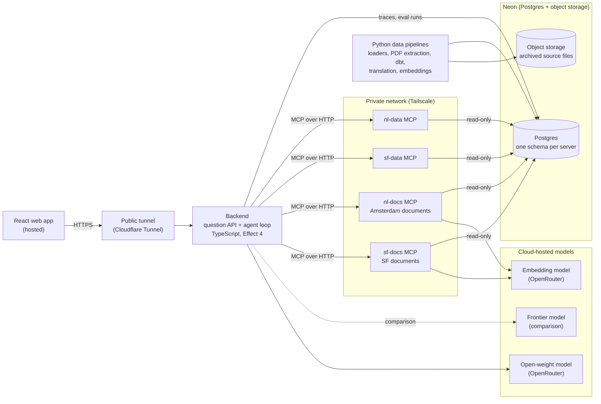

# PolicyHuis MVP: Technical Plan

Final demo: November 30, 2026.

This plan covers the backend: the agent, its tools, the data layer, the network and evaluation. The React web app is out of scope here beyond the API it calls; see [Follow-up](#follow-up). Everything below is open to revision as user research and the evaluation report back.

## Summary

The MVP is one AI agent that answers questions about housing policy in San Francisco and Amsterdam in plain language, citing the law, policy or dataset behind every claim. The agent answers with an open-weight model hosted in the cloud (see [Model hosting](#model-hosting)) and reaches its knowledge through independent [Model Context Protocol (MCP)](https://modelcontextprotocol.io/) servers:

- one **docs server per city** (`sf-docs`, `nl-docs`), for laws, ordinances and policy documents;
- one **data server per city** (`sf-data`, `nl-data`), for housing, demographic and climate data, queried with code so numbers come from data, not from the model.

The same agent can answer with a frontier model instead, so accuracy, latency and energy per answer can be compared directly.

## Model hosting

**Decided November 2026.** PolicyHuis does not run its chat model on the team's laptops. A model small enough to fit, `gpt-oss:20b` on a 24 GB Mac, did not answer reliably: in the evaluation it often said no tool held data that one did, and at a higher reasoning effort it was too slow. Larger models need more memory and compute than the laptops have.

The agent answers with an open-weight model, Qwen3.5-397B-A17B, hosted in the cloud through OpenRouter (the `open_cloud` configuration), with Claude Opus 5.5 (`frontier`) as the comparison. The aim is to show that open-weight models are fit for the job. Because the weights are open, the same model can later run on-premises, for example at a government agency with machines that have the memory and compute for it. Document-search embeddings are hosted the same way, with an open-weight model (Qwen3-Embedding-4B) through OpenRouter.

The `local` configuration stays in the code, not the default, as a reference for running a model on-premises.

## Goals and non-goals

### Goals

1. Answer the question types in the project overview (what a rule says, what is happening on the ground, rule plus data, climate) for San Francisco and Amsterdam, with citations to a specific provision, version or dataset.
2. Answer with an open-weight model, to show such models are fit for the job, and demonstrate independent servers on separate machines answering parts of one question.
3. Measure, rather than assert: answer accuracy (verified by the team's policy expert), latency, and energy per answer, for the open-weight model and the frontier model.
4. Treat climate as a first-class topic: climate-risk and building data sit in each city's data server alongside housing data.
5. Make every number, citation and passage reproducible from the repository and its archived source files.

### Non-goals for the MVP

- Legal advice or individual cases. The agent explains rules and points to the San Francisco Rent Board or the Huurcommissie.
- Causal claims ("did rent control reduce evictions?"). The agent can show a trend next to a rule, not conclude causation.
- Conversation memory. Each question is answered on its own.
- Agent-to-agent communication (A2A), IPFS, libp2p and Bacalhau. See [Deferred options](#deferred-options).
- Fine-tuning. Considered only if the evaluation shows a measurable gain RAG cannot provide.
- Phones as nodes.

## Architecture

### Why one agent with several MCP servers

The project overview notes that what makes a node "specialized" is its data, not its model. An MCP server is data plus tools behind a standard interface, so it carries the specialization on its own.

| | One agent + MCP servers | One agent per city, communicating over A2A |
|---|---|---|
| Model calls per cross-city question | One reasoning loop | Two or more full loops, one agent's output becoming the other's input |
| Latency and energy | Lower | Roughly double or more, against the project's energy goal |
| Tracing an error | Retrieval, a tool or the model | Compounds across agents |
| Evaluation | One system to score | Each agent, then the combination |
| Where it wins | Data and tools are the specialization | The remote party needs its own model, private instructions or long-running autonomy |

The decentralized claim rests on *where things run*: each MCP server can run on hardware owned by the group responsible for that data, and the backend on the hosting group's hardware. The model runs at a cloud host for now; being open-weight, it can move to a group's own hardware when that hardware can hold it. A per-city agent over A2A remains possible later without changing the MCP servers.

### Hosting model

| Model | Who runs the agent | Fit |
|---|---|---|
| Personal | A user, on their own machine | Technical users, privacy-sensitive research |
| **Group-hosted (MVP)** | An organization on its own hardware, serving users through the web app | Most users; no hardware needed |
| Commercial cloud | A cloud provider | Fallback only |

The MVP runs the backend and servers on team machines, with the model at a cloud host (see [Model hosting](#model-hosting)); the hosted web app reaches the backend through a tunnel. An organization adopting it can run the same open-weight model on its own hardware.

## Components

### Backend (agent service)

One TypeScript service is both the backend API the web app calls and the agent loop.

- **API.** An Effect `HttpApi` with one question endpoint that streams the answer and its citations back (server-sent events), so a long generation is visible as it happens. Requests are stateless.
- **Model.** Effect 4's `LanguageModel` service (`effect/ai/LanguageModel`). The agent loop depends only on that service; one layer per configuration, chosen per question, decides which model provides it. The open-weight model is reached through OpenRouter's OpenAI-compatible Chat Completions API with [`@effect/ai-openai-compat`](https://effect.website/docs/v4/api/ai-openai-compat), which also reaches a local runtime such as Ollama; Claude through `@effect/ai-anthropic` (see the [Evaluation and Model Comparison Plan](evaluation.md)). Every configuration runs through the same loop, prompts and tools.
- **Tools.** Effect's MCP client (`effect/ai/McpClient`, Streamable HTTP transport) connects to every server in the directory file. `McpClient.toolkit` binds each server's tools into an `effect/ai` `Toolkit` under that server's tool prefix, so the model sees them as ordinary tools.
- **Behavior rules in the system prompt.** Cite every claim; answer only from tool results; state the version or date a rule applies to; decline legal advice and causal conclusions and point to the right body.
- **Traces.** Each request writes its model, tool calls, token counts and latency to the `app` schema, for evaluation, debugging and energy estimates.

### MCP servers

All servers are TypeScript, built with Effect's MCP server (`effect/ai/McpServer`, served over Streamable HTTP with `McpServer.layerHttp`). Each tool is an `effect/ai` `Tool` with Effect `Schema` input and output, registered through a `Toolkit`, and returns its result as MCP `structuredContent` described by the tool's `outputSchema`. Servers share nothing with the backend but MCP itself, plus these conventions, which each server implements in its own code (see [Domain-Driven Design](../domain-driven-design.md#conventions-between-servers-and-the-backend)):

- **Tool naming.** Each tool is prefixed with its server's short name (for example `sf_docs_search_policy`, `nl_data_social_rent_pipeline`), so the model can tell same-purpose tools apart across cities. The prefix comes from the backend's directory file; servers name tools without it.
- **Citation object.** Every result carries the citations behind it, by the citation convention: stable source and citation IDs namespaced by the server, the source's title, publisher, URL and version, and optionally a locator (the provision or the data selected, in words) and a quote. The backend reads them from results and streams them to the browser app; the browser shows them, and the evaluation checks them from traces. The archived file's hash stays in the load record, reached through the source ID.
- **Errors.** Typed and returned to the model as tool results (`failureMode: "return"`), never thrown as transport failures, so the model can say "no data" rather than guess. A server that cannot reach its own database returns `DatabaseUnavailable`, which the backend treats as the server being unavailable.
- **Sessionless MCP.** Servers and the backend's client use MCP protocol version `2026-07-28`, which has no session, so a server can restart without breaking the backend's connection (see [MCP connections](agent-loop.md#mcp-connections)). If a server is down, the agent answers with the others and says which could not be reached.
- **Database access.** Each server connects with a role that can only read its own schema.

#### Docs server

One server per city (`san-francisco/mcp-servers/documents/`), reading its city's documents schema (`sf_docs`), since one city's documents need their own structure and tools. Each city's documents ingestion (`san-francisco/ingest/documents/`) holds its own passage pipeline: San Francisco's splits along American legal numbering ((a), (1), (A), (i)), which Dutch law does not use, so no pipeline is shared.

| Tool | Purpose |
|---|---|
| `search_policy` | Find passages relevant to a question, optionally filtered by document |
| `get_provision` | Return one provision's text, with an outline of its subsections |
| `list_provisions` | List a document's provisions, to find one by its place in the document |

Each document is loaded in one version, so the tools take no date. A `list_versions` tool and date parameters are added only if a question needs a document's history.

**Retrieval is vector search**: an HNSW index on a `halfvec` embedding column, ranked by cosine distance. For San Francisco, [spike S4](spikes/s4-embeddings.md#decision) found keyword search added nothing on its question set, so the `tsvector` column is kept but unused. Amsterdam's embedding spike decides again, including whether keyword search helps exact terms such as article numbers.

#### Dutch sources

Questions arrive in English and answers are returned in English, while Amsterdam's laws and policy documents are in Dutch. The Amsterdam corpus is **translated once, at load time**, by the Python passage pipeline. No translation runs while a question is being answered.

| Step | How it handles Dutch |
|---|---|
| Vector search | A multilingual embedding model places English questions and Dutch passages in the same vector space. Whether to embed the Dutch original or the English translation is tested in spike S4. |
| Keyword search *(if Amsterdam's spike keeps it)* | Runs over the stored English translation with the `english` configuration, so the question needs no translation. |
| Identifier search *(optional)* | A third keyword search over the Dutch original with the `simple` configuration (no stemming), to match language-neutral identifiers such as "artikel 7:248" exactly. Kept only if spike S3 shows it adds value. |
| What the model reads | The English translation, with the Dutch original alongside for quoting. |
| Citations | Point to and quote the Dutch original. Translated text is labeled as machine translation. |

Translating at load time rather than per question:

- removes translation latency and energy from every query;
- lets the translation model be chosen for quality rather than speed, since it runs offline in batch;
- makes every translation stored, reviewable and traceable to the model that produced it;
- keeps translation out of the docs servers, which read only stored text.

The costs are about 2 KB more storage per Amsterdam passage, and translating the new passages when a law version changes. Translation energy is a one-time cost, measured and reported separately from per-query energy.

#### City data servers

One per city (`sf-data` for San Francisco, `nl-data` for the Netherlands). Their tools are specific to each city's datasets and include its climate data (flood and sea-level-rise zones, heat stress, energy labels, building age).

Climate data sits inside each city's server because the MVP sources are city-specific. A separate climate server becomes worthwhile when one source covers many places (for example FEMA's national flood maps for several US cities); it would answer by location, not by city.

### Data pipelines

A Python package (uv, ruff, pytest) owns everything that loads or transforms data:

1. **Loaders** download each source file, archive it in Neon object storage with its hash, then parse the archived copy into the city's `raw_*` schema. The load record (manifest row) and the data rows are written in one transaction.
2. **Nationwide datasets** (BAG, EP-Online, CBS StatLine) are archived whole and filtered to the city on load. The filter lives in config and is recorded in the manifest.
3. **PDF extraction** (Housing Element, Housing Inventory, Woningbouwplan, Wonen in Amsterdam) uses Python tools: San Francisco's with `pypdf`; the library for Amsterdam's tables is chosen in spike S6.
4. **dbt** builds the city data models each data server reads.
5. **Passage pipeline** for each city's documents corpus: split documents into passages along their own structure (article, section, paragraph), keep the version and effective date, translate Dutch passages to English (storing both texts and the translation model's identifier), compute embeddings, and write to the city's documents schema (`sf_docs`). Passages that already exist unchanged in an earlier version reuse their stored translation and embedding.

**Provenance rules.**

- Every number, label, passage and coordinate reaches the database either from an archived source file through a loader, or through checked-in transformation code.
- Nothing is written by hand, and no values are typed from memory.
- Classification rules (which neighborhood a building is in, which provision a passage belongs to) are code with tests pinning them to known cases.
- Analytical choices with no source to derive them from (load filters, corpus membership) live in reviewed config files.

## Data layer

### Schemas and ownership

| Schema | Written by | Migrations | Read by |
|---|---|---|---|
| `raw_sf_data`, `raw_nl_data` | Data ingestion loaders | Alembic (raw SQL) | dbt |
| `sf_data`, `nl_data` | dbt | dbt | The city's data server |
| `raw_sf_docs`, `raw_nl_docs` | Documents ingestion loaders | Alembic (raw SQL) | The passage pipeline |
| `sf_docs`, `nl_docs` | The city's passage pipeline | Alembic | The city's docs server |
| `app` | Backend | Drizzle (`backend/drizzle/`) | Backend, evaluation reports |

No server reads another server's schema. Moving a server to its own database later is then a connection-string change.

### Neon free tier

Limits per project, checked on [neon.com/pricing](https://neon.com/pricing) on October 14, 2026:

| Resource | Free limit |
|---|---|
| Postgres storage | 1 GB (20 GB across up to 100 projects) |
| Object storage | 5 GB |
| Compute | 100 CU-hours |
| Data transfer out | 5 GB |
| Idle | Scales to zero after 5 minutes |

- **Object storage** holds the archive of record: every downloaded file (PDF, XML, CSV, GeoJSON).
- **Postgres** holds only what the servers query: passage text and metadata, embeddings, and city-filtered data.

Embeddings are stored as `halfvec`, at 2 bytes a dimension. That halves vector storage against `vector`, and pgvector's HNSW index supports `halfvec` up to 4,000 dimensions (versus 2,000 for `vector`), which keeps larger embedding models open.

**Escape hatch if storage runs short:** each server already has its own Neon project; a server whose data outgrows 1 GB moves to a paid plan or splits by source. Servers never join across schemas, so this needs only a connection-string change.

### Embeddings

The passage pipeline (Python) and the docs server (TypeScript) must embed text with exactly the same model, or search quality degrades silently.

- **Each docs node and its passage pipeline call the same model through OpenRouter, pinned to one host** with fallbacks off, since OpenRouter's hosts may serve different quantizations of one model. Search then depends on that service, but on no other node.
- Every embedding row stores its model and host.
- The docs server checks on startup that its configured model and host match the stored ones, and refuses to start if they do not.

## Network

| Layer | MVP choice | Notes |
|---|---|---|
| Web app → backend | [Cloudflare Tunnel](https://developers.cloudflare.com/cloudflare-one/connections/connect-networks/) gives the backend's machine a public HTTPS address | Supports streaming. Optional simple access control: [Cloudflare Access](https://developers.cloudflare.com/cloudflare-one/policies/access/) one-time email PINs, with no code |
| Agent → MCP servers | [Tailscale](https://tailscale.com/blog/how-nat-traversal-works) private network between team machines | WireGuard tunnels with NAT traversal; machines need not share a LAN. [Headscale](https://github.com/juanfont/headscale) self-hosts the coordination server if needed |
| Discovery | A directory file in the repo listing each server's name, address, owner and tool prefix | Replaced by a registry or distributed lookup only if the network grows |

The agent and servers are reachable only while their machines are awake and connected. That is acceptable for the demo.

## Evaluation and energy

### Question set

- **Questions:** drawn from the project overview's question types, for both cities, including questions the agent should decline. San Francisco's set is [`evaluation/questions/sf.yaml`](../../evaluation/questions/sf.yaml); Amsterdam's are [drafts](netherlands-ingestion.md#draft-questions), pending confirmation from the research team.
- **Verification:** the research team's policy expert checks the expected answers and citations.
- **Storage:** questions live in a reviewed file in the repo; each answer's trace goes to the `app` schema with its evaluation run ID, and promptfoo keeps each run's results in `evaluation/results/`.
- **Run conditions:** evaluation runs never overlap demo traffic, and answer one question at a time, so latencies are comparable. Traces record tool latency apart from model time.

**Per question, record:**

- answer correctness (expert-graded);
- citation correctness (right provision and version, right dataset);
- correct declining (legal advice, causation, missing data);
- tool calls made;
- latency (time to first token, total);
- input and output tokens;
- energy (estimated, see [Energy](#energy)).

### Configurations compared

1. **Open model in the cloud** (`open_cloud`, the default): Qwen3.5-397B-A17B through OpenRouter.
2. **Frontier model** (`frontier`): Claude Opus 5.5, as an accuracy ceiling.
3. **Local** (`local`, optional): `gpt-oss:20b` in Ollama on a laptop, a reference for on-premises runs.
4. **Same model in the cloud** (`same_model_cloud`): the local model at a cloud provider, to separate hardware from model. Not configured.

### Energy

Energy per answer is estimated from its token counts with per-token factors from CLEER, for the two cloud configurations; see the [Energy Estimates Plan](energy.md). Results are reported whichever way they come out: data centers process many requests together on efficient hardware, so a smaller or open model is not assumed to use less energy.

## Repository and conventions

One shared repository.

| Area | Tooling |
|---|---|
| TypeScript workspaces | yarn |
| Lint and format (TS) | ESLint + Prettier |
| Tests (TS) | `@effect/vitest` |
| Effect | Effect 4 (`effect` 4.x, with AI modules under `effect/ai`) |
| Validation | Effect `Schema` |
| Operational database | `effect/sql` with the `@effect/sql-pg` driver |
| MCP server and client | `effect/ai/McpServer`, `effect/ai/McpClient` |
| Python | uv, ruff, pytest |
| Raw-schema migrations | Alembic, raw SQL, sequential IDs, append-only once applied |
| Data models | dbt |
| Integration tests | Throwaway Postgres in a testcontainer, never a real database |

The layout is in [CLAUDE.md](../../CLAUDE.md#project-structure) and the [README](../../README.md#repository-layout).

**Rules:**

- Credentials live only in a gitignored `.env`.
- No lint or type-check suppressions.
- The two languages communicate only through the database schemas, never by importing each other's code.

## Spikes

Each spike answers one question and records its result in `docs/plans/spikes/`.

| ID | Question | Status |
|---|---|---|
| S1 | Do tool calls and streaming work with each local runtime and model? | Overtaken by [Model hosting](#model-hosting): the backend's own tests and the evaluation cover tool calls and streaming for the configured models |
| S2 | Can a small model pick the right tool and copy citation IDs exactly? | Overtaken: the backend gives the model short citation keys, and the evaluation checks tool choice and citations |
| S3 | Which model translates Dutch legal text well enough, under a usable license? Does a Dutch identifier search add value? | Open |
| S4 | Which embedding model, and how much storage? | [Decided](spikes/s4-embeddings.md#decision) for San Francisco; Amsterdam's corpus needs its own run |
| S5 | Can energy be measured and estimated credibly? | Replaced by the [Energy Estimates Plan](energy.md) and, for the frontier model, the [Evaluation and Model Comparison Plan](evaluation.md) |
| S6 | Which tool extracts PDF tables reliably? | Not run. San Francisco's PDFs are read with `pypdf` (`shared/ingest`); open for Amsterdam's table-heavy PDFs |

## Milestones

| Milestone | Done when |
|---|---|
| M0. Sources and questions | A source proposal per city records each chosen source and the reason for choosing it, with its access method, license or reuse terms, and actual format checked. Questions are drafted (San Francisco's in [`evaluation/questions/sf.yaml`](../../evaluation/questions/sf.yaml), Amsterdam's in the [draft questions](netherlands-ingestion.md#draft-questions)), pending confirmation from the research team. The first rule-plus-data pair per city is chosen. Spikes S1–S6 run alongside and are recorded with decisions. |
| M1. Contracts | The data servers' tool schemas, the citation contract and the backend API contract (the question endpoint and its streamed events) are defined as Effect `Schema` (the tool schemas and each server's citation schema in the server, following the citation convention; the API and the citation schema the browser decodes in `protocol/`), and reviewed against the provisional questions. |
| M2. Data foundation | Database schemas, roles and migrations exist; source files are archived in object storage; the first rule-plus-data pair per city is loaded **in full** with provenance (for example, for San Francisco, a section of the Administrative Code and a dataset that answers questions about it). |
| M3. First answer | The agent loop, each city's docs server and data server (with tools for the first pair) are running, and a rule-plus-data question returns a cited answer through the API endpoint, with a trace in `app`. |
| M4. Remaining sources | The other chosen sources are loaded and their tools implemented. |
| M5. Evaluation | The question set runs against the open-weight and frontier configurations; accuracy, latency and energy are reported. |
| M6. Demo | Servers run on separate machines over the private network, the web app is connected through the tunnel, and the demo questions are chosen from user research. |

Loading one complete pair per city before the remaining sources tests both pipelines (legal text and structured data) and both kinds of MCP server at real scale (storage against Neon's limits, load time, city filtering, data-quality edge cases) before the loader pattern is repeated for other sources.

Amsterdam's M2 depends on spike S3, because loading Dutch legal text means translating it.

San Francisco work (source proposal, ingestion, corpus, `sf-data` and `sf-docs`) is owned by Molly. Amsterdam work (source proposal, pipelines, corpus, `nl-data` and `nl-docs`) is owned by Martin. Ownership of shared pieces is an open question.

## Deferred options

| Option | What it would add | Revisit when |
|---|---|---|
| A2A agent per city | Each party runs its own reasoning and model | A party needs its own model, private instructions or long-running tasks |
| libp2p | Peer discovery and NAT traversal without a coordination service; the most truly peer-to-peer option | The network has more participants than a directory file can manage |
| IPFS | Content-addressed sharing of models and datasets | Several independent groups publish datasets for others to reuse. For the MVP, file hashes in the load records give verified, versioned copies |
| [Bacalhau](https://bacalhau.org/docs/) | Running batch jobs (Docker or WASM) where the data lives, scheduled by an orchestrator | Several independently run data nodes need coordinated batch refreshes, such as re-embedding or evaluation runs. Not suited to answering interactive questions |
| Shared climate server | One server answering by location across cities | A climate source covers several cities in scope |
| Fine-tuning | A smaller model matching a larger one on this task | The evaluation shows a gap RAG cannot close |
| Self-hosted Postgres | Data on the group's own hardware | See open questions |

## Open questions

1. **Hosting story.** Confirm with Martin the framing in [Model hosting](#model-hosting): an open-weight model hosted in the cloud now, on an adopting organization's own hardware later.
2. **Cloud database vs. self-hosted.** Neon is a managed cloud service, which sits uneasily with running on the group's own hardware. Keep Neon past the MVP, or move to self-hosted Postgres?
3. **Same model in the cloud.** Whether to configure it, and with which provider; OpenRouter serves `openai/gpt-oss-20b`.
4. **Translation review.** Who on the research team can verify Dutch-to-English translations of legal text and grade the Amsterdam answers?
5. **Translation model** (spike S3), including whether its license allows commercial use if PolicyHuis becomes a company.
6. **Questions.** The research team confirms or revises San Francisco's question set and Amsterdam's [draft questions](netherlands-ingestion.md#draft-questions).
7. **Demo questions**, chosen from user research.
8. **Ownership of shared pieces**: the backend, `protocol/`, `shared/`, evaluation.
9. **Data server tool design.** Fixed, parameterized tools only, or a constrained query tool as well? Fixed tools keep numbers traceable to tested queries; a query tool covers more questions.
10. **License** for the code, and confirming each model's license allows this use.

## Follow-up

Planned separately from this backend plan:

1. **Web app design and implementation.** The Phase 1 prototype is planned in the [Browser App Plan](browser-app.md). The full design covers the React app's pages and components, how answers and citations are displayed (including Dutch originals beside their machine translations), loading and streaming states, and hosting.
2. **Energy in the web app**: per-answer estimates and a dashboard tab comparing the cloud configurations, in the [Energy Estimates Plan](energy.md).
3. **Schema snapshots as the contract.** Each ingest project generates its schema's DDL, a test fails when it is stale, and its server's tests load it in place of hand-written fixtures.
4. **Search settings in the database.** The documents pipeline writes the embedding model and host to a one-row table in its schema, which the server reads at startup instead of its own copy of `search.yaml`.
5. **Deployment:** a Dockerfile for each server, and the ingest projects as scheduled jobs.

## References

- Model Context Protocol: <https://modelcontextprotocol.io/>
- Neon pricing: <https://neon.com/pricing>
- Tailscale, How NAT traversal works: <https://tailscale.com/blog/how-nat-traversal-works>
- Cloudflare Tunnel: <https://developers.cloudflare.com/cloudflare-one/connections/connect-networks/>
- Bacalhau documentation: <https://bacalhau.org/docs/>
