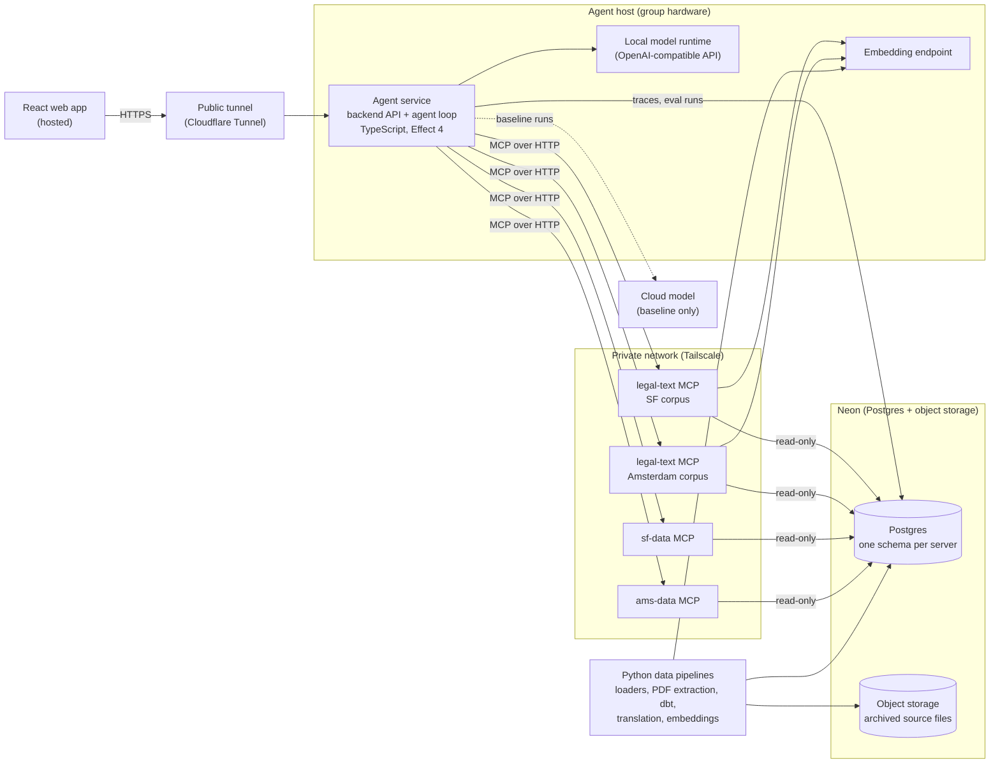

# PolicyHuis MVP: Technical Plan

Draft, October 14, 2026. Final demo: November 30, 2026.

This plan covers the backend: the agent, its tools, the data layer, the network and evaluation. The React web app is out of scope here beyond the API it calls; see [Follow-up](#follow-up). Everything below is open to revision as user research and the spikes report back.

## Summary

The MVP is one AI agent that answers questions about housing policy in San Francisco and Amsterdam in plain language, citing the law, policy or dataset behind every claim. The agent runs an open-weight model on the group's own hardware and reaches its knowledge through independent [Model Context Protocol (MCP)](https://modelcontextprotocol.io/) servers:

- one **legal-text server** codebase, run once per city's corpus, for laws, ordinances and policy documents;
- one **data server per city**, for housing, demographic and climate data, queried with code so numbers come from data, not from the model.

The same agent can swap the local model for a cloud model, so accuracy, latency and energy per query can be compared directly.

Work starts with spikes that test the riskiest assumptions before any build-out.

## Goals and non-goals

### Goals

1. Answer the question types in the project overview (what a rule says, what is happening on the ground, rule plus data, climate) for San Francisco and Amsterdam, with citations to a specific provision, version or dataset.
2. Run the model locally on the group's hardware, and demonstrate independent servers on separate machines answering parts of one question.
3. Measure, rather than assert: answer accuracy (verified by the team's policy expert), latency, and energy per query, for the local model and for cloud baselines.
4. Treat climate as a first-class topic: climate-risk and building data sit in each city's data server alongside housing data.
5. Make every number, citation and passage reproducible from the repository and its archived source files.

### Non-goals for the MVP

- Legal advice or individual cases. The agent explains rules and points to the San Francisco Rent Board or the Huurcommissie.
- Causal claims ("did rent control reduce evictions?"). The agent can show a trend next to a rule, not conclude causation.
- Conversation memory. Each question is answered on its own.
- Agent-to-agent communication (A2A), IPFS, libp2p and Bacalhau. See [Deferred options](#deferred-options).
- Fine-tuning. Considered only if the evaluation shows a measurable gain RAG cannot provide.
- Phones as nodes.

## Architecture



### Why one agent with several MCP servers

The project overview notes that what makes a node "specialized" is its data, not its model. An MCP server is data plus tools behind a standard interface, so it carries the specialization on its own.

| | One agent + MCP servers | One agent per city, communicating over A2A |
|---|---|---|
| Model calls per cross-city question | One reasoning loop | Two or more full loops, one agent's output becoming the other's input |
| Latency and energy | Lower | Roughly double or more, against the project's energy goal |
| Tracing an error | Retrieval, a tool or the model | Compounds across agents |
| Evaluation | One system to score | Each agent, then the combination |
| Where it wins | Data and tools are the specialization | The remote party needs its own model, private instructions or long-running autonomy |

The decentralized claim rests on *where things run*: each MCP server can run on hardware owned by the group responsible for that data, and the agent runs on the hosting group's hardware rather than a Big Tech cloud. A per-city agent over A2A remains possible later without changing the MCP servers.

### Hosting model

| Model | Who runs the agent | Fit |
|---|---|---|
| Personal | A user, on their own machine | Technical users, privacy-sensitive research |
| **Group-hosted (MVP)** | An organization on its own hardware, serving users through the web app | Most users; no hardware needed |
| Commercial cloud | A cloud provider | Fallback only |

The MVP demonstrates group-hosted: the agent and its model run on a team laptop, and the hosted web app reaches it through a tunnel.

## Components

### Agent service

One TypeScript service is both the backend API the web app calls and the agent loop.

- **API.** An Effect `HttpApi` with one question endpoint that streams the answer and its citations back (server-sent events), so a local model's 10–30 seconds of generation is visible as it happens. Requests are stateless.
- **Model.** Effect 4's `LanguageModel` service (`effect/ai/LanguageModel`). The agent loop depends only on that service; one layer, chosen in config, decides which model provides it. Local runtimes (Ollama, LM Studio, llama.cpp, `mlx_lm.server`) imitate OpenAI's **Chat Completions** API (`/v1/chat/completions`), which [`@effect/ai-openai-compat`](https://effect.website/docs/v4/api/ai-openai-compat) calls, with tool calls and streaming. Spike S1 confirms tool calls and streaming work with each candidate model and runtime.
- **One provider package for every configuration.** Local, same-model cloud and frontier configurations all use `@effect/ai-openai-compat`. Every configuration then runs through the same loop, prompts and tools, and its prompts, tools and tool results are serialized into identical requests, so differences in accuracy and tokens come from the model and hardware rather than the client. If the chosen frontier model does not work fully through Chat Completions (some models may be served only through OpenAI's newer Responses API), its configuration falls back to the provider's first-party package, such as `@effect/ai-openai`. The fallback is one more case in the layer that selects the model; the agent loop does not change.
- **Tools.** Effect's MCP client (`effect/ai/McpClient`, Streamable HTTP transport) connects to every server in the directory file. `McpClient.toolkit` binds each server's tools into an `effect/ai` `Toolkit` under that server's tool prefix, so the model sees them as ordinary tools.
- **Behavior rules in the system prompt.** Cite every claim; answer only from tool results; state the version or date a rule applies to; decline legal advice and causal conclusions and point to the right body.
- **Traces.** Each request writes its model, tool calls, token counts, latency and energy sample to the `app` schema, for evaluation and debugging.

### MCP servers

All servers are TypeScript, built with Effect's MCP server (`effect/ai/McpServer`, served over Streamable HTTP with `McpServer.layerHttp`). Each tool is an `effect/ai` `Tool` with Effect `Schema` input and output, registered through a `Toolkit`, so servers and agent use one schema system end to end. All servers follow one **shared contract**, kept as Effect `Schema` definitions in a shared package:

- **Tool naming.** Each tool is prefixed with its server (for example `sf_policy_search`, `ams_data_social_rent_pipeline`), so the model can tell same-purpose tools apart across cities.
- **Citation object.** Every result carries the citations behind it: source, title, provision or table, version or effective date, source URL, archived file hash and language.
- **Errors.** Typed and returned to the model as tool results (`failureMode: "return"`), never thrown as transport failures, so the model can say "no data" rather than guess.
- **Database access.** Each server connects with a role that can only read its own schema.

#### Legal-text server

One codebase, run as one instance per corpus (SF and Amsterdam), configured with its corpus and database schema.

| Tool | Purpose |
|---|---|
| `search_policy` | Find passages relevant to a question, optionally filtered by document or effective date |
| `get_provision` | Return a full article or section by its identifier, in a given version |
| `list_versions` | List the versions of a document and their effective dates |

**Retrieval is hybrid.** Two searches run over the same passages and their rankings are combined:

- **Vector search.** An HNSW index on a `halfvec` embedding column, ranked by cosine distance.
- **Keyword search.** A GIN index on a `tsvector` column built from the passage's English text, matched with `websearch_to_tsquery` and ranked with `ts_rank` using the `english` text-search configuration. For Amsterdam, the English text is the stored translation (see [Dutch sources](#dutch-sources)), so English questions are searched directly without translating them.
- **Combining the rankings.** Each search returns its top candidates (a pool of 100), and the rankings are merged by reciprocal rank fusion (RRF). Each passage scores the sum of `1 / (k + rank)` over the searches that found it, with `k = 60` ([Cormack et al., 2009](https://doi.org/10.1145/1571941.1572114)). Ties are broken by vector distance. RRF uses ranks, not raw scores, because cosine distance and `ts_rank` have no shared scale to weight against each other.
- **Highlights.** Keyword matches are highlighted in the returned passage with `ts_headline`.

Keyword search matters for legal text because questions often hinge on exact terms: article numbers ("37.9"), defined terms, ordinance names. Vector search catches paraphrases.

#### Dutch sources

Questions arrive in English and answers are returned in English, while Amsterdam's laws and policy documents are in Dutch. The Amsterdam corpus is **translated once, at load time**, by the Python passage pipeline. No translation runs while a question is being answered.

| Step | How it handles Dutch |
|---|---|
| Vector search | A multilingual embedding model places English questions and Dutch passages in the same vector space. Whether to embed the Dutch original or the English translation is tested in spike S4. |
| Keyword search | Runs over the stored English translation with the `english` configuration, so the question needs no translation. |
| Identifier search *(optional)* | A third keyword search over the Dutch original with the `simple` configuration (no stemming), to match language-neutral identifiers such as "artikel 7:248" exactly. Kept only if spike S3 shows it adds value. |
| What the model reads | The English translation, with the Dutch original alongside for quoting. |
| Citations | Point to and quote the Dutch original. Translated text is labeled as machine translation. |

Translating at load time rather than per question:

- removes translation latency and energy from every query;
- lets the translation model be chosen for quality rather than speed, since it runs offline in batch;
- makes every translation stored, reviewable and traceable to the model that produced it;
- keeps the legal-text server one codebase, with only per-corpus config differing.

The costs are about 2 KB more storage per Amsterdam passage, and translating the new passages when a law version changes. Translation energy is a one-time cost, measured and reported separately from per-query energy.

#### City data servers

One per city (`sf-data`, `ams-data`). Their tools are specific to each city's datasets and include its climate data (flood and sea-level-rise zones, heat stress, energy labels, building age).

Climate data sits inside each city's server because the MVP sources are city-specific. A separate climate server becomes worthwhile when one source covers many places (for example FEMA's national flood maps for several US cities); it would answer by location, not by city.

### Data pipelines

A Python package (uv, ruff, pytest) owns everything that loads or transforms data:

1. **Loaders** download each source file, archive it in Neon object storage with its hash, then parse the archived copy into the city's `raw_*` schema. The load record (manifest row) and the data rows are written in one transaction.
2. **Nationwide datasets** (BAG, EP-Online, CBS StatLine) are archived whole and filtered to the city on load. The filter lives in config and is recorded in the manifest.
3. **PDF extraction** (Housing Element, Housing Inventory, Woningbouwplan, Wonen in Amsterdam) uses Python tools; the library is chosen in spike S6.
4. **dbt** builds the city data models each data server reads.
5. **Passage pipeline** for the legal-text corpus: split documents into passages along their own structure (article, section, paragraph), keep the version and effective date, translate Dutch passages to English (storing both texts and the translation model's identifier), compute embeddings, and write to the `policy_text_*` schemas. Passages that already exist unchanged in an earlier version reuse their stored translation and embedding.

**Provenance rules.**

- Every number, label, passage and coordinate reaches the database either from an archived source file through a loader, or through checked-in transformation code.
- Nothing is written by hand, and no values are typed from memory.
- Classification rules (which neighborhood a building is in, which provision a passage belongs to) are code with tests pinning them to known cases.
- Analytical choices with no source to derive them from (load filters, corpus membership) live in reviewed config files.

## Data layer

### Schemas and ownership

| Schema | Written by | Migrations | Read by |
|---|---|---|---|
| `raw_sf`, `raw_ams` | Python loaders | Alembic (raw SQL) | dbt |
| `sf`, `ams` | dbt | dbt | The city's data server |
| `policy_text_sf`, `policy_text_ams` | Python passage pipeline | Alembic | The matching legal-text server |
| `app` | Agent service | `effect/sql` Migrator | Agent service, evaluation reports |

No server reads another server's schema. Moving a server to its own database later is then a connection-string change.

### Neon free tier

Limits per project, checked on [neon.com/pricing](https://neon.com/pricing) on October 14, 2026:

| Resource | Free limit |
|---|---|
| Postgres storage | 1 GB (20 GB across up to 100 projects) |
| Object storage | 5 GB |
| Compute | 100 CU-hours |
| Data transfer out | 5 GB |
| Idle | Scales to zero after 5 minutes |

- **Object storage** holds the archive of record: every downloaded file (PDF, XML, CSV, GeoJSON).
- **Postgres** holds only what the servers query: passage text and metadata, embeddings, and city-filtered data.

**Sizing estimate for the legal text, to be measured in spike S4.** With a 1024-dimension embedding model:

| Item | Size per passage |
|---|---|
| Vector, float32 (`vector`) | 4 KB |
| Vector, float16 (pgvector `halfvec`) | 2 KB |
| Text of a ~500-token passage | ~2 KB |
| HNSW search index | Roughly the vector size again (estimate) |

That is about 6–10 KB per passage, or on the order of 100,000 passages per GB.

Embeddings are stored as `halfvec` from the start. That halves vector storage, and pgvector's HNSW index supports `halfvec` up to 4,000 dimensions (versus 2,000 for `vector`), which keeps larger embedding models open.

**Escape hatch if storage runs short:** give the legal-text server its own Neon project, adding a separate 1 GB. Servers never join across schemas, so this needs only a connection-string change.

### Embeddings

The passage pipeline (Python) and the legal-text server (TypeScript) must embed text with exactly the same model, or search quality degrades silently.

- Both call **one shared embedding endpoint** (for example a local Ollama instance serving the chosen model).
- Every embedding row stores its model identifier.
- The legal-text server checks on startup that its configured model matches the stored identifier, and refuses to start if it does not.

## Network

| Layer | MVP choice | Notes |
|---|---|---|
| Web app → agent | [Cloudflare Tunnel](https://developers.cloudflare.com/cloudflare-one/connections/connect-networks/) gives the agent laptop a public HTTPS address | Supports streaming. Optional simple access control: [Cloudflare Access](https://developers.cloudflare.com/cloudflare-one/policies/access/) one-time email PINs, with no code |
| Agent → MCP servers | [Tailscale](https://tailscale.com/blog/how-nat-traversal-works) private network between team machines | WireGuard tunnels with NAT traversal; machines need not share a LAN. [Headscale](https://github.com/juanfont/headscale) self-hosts the coordination server if needed |
| Discovery | A directory file in the repo listing each server's name, address, owner and tool prefix | Replaced by a registry or distributed lookup only if the network grows |

The agent and servers are reachable only while their machines are awake and connected. That is acceptable for the demo.

## Evaluation and energy

### Question set

- **Size:** 30–50 questions drawn from the project overview's question types, for both cities, including questions the agent should decline. The [provisional questions](provisional-questions.md) are the starting set, pending confirmation from the research team.
- **Verification:** the research team's policy expert checks the expected answers and citations.
- **Storage:** questions live in a reviewed file in the repo; each run's results go to the `app` schema.

**Per question, record:**

- answer correctness (expert-graded);
- citation correctness (right provision and version, right dataset);
- correct declining (legal advice, causation, missing data);
- tool calls made;
- latency (time to first token, total);
- input and output tokens;
- energy.

### Configurations compared

1. **Local:** the chosen open-weight model on the agent laptop.
2. **Same model, in the cloud:** the same open-weight model served by a cloud inference provider. The model is identical and its size known, so this isolates local hardware versus data center.
3. **Frontier model:** a closed cloud model, as an accuracy ceiling.

### Energy

- **Local, measured.** Sample macOS `powermetrics` (requires sudo) during each request, net of an idle baseline taken with the same method.
- **Cloud, estimated.** Use [EcoLogits](https://ecologits.ai/latest/methodology/), run in the Python package over the logged token counts and latencies. For closed models, EcoLogits estimates parameter counts, so their figures carry wide uncertainty. Reference points: about 0.24 Wh for a median Gemini text prompt ([Google, 2025](https://cloud.google.com/blog/products/infrastructure/measuring-the-environmental-impact-of-ai-inference)), about 0.3 Wh for a GPT-4o query ([Epoch AI, 2025](https://epoch.ai/gradient-updates/how-much-energy-does-chatgpt-use)).

Results are reported as **measured (local) versus estimated (cloud)**, with uncertainty, whichever way they come out. Data centers process many requests together on efficient hardware, so local inference is not assumed to be more efficient. The claims under test are narrower:

- reusing existing hardware;
- running small models only when needed;
- keeping data under the group's control.

## Repository and conventions

One shared repository.

| Area | Tooling |
|---|---|
| TypeScript workspaces | yarn |
| Lint and format (TS) | ESLint + Prettier |
| Tests (TS) | `@effect/vitest` |
| Effect | Effect 4 (`effect` 4.x, with AI modules under `effect/ai`) |
| Validation | Effect `Schema` |
| Operational database | `effect/sql` with the `@effect/sql-pg` driver |
| MCP server and client | `effect/ai/McpServer`, `effect/ai/McpClient` |
| Python | uv, ruff, pytest |
| Raw-schema migrations | Alembic, raw SQL, sequential IDs, append-only once applied |
| Data models | dbt |
| Integration tests | Throwaway Postgres in a testcontainer, never a real database |

**Proposed layout:**

```
apps/agent/              agent service (backend API + agent loop)
mcp/legal-text/          legal-text MCP server (one codebase, per-corpus config)
mcp/sf-data/             SF data MCP server
mcp/ams-data/            Amsterdam data MCP server
packages/contract/       shared tool and citation schemas
pipelines/               Python: loaders, PDF extraction, passages, embeddings, energy estimates
pipelines/dbt/           dbt project
config/                  sources, load filters, corpus membership, server directory
evaluation/              question set and expected answers
docs/plans/              technical plans
```

**Rules:**

- Credentials live only in a gitignored `.env`.
- No lint or type-check suppressions.
- The two languages communicate only through the database schemas, never by importing each other's code.

## Spikes

Each spike answers one question and records its result in `docs/plans/spikes/`. The spikes come before the build-out. Pass thresholds are set with the team before each spike runs.

| ID | Question | Method | Decision it informs |
|---|---|---|---|
| S1 | Do tool calls and streaming work with each local runtime and model? | In a scratch Effect 4 project, point `@effect/ai-openai-compat` at Ollama, LM Studio, `mlx_lm.server` and llama.cpp; run a streamed two-tool round trip, including parallel tool calls, with each candidate model, with the tools served by a stub `McpServer` and bound through `McpClient.toolkit` | Local runtime; candidate models whose tool calling works; whether Effect's MCP server and client (marked unstable and experimental in Effect 4.1) hold up |
| S2 | Can a small model pick the right tool among about 12? | Mock MCP servers with realistic tool descriptions; 20 routing questions; candidate models that fit a 24 GB M4 | Base model; tool design and naming |
| S3 | Which model translates Dutch legal text well enough, under a usable license? | Translate sample passages from the Huisvestingsverordening and national rent law with candidates: dedicated translation models (for example [OPUS-MT](https://huggingface.co/Helsinki-NLP/opus-mt-nl-en), MADLAD-400) and a general open model prompted to translate. Have a Dutch reader grade a sample, and check each license, including whether it allows commercial use. Test whether the Dutch identifier search adds value. | Translation model; whether the identifier search is kept |
| S4 | Which embedding model, and how much storage? | Run hybrid search on a sample corpus in both languages with candidate multilingual embedding models; for Amsterdam, compare embedding the Dutch original versus the English translation; compare against vector-only and keyword-only to confirm each search adds value; measure storage per passage in Neon | Embedding model; which Amsterdam text is embedded; whether the storage escape hatch is needed |
| S5 | Can energy be measured and estimated credibly? | Sample `powermetrics` around local requests; check EcoLogits coverage of the candidate cloud providers; confirm the candidate frontier model works fully through Chat Completions with `@effect/ai-openai-compat` (tool calls, streaming, token counts including reasoning tokens) | Energy method; cloud baseline providers; whether the frontier configuration needs the first-party fallback |
| S6 | Which tool extracts PDF tables reliably? | Docling vs. pdfplumber on Housing Element and Woningbouwplan tables | PDF extraction library |

## Milestones

| Milestone | Done when |
|---|---|
| M0. Sources and questions | A source proposal per city records each chosen source and the reason for choosing it, with its access method, license or reuse terms, and actual format checked. Provisional questions are drafted (see [Provisional questions](provisional-questions.md)), pending confirmation from the research team. The first rule-plus-data pair per city is chosen. Spikes S1–S6 run alongside and are recorded with decisions. |
| M1. Contracts | The data servers' tool schemas, the citation contract and the backend API contract (the question endpoint and its streamed events) are defined as Effect `Schema` in the shared contract package, and reviewed against the provisional questions. |
| M2. Data foundation | Database schemas, roles and migrations exist; source files are archived in object storage; the first rule-plus-data pair per city is loaded **in full** with provenance (for example, for San Francisco, a section of the Administrative Code and a dataset that answers questions about it). |
| M3. First answer | The agent loop, the legal-text server and each city's data server (with tools for the first pair) are running, and a rule-plus-data question returns a cited answer through the API endpoint, with a trace in `app`. |
| M4. Remaining sources | The other chosen sources are loaded and their tools implemented. |
| M5. Evaluation | The question set runs against all three configurations; accuracy, latency and energy are reported. |
| M6. Demo | Servers run on separate machines over the private network, the web app is connected through the tunnel, and the demo questions are chosen from user research. |

Loading one complete pair per city before the remaining sources tests both pipelines (legal text and structured data) and both kinds of MCP server at real scale (storage against Neon's limits, load time, city filtering, data-quality edge cases) before the loader pattern is repeated for other sources.

M2 depends on spikes S3 and S4, because loading legal text means translating and embedding it.

San Francisco work (source proposal, pipelines, corpus, `sf-data`) is owned by Molly. Amsterdam work (source proposal, pipelines, corpus, `ams-data`) is owned by Martin. Ownership of shared pieces is an open question.

## Deferred options

| Option | What it would add | Revisit when |
|---|---|---|
| A2A agent per city | Each party runs its own reasoning and model | A party needs its own model, private instructions or long-running tasks |
| libp2p | Peer discovery and NAT traversal without a coordination service; the most truly peer-to-peer option | The network has more participants than a directory file can manage |
| IPFS | Content-addressed sharing of models and datasets | Several independent groups publish datasets for others to reuse. For the MVP, file hashes in the load records give verified, versioned copies |
| [Bacalhau](https://bacalhau.org/docs/) | Running batch jobs (Docker or WASM) where the data lives, scheduled by an orchestrator | Several independently run data nodes need coordinated batch refreshes, such as re-embedding or evaluation runs. Not suited to answering interactive questions |
| Shared climate server | One server answering by location across cities | A climate source covers several cities in scope |
| Fine-tuning | A smaller model matching a larger one on this task | The evaluation shows a gap RAG cannot close |
| Self-hosted Postgres | Data on the group's own hardware | See open questions |

## Open questions

1. **Hosting story.** Confirm with Martin that "group-hosted on the group's own hardware" is the framing for the pitch.
2. **Cloud database vs. self-hosted.** Neon is a managed cloud service, which sits uneasily with running on the group's own hardware. Keep Neon past the MVP, or move to self-hosted Postgres?
3. **Cloud baselines.** Which inference provider serves the same open-weight model, and which frontier model is the ceiling (spike S5)?
4. **Translation review.** Who on the research team can verify Dutch-to-English translations of legal text and grade the Amsterdam answers?
5. **Translation model** (spike S3), including whether its license allows commercial use if PolicyHuis becomes a company.
6. **Provisional questions.** The research team confirms or revises the [provisional questions](provisional-questions.md), which drive the tool design in M1.
7. **Demo questions**, chosen from user research.
8. **Ownership of shared pieces**: the agent service, the shared contract, the legal-text server, evaluation.
9. **Data server tool design.** Fixed, parameterized tools only, or a constrained query tool as well? Fixed tools keep numbers traceable to tested queries; a query tool covers more questions.
10. **License** for the code, and confirming each model's license allows this use.

## Follow-up

Planned separately from this backend plan:

1. **Web app design and implementation.** The React app's pages and components, how answers and citations are displayed (including Dutch originals beside their machine translations), loading and streaming states, and hosting.
2. **Energy dashboard in the web app.** Compares energy per query for the local model against the cloud baselines, especially the frontier model. Points to settle in that plan:
   - **Data.** It reads evaluation runs and request traces from the `app` schema through new read endpoints on the backend API.
   - **Measured vs. estimated.** Local figures are measured; cloud figures are EcoLogits estimates. The dashboard shows the difference, and the estimates' uncertainty ranges, visually.
   - **One-time costs.** Load-time translation and embedding energy appear separately, and optionally spread over the number of queries served.
   - **Context.** Energy sits next to accuracy and latency for the same questions, so a lower energy figure is never shown without the quality it came with.

## References

- Model Context Protocol: <https://modelcontextprotocol.io/>
- Neon pricing: <https://neon.com/pricing>
- EcoLogits methodology: <https://ecologits.ai/latest/methodology/>
- Google, Measuring the environmental impact of AI inference (2025): <https://cloud.google.com/blog/products/infrastructure/measuring-the-environmental-impact-of-ai-inference>
- Epoch AI, How much energy does ChatGPT use? (2025): <https://epoch.ai/gradient-updates/how-much-energy-does-chatgpt-use>
- Tailscale, How NAT traversal works: <https://tailscale.com/blog/how-nat-traversal-works>
- Cloudflare Tunnel: <https://developers.cloudflare.com/cloudflare-one/connections/connect-networks/>
- Bacalhau documentation: <https://bacalhau.org/docs/>
