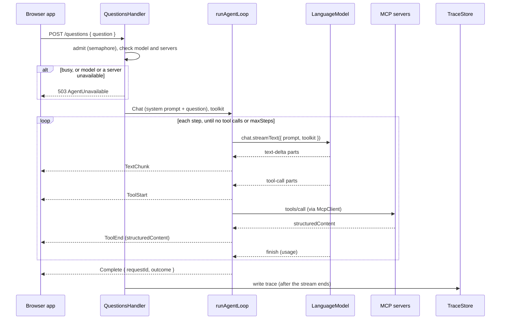

# PolicyHuis: San Francisco Plan

Draft, November 3, 2026; revised November 4, 2026.

This plan covers the San Francisco build: its sources, the San Francisco MCP servers, and the agent loop that every city's servers plug into. It builds on the [MVP Technical Plan](mvp-technical-plan.md), which remains the reference for the shared architecture (one agent, independent MCP servers, the shared contract, the data layer, the network, evaluation and energy). Where this plan is more specific, this plan wins for San Francisco.

## Summary

- **Focus:** San Francisco's affordable housing pipeline. Two questions run through the demo: *where is it, and is it moving?* and *is it climate-ready?* The research behind this choice is in [*SF affordable housing challenges*](../../research/reports/SF%20affordable%20housing%20challenges.md) (November 4, 2026): money, not zoning, now holds projects back, and the figures cited in public debate are often real dataset totals with misleading labels, which is where cited answers help most.
- **Users:** policy makers and residents. One answer style for now; the API is designed so an audience attribute can be added later without breaking callers.
- **Phase 1, prototype:** the two project pipelines (Planning's and MOHCD's), two flood maps and the air-pollutant exposure zone, served by `sf-housing`, answered through the agent loop and shown in a simple web app. Answers cite datasets only.
- **Phase 2, rules and evictions:** the legal-text server, with the inclusionary, all-electric and air-quality ordinances and the analysis reports that explain stalls, then the Rent Ordinance, the California tenant-protection statutes and the Eviction Notices dataset with its tools.
- **Phase 3, evaluation:** the San Francisco questions run against the three model configurations.
- **Servers:** one San Francisco data server (see [Data servers](#data-servers)), and from Phase 2 the shared legal-text server with a San Francisco corpus.
- **Data tools:** fixed, parameterized tools backed by tested queries. No free-form query tool.
- **Agent loop:** a custom multi-step loop over Effect's `Chat` and `LanguageModel`, streaming typed events to the API (see [Agent loop](#agent-loop)).

## What already exists in San Francisco

From the research report [*SF housing policy tools landscape*](../../research/reports/SF%20housing%20policy%20tools%20landscape.md) (November 3, 2026), which cites a source for each point:

- **No public tool answers San Francisco housing questions with citations that join the law, the city's housing data and climate risk.** That holds for policy makers and for residents.
- **Law:** the official code host (American Legal Publishing) offers keyword search only, and no chatbot covers the Rent Ordinance or the Planning Code. The closest prior work is the City Attorney's use of Stanford RegLab's STARA to scan the whole Municipal Code, which was internal and not about housing.
- **Data:** official housing data is plentiful (DataSF, Planning's Housing Dashboard, the pipeline reports, the Rent Board Housing Inventory), but none of it can be queried in plain language through an official tool.
- **City staff and AI:** about 30,000 city staff have had Copilot Chat since July 2025. The city's Generative AI Guidelines prohibit "relying on AI to review legal or regulatory issues" and treat summarizing policy-related data as higher risk. For policy makers, the tool must therefore present itself as cited research that a person checks, and it must do something general-purpose assistants already approved for staff cannot.
- **Climate:** the city's sea-level-rise and flood layers are open but dated, and each covers a different hazard. No public tool shows housing projects against them.
- **Residents:** tenants rely on people (Rent Board counselors, tenant organizations, the right-to-counsel program). No San Francisco agency or nonprofit runs a tenant AI tool. The clearest gap is telling a tenant which law covers their unit: the Rent Ordinance, the state Tenant Protection Act, or neither. The documented risks are procedural errors (wrong deadlines, wrong steps), which Stanford's Legal Design Lab finds do the most harm, and AI that presents legal information as legal advice.

These findings set requirements that run through this plan:

1. Every claim cites the provision or dataset behind it, with its version or as-of date.
2. Answers give legal information, not advice, and point to the Rent Board or a tenant organization for individual cases.
3. Every climate answer names the hazard map or exposure zone it used, with its date and limits.
4. Status answers give the pipeline snapshot they come from, and say "approved in 2014, in this status since 2019" rather than calling a project "stalled": a stall threshold would be our judgment, not the data's.
5. Eviction answers (Phase 2) say that notices are filings, not completed evictions.

## Users and questions

One answer style serves both audiences. The tools and citations are the same for both; what differs is the question.

**Phase 1** (datasets only):

| Type | Resident example | Policy maker example | Sources |
|---|---|---|---|
| Where is it | "What affordable housing is planned in my neighborhood, and for which income levels?" | "How many affordable units are in the pipeline by supervisor district and income band?" | MOHCD pipeline; Planning pipeline |
| Is it moving | "The project on my block was approved years ago. Is anything happening?" | "Which Planning-approved projects with affordable units have not filed for a building permit, and since when?" | Planning pipeline |
| Checking a claim | "Is it true that 10,000 affordable homes are stalled?" | "How many of MOHCD's pipeline units are under construction, and how many are not?" | MOHCD pipeline: the research found this claim matches the dataset's total, which includes projects already under construction |
| Climate-ready | "Are new affordable buildings being built in flood-prone areas?" | "Which affordable pipeline projects fall in the 66-inch sea-level-rise and 100-year storm zone, or in the air-pollutant exposure zone, and how many units do they hold?" | Both pipelines; flood maps; air-pollutant exposure zone |
| Data currency | "How up to date is this?" | "Which quarter's pipeline is this, and when did MOHCD last update its data?" | Dataset metadata |
| Decline | "Should I apply for this building?" | "Would lower inclusionary rates get these projects built?" | None: refer, or show the data without a causal claim |

**Phase 2** adds rules and evictions:

| Type | Resident example | Policy maker example | Sources |
|---|---|---|---|
| Why is it stuck | "Why are approved projects not getting built?" | "What does the budget analyst say the affordable housing funding gap is, and what drives unit costs?" | Analysis reports; Planning pipeline |
| Rule | "Does a new building near the freeway have to filter the air?" | "Which inclusionary requirements apply to a 30-unit project since August 2026?" "When must affordable renovations be all-electric?" | Inclusionary, Article 38 and all-electric ordinances |
| Rule (tenants) | "Can my landlord evict me to move in themselves, and what do they owe me?" (answered as information, with a referral) | "Which grounds for eviction does Section 37.9 allow?" | Chapter 37 |
| Rule (state) | "Does the state rent cap apply if my unit is under San Francisco rent control?" | "How does the Tenant Protection Act interact with local rent control?" | Civil Code sections from the Tenant Protection Act; Costa-Hawkins |
| Ground | "How many eviction notices were filed in my neighborhood last year?" | "Which eviction grounds account for most notices since 2020, by supervisor district?" | Eviction Notices |
| Rule + data | "What is an owner move-in eviction, and how common is it in the Mission?" | "Which approved projects in the air-pollutant exposure zone will need enhanced ventilation?" | Ordinances with either dataset |

These extend the San Francisco questions in [Provisional Questions](provisional-questions.md) and the question list in the research report, and will be reviewed with whoever checks San Francisco answers (see [Open questions](#open-questions)).

### Leaving room for an audience attribute

The first request schema carries only the question. Adding an audience later is an additive change:

- The request gains an optional `audience` field (for example `resident` or `policy_maker`). Callers that omit it get today's behavior.
- The agent selects a system prompt variant by audience; prompts are versioned files, and each trace records the variant and version used.
- The evaluation set tags each question with its audience, so scores can be split by audience once the field exists.

Nothing in Phase 1 or 2 branches on audience, so adding it touches the request schema, prompt selection and evaluation tagging only.

## Sources

Checked on November 3 and 4, 2026. DataSF moved from `data.sfgov.org` to `data.sf.gov`; old links redirect.

**Publicly available sources only.** This is a demo, so it uses sources the city and state publish openly and does not seek reuse permissions. Every citation names the publisher and links to the source, and each dataset's stated license (or the absence of one) is recorded with the load and returned by `sf_dataset_info`.

**Size.** Phase 1 is about 2,100 project rows and four zone layers; Phase 2 adds about 49,000 eviction notices and a few thousand passages. At the MVP plan's estimate of 6–10 KB per passage, everything fits well inside one 1 GB Neon project per server. This is an estimate, confirmed by measuring after the first load.

### Phase 1 data

| Source | ID | License | Updated | Size and shape | Notes |
|---|---|---|---|---|---|
| SF Development Pipeline | [`6jgi-cpb4`](https://data.sf.gov/d/6jgi-cpb4) (Planning) | CC0 1.0 | Quarterly; 2026 Q2 snapshot, rows updated August 28, 2026 | 1,917 projects; `current_status` (PL Filed, PL Approved, BP Filed, BP Approved, BP Issued, Construction) with `current_status_date`, `approved_date_planning`, net and affordable units by income level (`bmr_units_ex_low` … `bmr_units_moderate`), `blklot`, `case_no`, `nhood41`, `sd22`, latitude and longitude | Every project in the city, not only affordable ones; 162 carry affordable units. A parcel can hold several projects (118 parcels do), so a project is identified by parcel, Planning case and building permit application together. 8 projects have no status date. Neighborhood names use " - " where the Analysis Neighborhoods list uses "/" ("Castro - Upper Market"); a dbt macro converts them. Holds only the current quarter: earlier snapshots were retired from DataSF as of 2024 Q3 and are available on request from the dataset owner, per its description. The description also warns that "the data may change at any time" while Planning improves its systems. One status value appears as `BP BP Issued` (6 rows), which the dbt model maps to `BP Issued` with a test. Field definitions: Planning's [data dictionary](https://sfplanning.org/sites/default/files/documents/reports/pipeline_data_dictionary.pdf). |
| MOHCD Affordable Housing Pipeline | [`aaxw-2cb8`](https://data.sf.gov/d/aaxw-2cb8) | PDDL | Quarterly; rows updated May 21, 2026 | 190 projects; status, construction stage, units by bedroom count and by income level (20% to 150% of area median income), estimated construction start and completion, neighborhood, district, latitude and longitude | The dataset's description still says "as of September 30, 2023", so its true as-of date is unclear; answers give the rows-updated date. Estimated start dates for several projects have already passed; answers say they are MOHCD's estimates. |
| SFPUC 100-Year Storm Flood Risk Map, 2024 update | SFPUC's GIS server: [FeatureServer](https://gis.sfpuc.org/server/rest/services/Hosted/100_Year_Storm_Flood_Risk_Map_2024_Update/FeatureServer), used by SFPUC's [flood map app](https://gis.sfpuc.org/portal/apps/instant/basic/index.html?appid=5dbe439cb71f42c89de0e2af110ae1f0) | None stated; layer credited to SFPUC | Map updated December 2024 per [sfpuc.gov](https://www.sfpuc.gov/learning/emergency-preparedness/flood-maps); layers last edited December 12, 2025 | Layer 2: one flood risk zone polygon (920 acres). Layer 0: 1,450 flood elevation zones (`contourmin`, `contourmax`, feet above San Francisco City Datum) | Stormwater flooding only, not Bay or ocean flooding. Replaces the 2018 version on the older ArcGIS Online service and DataSF (last edited July 1, 2022). The zone layer's description still says July 1, 2022, so the loader records the service's edit date, not the description. Flood elevations are heights above the datum, not flood depths. |
| 100-year storm + 66 inches of sea-level rise | [`6ann-usi8`](https://data.sf.gov/d/6ann-usi8) | **None listed on DataSF**; attributed to BCDC | Rows updated February 25, 2020 | Multipolygon | From BCDC's Adapting to Rising Tides program; 66 inches of sea-level rise plus a 100-year storm equals 108 inches of total water level. Used instead of the 108-inch zone *line* (`92e4-7ptg`), which is a boundary line and cannot answer whether a point is inside the zone. |
| Air Pollutant Exposure Zone (2025) | [`t65d-x6p8`](https://data.sf.gov/d/t65d-x6p8) (Planning and Public Health) | Public domain | Rows updated March 19, 2025 | One multipolygon | New housing inside the zone must meet Health Code Article 38's enhanced ventilation rules. An exposure zone, not a hazard forecast. |
| Analysis Neighborhoods | [`j2bu-swwd`](https://data.sf.gov/d/j2bu-swwd) | PDDL | October 17, 2023 | 41 neighborhoods | Source of valid neighborhood names for tool inputs. Both pipelines name neighborhoods from this set (`nhood41`, `city_analysis_neighborhood`); a dbt test fails on any name outside it. |

**The two pipelines overlap only in part.** On November 4, 2026, 79 of MOHCD's 190 projects matched a Planning pipeline project by Planning case number or by block and lot (after padding lot numbers to MOHCD's format), so the two cannot be merged into one project list. Phase 1 serves them as two sources with their own tools, and says which one an answer comes from. A tested crosswalk between them is a later addition.

**Hazard maps answer different questions.** The sea-level-rise layer is an extreme planning scenario: the city's disclaimer for its 108-inch zone calls that scenario "very, very unlikely", and the modelling rests on 2010 ground conditions. The SFPUC map covers stormwater only. The air-pollutant exposure zone triggers a building requirement and is not a hazard map. Tools return results per zone, with each zone's name, date and limits, and never merge them into one "risk" answer.

### Phase 2 documents

The legal-text server's corpus holds laws and the analysis reports that explain them. Each citation carries a `documentType` (`law`, `report` or `reference`), and answers label reports as analysis, not rules.

| Document | Publisher | Access | Type | As of | Notes |
|---|---|---|---|---|---|
| Inclusionary Housing Program updates and impact fee reductions (Board File 260538) | Board of Supervisors, [Legistar](https://sfgov.legistar.com/View.ashx?GUID=40004122-9FEB-4E0C-A67B-2126814C08E5&ID=15691706&M=F) | PDF, 195 pages | Law | Amended in Board July 14, 2026 | Amends the Planning Code, including Section 415. The research reports enactment as Ordinance 136-26, effective August 22, 2026, but `sfbos.org` returned 404 for that ordinance PDF on November 4, so the enacted text and number are confirmed before loading. |
| All-electric major renovations (Ordinance 174-25) | Board of Supervisors, [sfbos.org](https://www.sfbos.org/sites/default/files/o0174-25.pdf) | PDF | Law | 2025 | 100% affordable projects are exempt until July 1, 2027, per the research. |
| Article 38 enhanced ventilation amendments (Ordinance 186-25) | Board of Supervisors, [sfbos.org](https://www.sfbos.org/sites/default/files/o0186-25.pdf) | PDF | Law | 2025 | Effective date unconfirmed. |
| Financing Affordable Housing | Budget and Legislative Analyst, [sf.gov](https://media.api.sf.gov/documents/BLA_Financing_Affordable_Housing_060526.pdf) | PDF | Report | June 5, 2026 | Costs per unit, funding sources and the funding gap. |
| Housing Production and Development Pipeline, 2026 Q2 | SF Planning, [sfplanning.org](https://sfplanning.org/sites/default/files/documents/reports/Housing_Production_Development_Pipeline-2026Q2.pdf) | PDF | Report | 2026 Q2 | The narrative behind the `6jgi-cpb4` snapshot. |
| Pipeline data dictionary | SF Planning, [sfplanning.org](https://sfplanning.org/sites/default/files/documents/reports/pipeline_data_dictionary.pdf) | PDF | Reference | Undated | What each pipeline status means. |
| Rent Ordinance (Administrative Code, Chapter 37) | San Francisco Rent Board | PDF, [sf.gov](https://media.api.sf.gov/documents/600_Ordinance_6-29-26.pdf), 146 pages, 27 sections (Sec. 37.1 to Sec. 37.16) | Law | Amended through June 29, 2026 | The PDF states it is "not an official record" and that it reflects court decisions and state legislation the official record may not. A separate [list of amendments](https://media.api.sf.gov/documents/601_List_of_Ord_Amendments_6-29-26.pdf) is published alongside. Citations link to this PDF. |
| California Civil Code: Tenant Protection Act sections (1946.2, 1947.12, 1947.13) and the Costa-Hawkins Rental Housing Act (1954.50 and following) | California Legislature | Daily bulk database downloads at [downloads.leginfo.legislature.ca.gov](https://downloads.leginfo.legislature.ca.gov/) | Law | Daily | The exact sections loaded are corpus membership in `san-francisco/legal-text/corpus.yaml`. A 2025 bill (SB 522) proposed amendments to 1946.2 and 1947.12; whether it was enacted is unconfirmed, which is why every load records the version it took. |

American Legal Publishing, the official host of the city's codes, refused automated requests during the research, so code sections come from the enacted ordinances and the Rent Board's copy, and citations link to those. The city's older raw code files on GitHub ([SFMOCI/openlaw](https://github.com/SFMOCI/openlaw)) were last updated in April 2014, so they cannot serve as the source for current law.

The Rent Ordinance PDF's text extracts cleanly. Each section starts with a "Sec. 37.x" heading, and the pleading-paper line numbers (1 to 28) down each page are removed during extraction; the ordinances use the same pleading format.

### Phase 2 data

| Source | DataSF ID | License | Updated | Size and shape | Notes |
|---|---|---|---|---|---|
| Eviction Notices | [`5cei-gny5`](https://data.sf.gov/d/5cei-gny5) | ODC Public Domain (PDDL) | Monthly; rows updated November 4, 2026 | About 49,000 notices filed since January 2, 1997; 21 ground flags per notice, block-level address, supervisor district, analysis neighborhood, point location | Notices filed with the Rent Board under Section 37.9(c). A notice is not an eviction. A notice can carry several grounds. A duplicate-row issue was fixed on February 27, 2024. |

**Mapping eviction grounds to the ordinance.** The dataset names each ground in words ("owner move in", "Ellis Act withdrawal") but does not give the Section 37.9 subsection it corresponds to. Linking a ground to its subsection is what makes rule-plus-data answers possible, so the mapping is a declared table in `san-francisco/ingest/config/`, with a source cited for each row (for example, the Rent Board's eviction notice form or its annual eviction report), reviewed by pull request and pinned by a test. It is not written from memory. Grounds the dataset marks as "other cause" map to no subsection.

## Data servers

**One San Francisco data server, `sf-housing`**, holding the housing pipelines, the zones they are checked against and, from Phase 2, the eviction data in one schema. Its code is in `san-francisco/housing-server/`; its sources, migrations and dbt models are in `san-francisco/ingest/`. Code every node reuses (fetching, archiving and loading sources; MCP server setup; citation IDs; the legal-text server) is in `shared/`, installed by each node as a library, so each node still runs on its own device.

The climate question needs a spatial join: which pipeline projects fall inside which zone. Done in the database, that join is one tested query with PostGIS. Split across a housing server and a climate server, the model would have to carry each project's coordinates from one server's result into another server's call, which a small model does unreliably and which no test can pin.

The split is revisited when a climate source covers places beyond San Francisco (for example, national flood maps for several cities, or the Netherlands' national climate layers). A climate server then answers by location for any city, and the city data servers call it at load time, not through the model.

**Neon layout**, following the scope proposal's one-account, project-per-part approach:

| Neon project | Holds | From |
|---|---|---|
| `sf-housing` | Both pipelines, the flood and exposure zones and neighborhoods with PostGIS; eviction notices from Phase 2 | Phase 1 |
| `app` | Traces and evaluation results (shared with every city) | Phase 1 |
| `sf-legal-text` | The ordinances, reports, Chapter 37 and the California sections: passages, embeddings, search indexes | Phase 2 |

Neon supports both extensions needed: PostGIS (3.5.7 on Postgres 17) and pgvector (0.8.0 on Postgres 17), per [Neon's extension list](https://neon.com/docs/extensions/pg-extensions).

## Protocol and shared helpers

Once servers run on their own devices, the only interface between a server and the backend is what the server exposes over MCP: its tool definitions and results. So no schema package is shared between servers and the backend. Two things are shared, for different reasons:

| Package | Holds | Used by |
|---|---|---|
| `protocol/` | The API between the backend and the browser app: the question endpoint, the streamed events, and the citation schema the browser renders | The backend and the browser app, as in the reference project's `protocol` package. Servers produce citations that match its citation schema (published as JSON Schema), without importing it. |
| `shared/mcp-kit/` | Helpers for building MCP servers: common formats, the `UnknownValue` error, citation ID construction, read-only database access, server setup | TypeScript MCP servers that choose to use it; a server in another language follows the same conventions without it |

The code below is copied from the repo, where it typechecks against `effect` 4.1.2; the Phase 2 tool blocks are drafts until those servers are built.

**Formats.** Months, dates and counts as tool inputs and results.

```ts
// shared/mcp-kit/src/Formats.ts
import { Schema } from "effect"

export { IsoDate } from "@policyhuis/protocol/Formats"

export const YearMonth = Schema.String.pipe(
  Schema.check(Schema.isPattern(/^\d{4}-(0[1-9]|1[0-2])$/, { message: "a month as YYYY-MM" }))
).annotate({ description: "A month, as YYYY-MM" })

export const PositiveInt = Schema.Int.pipe(Schema.check(Schema.isGreaterThan(0)))
export const NonNegativeInt = Schema.Int.pipe(Schema.check(Schema.isGreaterThanOrEqualTo(0)))
```

**Citations.** Every tool result carries the citations behind it in its `structuredContent` (see [Tool results](#tool-results-and-the-result-guard)). A citation is either a passage from a document (a law, a report or a reference) or a dataset query. Phase 1 uses dataset citations only; document citations arrive with the legal-text server in Phase 2. Every citation carries two stable IDs, assigned by the tool that returns it:

- **`sourceId`** names one version of a source: `<documentId>@<versionDate>` for a document (`rent_ordinance@2026-06-29`), `<datasetKey>@<sourceVersion>` for a dataset (`sf.development_pipeline@2026-08-28`). Every citation of the same dataset or PDF version, from any call, has the same `sourceId`.
- **`citationId`** names the part of that source a claim rests on: `<sourceId>#<provision>` for a document (`rent_ordinance@2026-06-29#37.9(a)(8)`), `<sourceId>#<queryKey>` for a dataset. `queryKey` is the first 16 hex characters of the SHA-256 of the tool name and its decoded parameters as canonical JSON (keys sorted, absent optional fields omitted), so the same query always gets the same ID.

Both IDs are derived from the citation's own fields, so they are the same across calls, requests, model configurations and evaluation runs. The schema rejects a citation whose IDs do not match its fields, so anything decoding citations (the browser app, the evaluation) can rely on the rule. The model cites claims with the full `citationId` (see [Citations in answers](#citations-in-answers)).

**The archived file's hash is not in the citation.** Users can only open the publisher's live link (`sourceUrl`), not our archive, so the hash would cost the model tokens in every tool result without anything a user could check. It stays in `raw_sf.load_manifest`, where `sourceId` leads to the archived file and its hash for reproducing an answer or detecting that the publisher replaced a file. The web app shows the version cited and notes that the live link may show newer data. Serving archived public-domain files by `sourceId` can be added later without changing the citation.

The citation schema is in `protocol/`, because the browser app decodes it to show each source. `shared/mcp-kit` builds the IDs for TypeScript servers.

```ts
// protocol/src/Citation.ts
import { Schema } from "effect"

import { IsoDate } from "./Formats.ts"

const IdPart = Schema.String.pipe(
  Schema.check(Schema.isPattern(/^[A-Za-z0-9_.()-]+$/, { message: "letters, digits, _ . ( ) - only" }))
)

export const SourceId = Schema.String.pipe(
  Schema.check(Schema.isPattern(/^[A-Za-z0-9_.()-]+@[A-Za-z0-9_.()-]+$/, { message: "a source ID, <key>@<version>" })),
  Schema.brand("SourceId")
)

export const CitationId = Schema.String.pipe(
  Schema.check(
    Schema.isPattern(/^[A-Za-z0-9_.()-]+@[A-Za-z0-9_.()-]+#[A-Za-z0-9_.()-]+$/, {
      message: "a citation ID, <sourceId>#<part>"
    })
  ),
  Schema.brand("CitationId")
)

const idsMatch = (sourceId: string, expectedSource: string, citationId: string, part: string) =>
  sourceId !== expectedSource
    ? `sourceId must be ${expectedSource}`
    : citationId !== `${sourceId}#${part}`
      ? `citationId must be ${sourceId}#${part}`
      : true

export class LegalCitation extends Schema.TaggedClass<LegalCitation>()(
  "LegalCitation",
  Schema.Struct({
    sourceId: SourceId,
    citationId: CitationId,
    documentId: IdPart,
    documentTitle: Schema.String,
    documentType: Schema.Literals(["law", "report", "reference"]),
    provision: IdPart,
    versionDate: IsoDate,
    quote: Schema.String,
    publisher: Schema.String,
    sourceUrl: Schema.String
  }).check(
    Schema.makeFilter((c) => idsMatch(c.sourceId, `${c.documentId}@${c.versionDate}`, c.citationId, c.provision))
  )
) {}

export class DatasetCitation extends Schema.TaggedClass<DatasetCitation>()(
  "DatasetCitation",
  Schema.Struct({
    sourceId: SourceId,
    citationId: CitationId,
    datasetKey: IdPart,
    title: Schema.String,
    publisher: Schema.NullOr(Schema.String),
    sourceUrl: Schema.String,
    sourceVersion: IdPart,
    tool: IdPart,
    parameters: Schema.Record(Schema.String, Schema.Unknown),
    queryKey: Schema.String.pipe(Schema.check(Schema.isPattern(/^[0-9a-f]{16}$/)))
  }).check(
    Schema.makeFilter((c) => idsMatch(c.sourceId, `${c.datasetKey}@${c.sourceVersion}`, c.citationId, c.queryKey))
  )
) {}

export const Citation = Schema.Union([LegalCitation, DatasetCitation])
export type Citation = typeof Citation.Type
```

| Field | Document | Dataset |
|---|---|---|
| Identity | `sourceId`, `citationId` | `sourceId`, `citationId`, `queryKey` |
| What was cited | `documentId`, `documentType`, `provision` (a section number for a law; a section number or `p<page>` for a report), `quote` | `datasetKey`, `title`, `tool` and `parameters`: the fixed tool that ran and the arguments it ran with, from which `queryKey` is computed |
| Which version | `versionDate`: the "amended through" or effective date | `sourceVersion`: the dataset's `rowsUpdatedAt` or the layer's edit date, as `YYYY-MM-DD` |
| Where it came from | `publisher`, `sourceUrl` (the copy loaded and quoted) | `publisher`, `sourceUrl`; the license is returned by `dataset_info` |

**Tool errors.** Returned to the model as results (`failureMode: "return"`), so it can correct its call or say there is no data. The backend does not interpret them. `UnknownValue`, shared through `shared/mcp-kit`, always lists the valid values; errors specific to one server's tools (such as `PeriodOutOfRange` for eviction counts) are defined with those tools.

```ts
// shared/mcp-kit/src/ToolErrors.ts
import { Schema } from "effect"

export class UnknownValue extends Schema.TaggedError<UnknownValue>()("UnknownValue", {
  field: Schema.String,
  value: Schema.String,
  validValues: Schema.Array(Schema.String)
}) {}
```

## Data server tools

Fixed tools, each backed by a tested dbt model or query. Servers name tools without a prefix; the agent's directory file gives each server its prefix (`sf_`), and `McpClient.toolkit(client, prefix)` applies it, so the model sees `sf_development_pipeline_projects`. Phase 1 gives the model six tools; Phase 2 adds two eviction tools and the legal-text server's two, for ten, which spike S2 tests for tool selection.

| Tool (as the model sees it) | Phase | Answers | Errors |
|---|---|---|---|
| `sf_development_pipeline_projects` | 1 | Which projects are at a stage, since when, and with how many affordable units | `UnknownValue` |
| `sf_development_pipeline_summary` | 1 | Totals by status, neighborhood, district or year of approval | `UnknownValue` |
| `sf_affordable_pipeline_projects` | 1 | Which MOHCD projects, with units by income band and estimated dates | `UnknownValue` |
| `sf_affordable_pipeline_summary` | 1 | Totals by status, construction stage, neighborhood, district or income band | `UnknownValue` |
| `sf_project_hazard_exposure` | 1 | Which projects from either pipeline sit inside one flood or exposure zone, and how many units they hold | `UnknownValue` |
| `sf_dataset_info` | 1 | How current each dataset is, its license, and the publisher's own description of it | `UnknownValue` |
| `sf_eviction_notice_counts` | 2 | How many notices, when, where, for which grounds; a period with no notices returns zero counts | `UnknownValue`, `PeriodOutOfRange` |
| `sf_eviction_grounds` | 2 | Which grounds exist and which Section 37.9 subsection each maps to | None |

**"Is it moving" is a filter, not a label.** `development_pipeline_projects` returns each project's status date and days in that status, and takes `inStatusSinceBefore` and `approvedBefore`, so a question such as "approved before 2020 and not yet under construction" is answered from the data. No tool decides what counts as stalled.

**Inputs are validated against the data, not the schema.** Neighborhood names, districts, statuses and grounds are plain strings in the schema and are checked against the loaded reference tables, so new values in the source need no contract change. Field descriptions, not patterns, reach the model: Effect's tool JSON Schema carries each field's `description` but not its `isPattern` check, so formats such as `YYYY-MM` are stated in the description and enforced on decode.

**Limits of the data are stated three ways, none of them prose in config:**

- **Facts about the data are typed fields**, computed from the data: `snapshot`, `dataAsOf`, `statusSince` (null for the few projects without one), `projectsWithoutLocation`, a zone's `sourceEditedAt`, and dates named as estimates (`estimatedConstructionStart`).
- **The publisher's own caveats are loaded from the source.** Each loader archives the dataset's metadata, and `dataset_info` and `project_hazard_exposure` return the publisher's description verbatim, as a citable quote. DataSF's descriptions already state the main limits, for example the Eviction Notices dataset's "A notice of eviction does not necessarily indicate that the tenant was eventually evicted". Where a description is known to be stale (MOHCD's says "as of September 30, 2023"; the SFPUC zone layer's says July 1, 2022), the typed version fields are the authority, and the answer says the description is older than the data.
- **How to read a result is part of the tool's description**, in code, reviewed like code: for example, that counts by ground do not sum to the total, or that zones are never combined. The model reads these when it chooses the tool.

The answer rules (cite the snapshot, never say "stalled", notices are not evictions) are in the system prompt and checked by the evaluation. If the evaluation shows answers dropping a rule, the fix is a structured flag in the result (for example `countsOverlap: true`), not prose.

```ts
// san-francisco/housing-server/src/Tools.ts
import { Schema } from "effect"
import { Tool, Toolkit } from "effect/ai"

import { IsoDate, NonNegativeInt, PositiveInt, UnknownValue } from "@policyhuis/mcp-kit"
import { Citation } from "@policyhuis/protocol/Citation"

const Citations = Schema.Array(Citation)

const NeighborhoodName = Schema.String.annotate({
  description: "An analysis neighborhood name, such as appears in tool results"
})
const SupervisorDistrict = PositiveInt.annotate({ description: "A supervisor district number" })
const DevelopmentStatus = Schema.String.annotate({
  description: "A Planning pipeline status, as listed by development_pipeline_summary grouped by status"
})
const AffordableStatus = Schema.String.annotate({
  description: "A MOHCD project status, as listed by affordable_pipeline_summary grouped by status"
})
const Limit = Schema.Int.pipe(Schema.check(Schema.isBetween({ minimum: 1, maximum: 50 })))

const DevelopmentProject = Schema.Struct({
  projectKey: Schema.String,
  blockLot: Schema.String,
  nameOrAddress: Schema.String,
  status: Schema.String,
  statusSince: Schema.NullOr(IsoDate),
  daysInStatus: Schema.NullOr(NonNegativeInt),
  planningApprovedOn: Schema.NullOr(IsoDate),
  netUnits: Schema.NullOr(Schema.Int),
  affordableUnits: Schema.NullOr(NonNegativeInt),
  affordableUnitsByLevel: Schema.Struct({
    extremelyLow: Schema.NullOr(NonNegativeInt),
    veryLow: Schema.NullOr(NonNegativeInt),
    low: Schema.NullOr(NonNegativeInt),
    moderate: Schema.NullOr(NonNegativeInt)
  }),
  neighborhood: Schema.NullOr(Schema.String),
  supervisorDistrict: Schema.NullOr(PositiveInt)
})

const AmiUnits = Schema.Struct({
  amiBand: Schema.String,
  units: NonNegativeInt
})

const AffordableProject = Schema.Struct({
  projectId: Schema.String,
  name: Schema.String,
  status: Schema.String,
  constructionStatus: Schema.String,
  neighborhood: Schema.String,
  supervisorDistrict: PositiveInt,
  totalUnits: NonNegativeInt,
  affordableUnits: NonNegativeInt,
  unitsByAmi: Schema.Array(AmiUnits),
  estimatedConstructionStart: Schema.NullOr(IsoDate),
  estimatedCompletion: Schema.NullOr(IsoDate)
})

export const HazardZoneKey = Schema.Literals([
  "slr_66in_100yr_storm",
  "sfpuc_100yr_storm",
  "air_pollutant_exposure_zone"
])
export const ProjectSource = Schema.Literals(["development_pipeline", "affordable_pipeline"])

export const DevelopmentPipelineProjects = Tool.make("development_pipeline_projects", {
  description:
    "List projects in the Planning Department's development pipeline, with each project's status, the date it reached that status, and its affordable units. The data is one quarterly snapshot: say which. Report how long a project has held its status; do not call a project stalled.",
  parameters: Schema.Struct({
    status: Schema.optional(DevelopmentStatus),
    neighborhood: Schema.optional(NeighborhoodName),
    supervisorDistrict: Schema.optional(SupervisorDistrict),
    minAffordableUnits: Schema.optional(NonNegativeInt),
    inStatusSinceBefore: Schema.optional(IsoDate),
    approvedBefore: Schema.optional(IsoDate),
    limit: Schema.optional(Limit)
  }),
  success: Schema.Struct({
    totalMatching: NonNegativeInt,
    projects: Schema.Array(DevelopmentProject),
    snapshot: Schema.String,
    citations: Citations
  }),
  failure: UnknownValue,
  failureMode: "return"
})

export const DevelopmentPipelineSummary = Tool.make("development_pipeline_summary", {
  description:
    "Total the development pipeline's projects, net units and affordable units by status, neighborhood, district or year of Planning approval, from one quarterly snapshot: say which.",
  parameters: Schema.Struct({
    groupBy: Schema.Literals(["status", "neighborhood", "district", "approval_year"]),
    status: Schema.optional(DevelopmentStatus),
    affordableOnly: Schema.optional(Schema.Boolean)
  }),
  success: Schema.Struct({
    groups: Schema.Array(
      Schema.Struct({
        key: Schema.String,
        projects: NonNegativeInt,
        netUnits: Schema.Int,
        affordableUnits: NonNegativeInt
      })
    ),
    snapshot: Schema.String,
    citations: Citations
  }),
  failure: UnknownValue,
  failureMode: "return"
})

export const AffordablePipelineProjects = Tool.make("affordable_pipeline_projects", {
  description:
    "List MOHCD-supported affordable housing projects, with units by income band and construction dates. Construction start and completion dates are MOHCD's estimates and some have passed: say so when you use them.",
  parameters: Schema.Struct({
    status: Schema.optional(AffordableStatus),
    neighborhood: Schema.optional(NeighborhoodName),
    supervisorDistrict: Schema.optional(SupervisorDistrict),
    minUnits: Schema.optional(PositiveInt),
    estimatedStartBefore: Schema.optional(IsoDate),
    limit: Schema.optional(Limit)
  }),
  success: Schema.Struct({
    totalMatching: NonNegativeInt,
    projects: Schema.Array(AffordableProject),
    dataAsOf: IsoDate,
    citations: Citations
  }),
  failure: UnknownValue,
  failureMode: "return"
})

export const AffordablePipelineSummary = Tool.make("affordable_pipeline_summary", {
  description:
    "Total MOHCD's affordable pipeline projects and units by status, construction stage, neighborhood, district or income band.",
  parameters: Schema.Struct({
    groupBy: Schema.Literals(["status", "construction_status", "neighborhood", "district", "ami_band"]),
    status: Schema.optional(AffordableStatus)
  }),
  success: Schema.Struct({
    groups: Schema.Array(Schema.Struct({ key: Schema.String, projects: NonNegativeInt, units: NonNegativeInt })),
    dataAsOf: IsoDate,
    citations: Citations
  }),
  failure: UnknownValue,
  failureMode: "return"
})

export const ProjectHazardExposure = Tool.make("project_hazard_exposure", {
  description:
    "List pipeline projects inside one flood or exposure zone. Each zone answers a different question (stormwater flooding, an extreme sea-level-rise scenario, or where new housing needs enhanced ventilation); never combine them into one risk. Name the zone, its publisher and date. Projects without a location are counted, not checked.",
  parameters: Schema.Struct({
    zone: HazardZoneKey,
    projects: ProjectSource,
    affordableOnly: Schema.optional(Schema.Boolean),
    limit: Schema.optional(Limit)
  }),
  success: Schema.Struct({
    zone: Schema.Struct({
      key: HazardZoneKey,
      name: Schema.String,
      publisher: Schema.NullOr(Schema.String),
      sourceEditedAt: IsoDate,
      publisherDescription: Schema.NullOr(Schema.String)
    }),
    projectsChecked: NonNegativeInt,
    projectsWithoutLocation: NonNegativeInt,
    totalInside: NonNegativeInt,
    unitsInside: Schema.Int,
    affordableUnitsInside: NonNegativeInt,
    projects: Schema.Array(
      Schema.Struct({ id: Schema.String, name: Schema.String, status: Schema.String, affordableUnits: NonNegativeInt })
    ),
    citations: Citations
  }),
  failure: UnknownValue,
  failureMode: "return"
})

export const DatasetInfo = Tool.make("dataset_info", {
  description:
    "Describe the loaded datasets: source, license, version, load date, and the publisher's own description, which states the data's limits in the publisher's words. Quote it when a user asks how current or reliable the data is.",
  parameters: Schema.Struct({ dataset: Schema.optional(Schema.String) }),
  success: Schema.Struct({
    datasets: Schema.Array(
      Schema.Struct({
        key: Schema.String,
        title: Schema.String,
        publisher: Schema.NullOr(Schema.String),
        sourceUrl: Schema.String,
        license: Schema.NullOr(Schema.String),
        sourceVersion: Schema.String,
        publisherDescription: Schema.NullOr(Schema.String)
      })
    ),
    citations: Citations
  }),
  failure: UnknownValue,
  failureMode: "return"
})

export const SfHousingToolkit = Toolkit.make(
  DevelopmentPipelineProjects,
  DevelopmentPipelineSummary,
  AffordablePipelineProjects,
  AffordablePipelineSummary,
  ProjectHazardExposure,
  DatasetInfo
)
```

Phase 2 adds the eviction tools to the same server:

```ts
// san-francisco/housing-server/src/EvictionTools.ts
export class PeriodOutOfRange extends Schema.TaggedError<PeriodOutOfRange>()("PeriodOutOfRange", {
  requestedFrom: YearMonth,
  requestedTo: YearMonth,
  coveredFrom: YearMonth,
  coveredTo: YearMonth
}) {}

const GroundKey = Schema.String.annotate({ description: "A ground key from eviction_grounds" })

export const EvictionNoticeCounts = Tool.make("eviction_notice_counts", {
  description:
    "Count eviction notices filed with the San Francisco Rent Board, by month range, optionally filtered and grouped. A notice is not an eviction. A notice can give several grounds, so counts by ground do not sum to the total.",
  parameters: Schema.Struct({
    from: YearMonth,
    to: YearMonth,
    grounds: Schema.optional(Schema.Array(GroundKey)),
    neighborhood: Schema.optional(NeighborhoodName),
    supervisorDistrict: Schema.optional(SupervisorDistrict),
    groupBy: Schema.optional(
      Schema.Array(Schema.Literals(["ground", "neighborhood", "district", "year", "month"])).pipe(
        Schema.check(Schema.isMaxLength(2))
      )
    )
  }),
  success: Schema.Struct({
    from: YearMonth,
    to: YearMonth,
    dataAsOf: IsoDate,
    totalNotices: NonNegativeInt,
    groups: Schema.Array(
      Schema.Struct({ key: Schema.Record(Schema.String, Schema.String), notices: NonNegativeInt })
    ),
    citations: Citations
  }),
  failure: Schema.Union([UnknownValue, PeriodOutOfRange]),
  failureMode: "return"
})

export const EvictionGrounds = Tool.make("eviction_grounds", {
  description: "List the grounds an eviction notice can give, each with its Rent Ordinance Section 37.9 subsection where one is mapped.",
  success: Schema.Struct({
    grounds: Schema.Array(
      Schema.Struct({
        key: Schema.String,
        label: Schema.String,
        subsection: Schema.NullOr(Schema.String),
        mappingSource: Schema.NullOr(Schema.String)
      })
    ),
    citations: Citations
  }),
  failureMode: "return"
})

export const SfDataToolkitWithEvictions = Toolkit.merge(SfDataToolkit, Toolkit.make(EvictionNoticeCounts, EvictionGrounds))
```

### Legal-text tools (Phase 2)

One codebase for every corpus; the San Francisco instance is prefixed `sf_` in the directory file. Each document is loaded in one version, so the tools take no date. Search is hybrid, as in the MVP plan: vector and keyword search over the same passages, combined by reciprocal rank fusion, which the Dutch corpus reuses.

```ts
// shared/legal-text/src/Tools.ts
export class ProvisionNotFound extends Schema.TaggedError<ProvisionNotFound>()("ProvisionNotFound", {
  documentId: Schema.String,
  provision: Schema.String
}) {}

const DocumentId = Schema.String.annotate({ description: "A document ID, such as appears in search results" })

const Passage = Schema.Struct({
  documentId: Schema.String,
  provision: Schema.String,
  heading: Schema.NullOr(Schema.String),
  text: Schema.String,
  versionDate: IsoDate
})

export const SearchPolicy = Tool.make("search_policy", {
  description: "Search the loaded laws and policies for passages relevant to a question.",
  parameters: Schema.Struct({
    query: Schema.String.pipe(Schema.check(Schema.isMinLength(1), Schema.isMaxLength(500))),
    documentId: Schema.optional(DocumentId),
    limit: Schema.optional(Schema.Int.pipe(Schema.check(Schema.isBetween({ minimum: 1, maximum: 10 }))))
  }),
  success: Schema.Struct({ passages: Schema.Array(Passage), citations: Citations }),
  failure: UnknownValue,
  failureMode: "return"
})

export const GetProvision = Tool.make("get_provision", {
  description: "Return the full text of one section or subsection.",
  parameters: Schema.Struct({
    documentId: DocumentId,
    provision: Schema.String.annotate({ description: "A section or subsection number, such as appears in search results" })
  }),
  success: Schema.Struct({ passages: Schema.Array(Passage), citations: Citations }),
  failure: Schema.Union([UnknownValue, ProvisionNotFound]),
  failureMode: "return"
})

export const LegalTextToolkit = Toolkit.make(SearchPolicy, GetProvision)
```

## Agent loop

The backend (`backend/`) answers one question per request by running a custom multi-step loop: call the model, run the tools it asks for, call the model again with the results, and stop when it answers. Effect's `LanguageModel.streamText` resolves one round of tool calls per call and has no step limit or loop of its own, so the loop is ours.

This section is the technical design for that loop and the service around it. Effect APIs named here were checked against the `effect` 4.1.2 type declarations and source on November 5, 2026; anything still to confirm is marked **(verify)**.

### Scope

The backend:

- accepts a question over `POST /questions` and streams the answer back as server-sent events;
- runs the loop against one model, chosen by configuration, with the tools of every MCP server in its directory;
- passes each tool result's `structuredContent` to the browser app unchanged (see [Citations in answers](#citations-in-answers));
- writes one trace per request to the `app` schema.

It does not:

- read, check or rewrite citations; the browser shows them and the evaluation checks them;
- keep conversations: every request starts from the system prompt and the question;
- read any server's database: it only calls tools.

### Where the code lives

| Module (`backend/src/`) | Responsibility |
|---|---|
| `main.ts` | Launches the server layer with `NodeRuntime.runMain` |
| `Server.ts` | Composes the layers: configuration, model, MCP connections, trace store, HTTP |
| `config/AgentConfig.ts` | Decodes `backend/config/agent.yaml` with a `Schema`; fails at startup if any field is missing or invalid |
| `config/ServerDirectory.ts` | Decodes `backend/config/servers.yaml`: each server's name, URL and tool prefix |
| `model/ModelLayer.ts` | Builds the `LanguageModel` layer for the configured model configuration (Local, Same model in the cloud, Frontier) through `@effect/ai-openai-compat`; the only module that imports a provider package |
| `tools/McpConnections.ts` | One long-lived `McpClient` per server; health; cached tool descriptors |
| `tools/TurnToolkit.ts` | Builds the merged toolkit for a request from the connections, with the result guard applied |
| `tools/ResultGuard.ts` | Turns handler defects into failed results; replaces oversized results |
| `loop/AgentLoop.ts` | `runAgentLoop`: the step loop, returning a `Stream` of `AgentStreamEvent` |
| `loop/TurnState.ts` | The per-request state service (`Ref`) |
| `loop/StepRecovery.ts` | Classifies step errors; builds the synthetic retry prompt |
| `loop/SystemPrompt.ts` | Loads the versioned system prompt file named in config |
| `api/QuestionsHandler.ts` | Implements the `protocol/` `QuestionsApi` group: admission, turn setup, the event stream |
| `trace/TraceStore.ts` | Writes the trace rows to `app` in one transaction |
| `migrations/` | `effect/sql` Migrator migrations for the `app` schema |

`protocol/` gains the `QuestionsApi` `HttpApiGroup`, so the browser app can call it with `HttpApiClient`.

### Configuration

Declared choices live in `backend/config/agent.yaml`, reviewed by pull request; secrets live only in `backend/.env`. Values marked "from S1/S2" are set from the spikes' results, not chosen in advance.

| Field | Meaning | Value |
|---|---|---|
| `model.configuration` | Which configuration provides `LanguageModel`: `local`, `same_model_cloud` or `frontier` | Set per run |
| `model.configurations.<key>` | Base URL and model ID for each configuration (no keys) | From S1 |
| `loop.maxSteps` | Model turns per question, counting each turn that called tools | From S2 |
| `loop.stepTimeout` | Longest one model turn may take, including its tool calls | From S1 (local generation takes 10–30 seconds per answer) |
| `loop.maxRetries` | Recoverable step errors tolerated per question | To decide |
| `loop.toolConcurrency` | Tool calls run at once when the model asks for several in one turn | To decide |
| `tools.callTimeout` | Longest one MCP tool call may take | To decide |
| `tools.resultByteLimit` | Largest tool result passed to the model | To decide; the `sf-housing` tools already cap list sizes |
| `api.maxConcurrentQuestions` | Questions answered at once | 1 for the local configuration, since one laptop runs one model |
| `prompt.file`, `prompt.version` | The system prompt file and its version, recorded in every trace | `backend/prompts/system.v1.md`, `v1` |

`backend/config/servers.yaml` is the server directory: for each server, its `name` (`sf-housing`), `url` (`http://<host>:<port>/mcp`) and tool `prefix` (`sf_`). `backend/.env` holds the `app` database URL and any cloud model API keys.

### Startup

1. Decode `agent.yaml` and `servers.yaml`; any error stops the process with the field that failed.
2. Run the `app` migrations with the `effect/sql` Migrator.
3. Build the `LanguageModel` layer for `model.configuration`.
4. For each server in the directory, open an `McpClient` with the Streamable HTTP transport (`McpClient.make` with `McpClient.http`, in the application scope), initialize it, list its tools and cache the descriptors. A server that cannot be reached is marked unavailable and retried in the background; startup continues.
5. Serve `QuestionsApi` over HTTP.

### Request lifecycle



### Admission

`POST /questions` takes a permit from a semaphore sized `api.maxConcurrentQuestions` with `Semaphore.withPermitsIfAvailable`. If none is free, or the model or any directory server is marked unavailable, it returns `503 AgentUnavailable` before the stream starts, so a stream that starts always ends with `Complete`. The permit is held until the stream ends.

### Building the turn

For each request:

1. **Request ID**: a UUID, sent in `Complete` and used as the trace's key.
2. **Per-request state**: a fresh `TurnState` (see [Per-request state](#per-request-state)).
3. **Chat**: `Chat.fromPrompt` with the system prompt (a system message) and the question (a user message). Nothing else is carried over from earlier requests.
4. **Toolkit**: for each available server, `McpClient.toolkit(client, { prefix, tools: cachedDescriptors, resultMode: "complete", failureMode: "return", timeout: tools.callTimeout })`, merged with `Toolkit.merge`, then wrapped by the result guard.
   - `tools: cachedDescriptors` avoids a `tools/list` round trip per request.
   - `resultMode: "complete"` gives the loop each full MCP result, `structuredContent` included, while the model reads it as text.
   - `failureMode: "return"` hands MCP and transport errors to the model as failed tool results instead of failing the step.

### Tool results and the result guard

Every handler in the merged toolkit is wrapped so that:

- a defect in a handler becomes a failed tool result the model can read, instead of failing the step;
- a result larger than `tools.resultByteLimit` is replaced with a failed result saying it was too large and how to narrow the request. Results are never cut in half, since a truncated table looks complete;
- the result the model reads is the same `structuredContent` the browser app receives.

**(verify)** Whether the guard is best written by wrapping the toolkit's `handle` or with `McpClient.toolkit`'s `transformTool` option is settled in the first implementation step; the behavior above is fixed either way.

### `runAgentLoop`

An `Effect.fn("AgentLoop.run")` that takes the `Chat`, the toolkit and the initial prompt, and returns `Stream<AgentStreamEvent>`. A sketch of its shape, not compiled code:

```
runAgentLoop(chat, toolkit, initialPrompt):
  queue  = Queue.unbounded<AgentStreamEvent, LoopError>()
  fork into the request scope (Effect.forkScoped):
    prompt = initialPrompt; step = 0; retries = 0; outcome = "answered"
    while true:
      if step == maxSteps: outcome = "step_limit"; break
      snapshot = Ref.get(chat.history)
      stepHadToolCalls = false
      result = chat.streamText({ prompt, toolkit, concurrency: toolConcurrency })
                 |> Stream.runForEach(part -> handlePart(part))   // emits events, updates TurnState
                 |> Effect.timeoutOrElse(stepTimeout -> fail StepTimedOut)
                 |> capture the error, if any
      if result failed:
        if recoverable(error) and retries < maxRetries:
          retries++; Ref.set(chat.history, snapshot)
          offer StepRetried { step, reason }
          prompt = retryPrompt(error); continue
        outcome = "failed"; fail the loop with error
      if not stepHadToolCalls: break                             // the model has answered
      prompt = Prompt.empty; step++
    ensuring:  offer Complete { requestId, outcome }            // every exit path
    on error:  Queue.fail(queue, error)
    on defect: outcome = "failed"; die
    ensuring:  Queue.end(queue)
  return Stream.fromQueue(queue)
```

- **One step** is one `chat.streamText` call: one model turn plus the resolution of the tool calls it makes. `Chat` appends the model's message and the tool results to its history.
- **The next step** continues with `Prompt.empty`, so the history, now holding the tool results, is the whole context.
- **The loop stops** when a step makes no tool calls (the model has answered), at `maxSteps`, or on an unrecoverable error.
- **The step timeout** covers the whole step. A stalled step fails the loop rather than being retried, because retrying a stalled turn usually stalls again.

### Stream parts to events

| `Response` part | Action | Event to the browser |
|---|---|---|
| `text-delta` | Append to the answer text in `TurnState` | `TextChunk { text }` |
| `tool-call` | Mark the step as having tool calls; record the call (ID, name, params, start time) | `ToolStart { callId, tool, arguments }` |
| `tool-result` (not `preliminary`) | Record the result and latency; read `structuredContent` from the MCP result; `isFailure` sets the outcome | `ToolEnd { callId, tool, outcome, result }` |
| `finish` | Add `usage` to `TurnState` | None |
| `error` | Fail the step with the provider's error, which recovery classifies | None (see `StepRetried`) |
| `reasoning-*`, `text-start`/`text-end`, `tool-params-*`, `response-metadata`, sources, files | Ignored | None |

### Errors and recovery

| Error | Where it comes from | Handling |
|---|---|---|
| Tool failure (the server returned an error result, such as `UnknownValue`) | MCP server | Not an error to the loop: the model reads it and corrects its call or explains |
| MCP or transport error during a call | `McpClient` | A failed tool result (`failureMode: "return"`); the model reads it |
| Handler defect | Toolkit | A failed tool result (result guard) |
| Malformed tool-call arguments, provider rate limit or transient error | `AiError` from the model | Recoverable: restore the step's history snapshot, emit `StepRetried`, and continue with a synthetic user message describing the error, up to `loop.maxRetries` |
| Step timeout | `Effect.timeoutOrElse` | Not retried: `Complete { outcome: "failed" }` |
| `maxSteps` reached | Loop | `Complete { outcome: "step_limit" }`; the answer so far is shown as incomplete |
| Any other error or defect | Loop | `Complete { outcome: "failed" }`, then the stream fails |
| Model or a server unreachable before the stream starts | Admission | `503 AgentUnavailable` |
| Trace write fails | `TraceStore` | Logged; the user's answer is unaffected |

**`StepRetried`** is a new event, added to `protocol/` with the loop. When a step fails after it has already streamed text or tool events, restoring the history snapshot removes that step from the model's context, but the browser has already shown it. `StepRetried { step, reason }` tells the browser to discard what it showed for that step. The browser numbers steps from the events it receives, and each event gains a `step` field so it knows which events to discard.

### Termination and cancellation

- **`Complete` is sent on every exit path**, from an `Effect.ensuring` around the loop, so the browser always learns the outcome and the trace is always written.
- **Errors** end the queue with `Queue.fail`, and defects die, so the stream always terminates.
- **If the browser disconnects**, the response stream is interrupted, which closes the request scope and interrupts the loop's fiber, including any model stream and tool calls in flight. The trace is still written, with outcome `cancelled` (added to the `app.requests.outcome` check), from the per-request state.

### Per-request state

A `Context.Service` holding a `Ref`, provided fresh to each request:

| Field | Purpose |
|---|---|
| `requestId` | Trace key, sent in `Complete` |
| `answerText` | The text streamed so far, minus discarded steps |
| `toolCalls` | Each call: step, ID, tool, arguments, outcome, `structuredContent`, latency |
| `usage` | Input and output tokens summed across steps |
| `steps`, `retries` | For the trace |
| `outcome` | Set when the loop ends |

A `Ref` rather than fiber-local state, because tool handlers run on forked fibers when the model calls several tools at once.

### Events

| Event | Fields | The browser app uses it to |
|---|---|---|
| `TextChunk` | step, text | Append answer text |
| `ToolStart` | step, call ID, tool name, arguments | Show "Checking the development pipeline…" status |
| `ToolEnd` | step, call ID, tool name, outcome, the result's `structuredContent` | Update the status, and keep the citations for linking |
| `StepRetried` | step, reason | Discard that step's text and statuses |
| `Complete` | request ID, outcome | Show whether the answer is complete |

The events are `Schema` classes in `protocol/` (see [API contract](#api-contract)), so the backend's server-sent event stream and the browser app decode the same shapes.

### Citations in answers

The backend does not read, check or rewrite citations. Citations are for the user: each claim points to the exact source, and the user checks it there.

- **Servers** put the citations behind each result in the result's `structuredContent`, in the shape set by `protocol/`'s citation schema, and declare it in the tool's `outputSchema`.
- **The model** marks each claim with the `citationId` it rests on, in square brackets (for example `[sf.development_pipeline@2026-08-28#3f9a1c0e7b2d4a6f]`, with an illustrative query key), as the system prompt tells it to.
- **The backend** passes each tool result's `structuredContent` to the browser app in `ToolEnd`, unchanged, and stores it in the trace.
- **The browser app** links each marker to the citation with that `citationId` among the results it received, groups citations by `sourceId`, and shows a marker that matches no citation as unlinked.
- **The evaluation** checks citations offline, from the traces: whether each claim cites the right source and whether any marker matched nothing.

**Copying full IDs is tested, not assumed.** Spike S2 checks that the chosen local model copies `citationId`s exactly. Short aliases (`c1`, `c2`) are a fallback, added only if it does not; they would need the backend to map them, so they are avoided if possible.

### Streaming to the browser

`QuestionsApi` is an `HttpApiGroup` in `protocol/` with one endpoint, `POST /questions`, whose success response is `HttpApiSchema.StreamSse` of `AgentStreamEvent`. Effect's HTTP API encodes each event as one server-sent event, and `HttpApiClient` in the browser app decodes them with the same schema. The handler returns the loop's stream, with the trace write attached to its end (`Stream.ensuring`), so the response is not delayed by the write.

### Traces

When the stream ends, `TraceStore` writes the `app.requests` row and its `app.tool_calls` rows in one transaction, from the per-request state: the question, model configuration and model ID, prompt version, outcome, steps, retries, token usage, latency, the answer text, and each tool call with its arguments and `structuredContent`. The evaluation reads citations from those results and markers from the answer text. Energy samples are added with the evaluation work.

### The system prompt

A versioned Markdown file (`backend/prompts/system.v1.md`) whose version is recorded in every trace. It covers:

- **Role and audience**: answer San Francisco housing questions for policy makers and residents, in plain language.
- **Answer only from tool results**, and say when the data cannot answer a question.
- **Citing**: mark every claim with the `citationId` of the result it rests on, in square brackets, copied exactly.
- **The data's limits**: name the pipeline snapshot or dataset date; describe how long a project has held a status rather than calling it stalled; never combine flood or exposure zones into one risk; say that MOHCD dates are estimates.
- **Declines**: legal advice and causal claims, pointing to the right body.
- **Tools**: prefer summary tools for totals; check `dataset_info` when asked how current the data is.

The prompt's exact wording is drafted with the evaluation questions and tested in spike S2.

### Observability

Every function is an `Effect.fn` with a name, so each request produces a span tree: the request, each step, each tool call. Logs carry the request ID. Nothing logs a question's text outside the trace store.

### Testing

| Area | Test |
|---|---|
| Loop | `@effect/vitest` tests with a scripted `LanguageModel` (`LanguageModel.make` with a `streamText` that replays a list of parts per call): tool call then answer; two tool calls in one turn; a malformed tool call then recovery, checking `StepRetried` and the restored history; repeated errors past `maxRetries`; never answering, to hit `maxSteps`; a stalled step, to hit the timeout. Each checks the event sequence and that `Complete` comes last. |
| Tools | The `sf-housing` server's registrations through `McpTest.makeClient`, so the loop runs against the real tools without HTTP |
| Result guard | A handler that dies, and one that returns more than the byte limit |
| Admission | A second question while one is running returns `503`; an unavailable server returns `503` |
| API | `QuestionsApi` through `HttpApiClient` against the running handler, checking the server-sent events decode |
| Traces | Rows written for each outcome, including `cancelled`, against a Postgres testcontainer |

### Decisions to review

1. **`StepRetried` and a `step` field on events**, so the browser can discard a failed step's output.
2. **Outcome `cancelled`** for traces of disconnected requests.
3. **Fail, don't retry, a timed-out step.**
4. **One question at a time** on the local configuration (`api.maxConcurrentQuestions: 1`), with `503` for a second; queueing instead would hold the browser's connection open for minutes.
5. **What happens at `maxSteps`**: stop with `step_limit` (as designed), or run one final model turn with tools disabled (`toolChoice: "none"`) asking for an answer from what was gathered.

## API contract

One endpoint, in the `QuestionsApi` group defined in `protocol/` so the backend and the browser app share it (see [Streaming to the browser](#streaming-to-the-browser)). Requests are stateless: each question is answered on its own.

### `POST /questions`

| | |
|---|---|
| Request body | `QuestionRequest`: `{ "question": string }`, 1 to 2,000 characters |
| Success | `200`, `Content-Type: text/event-stream`: a stream of `AgentStreamEvent`s, always ending with `Complete` |
| `400` | The body failed to decode: `HttpApi`'s built-in decode error |
| `503` | `AgentUnavailable`: another question is being answered, or the model or a server in the directory is unreachable. Checked before the stream starts, so a stream that starts always ends with `Complete` |

**Wire format.** Each event is one server-sent event, encoded with `Sse` from `effect/encoding`: the event name is the event's `_tag`, and `data` is the event encoded as JSON with its own schema. The browser app decodes `data` with `AgentStreamEvent`, so both ends share one definition.

```
event: ToolStart
data: {"_tag":"ToolStart","callId":"call_1","tool":"sf_development_pipeline_summary","arguments":{"groupBy":"status"}}

event: ToolEnd
data: {"_tag":"ToolEnd","callId":"call_1","tool":"sf_development_pipeline_summary","outcome":"success","result":{"groups":[…],"snapshot":"2026 Q2","citations":[{"_tag":"DatasetCitation","sourceId":"sf.development_pipeline@2026-08-28","citationId":"sf.development_pipeline@2026-08-28#3f9a1c0e7b2d4a6f",…}]}}

event: TextChunk
data: {"_tag":"TextChunk","text":"… [sf.development_pipeline@2026-08-28#3f9a1c0e7b2d4a6f]"}

event: Complete
data: {"_tag":"Complete","requestId":"…","outcome":"answered"}
```

The example's values are illustrative only, not data.

```ts
// protocol/src/QuestionsApi.ts
import { Schema } from "effect"

export class QuestionRequest extends Schema.Class<QuestionRequest>("QuestionRequest")({
  question: Schema.String.pipe(Schema.check(Schema.isMinLength(1), Schema.isMaxLength(2000)))
}) {}

export class TextChunk extends Schema.TaggedClass<TextChunk>()("TextChunk", {
  text: Schema.String
}) {}

export class ToolStart extends Schema.TaggedClass<ToolStart>()("ToolStart", {
  callId: Schema.String,
  tool: Schema.String,
  arguments: Schema.Unknown
}) {}

/** A tool call's outcome, with the tool's `structuredContent` passed through unchanged for the browser to render. */
export class ToolEnd extends Schema.TaggedClass<ToolEnd>()("ToolEnd", {
  callId: Schema.String,
  tool: Schema.String,
  outcome: Schema.Literals(["success", "failure"]),
  result: Schema.Unknown
}) {}

export class Complete extends Schema.TaggedClass<Complete>()("Complete", {
  requestId: Schema.String.pipe(Schema.check(Schema.isUUID())),
  outcome: Schema.Literals(["answered", "step_limit", "failed"])
}) {}

export const AgentStreamEvent = Schema.Union([TextChunk, ToolStart, ToolEnd, Complete])
export type AgentStreamEvent = typeof AgentStreamEvent.Type

export class AgentUnavailable extends Schema.TaggedError<AgentUnavailable>()("AgentUnavailable", {}) {}
```

| `Complete.outcome` | Meaning |
|---|---|
| `answered` | The model finished with no further tool calls |
| `step_limit` | `maxSteps` was reached first; the answer so far is incomplete, and the web app says so |
| `failed` | The loop failed or hit a defect after the stream started; the answer so far should not be trusted |

**No protocol version.** The backend and the browser app are built from this repo and released together, so `protocol/` carries no version. Changes still prefer additive ones (a new optional field, such as `audience`), and the browser app ignores event types it does not know.

**Not in the contract for now:** authentication (Cloudflare Access sits in front of the tunnel, per the MVP plan), conversation history, and cancellation beyond closing the connection, which ends the request's scope and with it the loop's fiber.

## Database schemas

Three Neon projects (see [Data servers](#data-servers)), each with its own schemas; `sf-legal-text` is created in Phase 2. Column names in `raw_sf` are the source's own field names, read from each dataset's DataSF metadata (`https://data.sf.gov/api/views/<id>.json`) on November 4, 2026.

| Neon project | Schema | Written by | Migrations | Read by |
|---|---|---|---|---|
| `sf-housing` | `raw_sf` | Python loaders | Alembic (raw SQL) | dbt |
| `sf-housing` | `sf` | dbt | dbt | `sf-housing` server (role `sf_housing_reader`) |
| `sf-legal-text` (Phase 2) | `raw_sf` | Python loaders | Alembic | Passage pipeline |
| `sf-legal-text` (Phase 2) | `policy_text_sf` | Python passage pipeline | Alembic | Legal-text server (role `sf_legal_text_reader`) |
| `app` | `app` | Backend | `effect/sql` Migrator | Backend, evaluation reports |

Each reader role has `USAGE` on its schema and `SELECT` on its tables, and nothing else.

### `raw_sf` (both data projects)

Every load writes one manifest row and its data rows in one transaction.

```sql
CREATE TABLE raw_sf.load_manifest (
    load_id               uuid PRIMARY KEY,
    source_key            text NOT NULL,          -- key in san-francisco/ingest/config/sources.yaml, and the raw table's name
    source_url            text NOT NULL,          -- the publisher's page, cited as sourceUrl
    data_url              text NOT NULL,          -- the request that fetched the data
    source_version        date NOT NULL,          -- rowsUpdatedAt or the layer's edit date, in UTC
    archive_key           text NOT NULL,          -- object storage path of the archived data
    archive_sha256        char(64) NOT NULL,
    metadata_archive_key  text NOT NULL,          -- object storage path of the archived metadata
    license               text,                   -- as stated by the source; null when none is stated
    source_title          text NOT NULL,          -- from the archived metadata
    publisher             text,                   -- the metadata's attribution
    publisher_description text,                   -- the metadata's description, verbatim
    row_count             integer NOT NULL,
    loader_version        text NOT NULL,          -- git commit of the loader, "-dirty" with uncommitted changes
    loaded_at             timestamptz NOT NULL DEFAULT now(),
    UNIQUE (source_key, archive_sha256)
);
```

Each raw table has the same four columns: `load_id`, `row_number`, `record` (the source row as `jsonb`, keyed by the source's own field names) and `geom` (the parsed geometry for GeoJSON sources, in EPSG:4326). Keeping the whole row as `jsonb` means no source column is dropped or retyped at load, and dbt reads fields with `record ->> 'field'`. A load whose data hash matches an earlier load of the same source is skipped. The loaders are in [`san-francisco/ingest/`](../../san-francisco/ingest/README.md).

| Table | Phase | Source | Fields used downstream |
|---|---|---|---|
| `raw_sf.development_pipeline` | 1 | `6jgi-cpb4` | `blklot`, `case_no`, `nameaddr`, `current_status`, `current_status_date`, `approved_date_planning`, `net_pipeline_units`, `pipeline_affordable_units`, `bmr_units_ex_low`, `bmr_units_very_low`, `bmr_units_low`, `bmr_units_moderate`, `nhood41`, `sd22`, `latitude`, `longitude`; the snapshot quarter, read from the metadata's description ("as of the end of 2026 Q2") |
| `raw_sf.affordable_pipeline` | 1 | `aaxw-2cb8` | `project_id`, `project_name`, `project_status`, `construction_status`, `housing_tenure`, `city_analysis_neighborhood`, `supervisor_district` (text in the source), `total_project_units`, `mohcd_affordable_units`, the AMI columns (`_20_ami` … `_150_ami`, `ami_undeclared`), `estimated_actual_construction_start_date`, `estimated_construction_completion`, `planning_case_number`, `block`, `lot`, `latitude`, `longitude` |
| `raw_sf.analysis_neighborhoods` | 1 | `j2bu-swwd` | `nhood` |
| `raw_sf.slr_66in_100yr_storm` | 1 | `6ann-usi8` | geometry → `geom` |
| `raw_sf.sfpuc_100yr_storm` | 1 | SFPUC FeatureServer layer 2 | `objectid`, `acres`, geometry → `geom` |
| `raw_sf.air_pollutant_exposure_zone` | 1 | `t65d-x6p8` | geometry → `geom` |
| `raw_sf.eviction_notices` | 2 | `5cei-gny5` | `eviction_id`, `file_date`, the 21 ground flags (`non_payment` … `good_samaritan_ends`), `neighborhood`, `supervisor_district`, `shape`, `data_as_of` |
| `raw_sf.document_pages` (`sf-legal-text`) | 2 | Each ordinance, report and the Rent Ordinance PDF | `document_key`, `page_number`, `text` |
| `raw_sf.ca_code_sections` (`sf-legal-text`) | 2 | Legislature bulk download | The section's code, number, heading, text and the bulk file's own version fields, named as in the bulk file |

### `sf` (dbt models)

| Model | Phase | Grain | Columns | Tests |
|---|---|---|---|---|
| `neighborhoods` | 1 | One per analysis neighborhood | `name` (PK) | Unique, not null |
| `development_pipeline` | 1 | One per project in the snapshot | `project_key` (PK with `snapshot`: parcel, Planning case and permit application), `block_lot`, `name_or_address`, `status`, `status_since`, `planning_approved_on`, `net_units`, `affordable_units`, `units_extremely_low` … `units_moderate`, `neighborhood` (FK, nullable, names converted to the official spelling), `supervisor_district` (int, cast from text), `geom geometry(Point, 4326)` (nullable), `snapshot`, `load_id` | Unique per snapshot; status values are the six documented ones after mapping `BP BP Issued`; a warning test lists projects whose affordable units by level do not sum to `affordable_units` (18 on November 4, 2026) |
| `affordable_pipeline` | 1 | One per project | `project_id` (PK), `name`, `status`, `construction_status`, `neighborhood` (FK), `supervisor_district` (int, cast from text), `total_units`, `affordable_units`, `estimated_start`, `estimated_completion`, `geom geometry(Point, 4326)`, `load_id` | Unique; every project has a location, or the build fails |
| `affordable_pipeline_ami_units` | 1 | One per project and income band | `project_id`, `ami_band` (the source column name), `units` | Bands are an unpivot of the source's AMI columns; zero-unit rows are dropped |
| `zones` | 1 | One per flood or exposure zone | `zone` (PK: `slr_66in_100yr_storm`, `sfpuc_100yr_storm`, `air_pollutant_exposure_zone`), `name`, `publisher`, `source_edited_at`, `publisher_description`, `geom` (polygons repaired with `ST_MakeValid`, then merged), `load_id` | Name, publisher, edit date and description come from each source's archived metadata; the zone key is the source's key in `san-francisco/ingest/san-francisco/ingest/config/sources.yaml` |
| `project_zone_exposure` | 1 | One per project, source and zone it falls inside | `project_source` (`development_pipeline` or `affordable_pipeline`), `project_id`, `zone` | `ST_Intersects`, for the latest pipeline snapshot; tests pin synthetic projects inside and outside a zone |
| `datasets` | 1 | One per loaded dataset | `dataset_key`, `title`, `publisher`, `source_url`, `license`, `source_version`, `publisher_description` | Built from the latest manifest row per source and its archived metadata |
| `eviction_grounds` | 2 | One per ground | `ground_key` (PK, the source column name), `label`, `subsection` (nullable), `mapping_source` | Every ground flag column in `raw_sf.eviction_notices` has a row |
| `eviction_notices` | 2 | One per notice | `eviction_id` (PK), `file_date`, `file_month`, `neighborhood` (FK → `neighborhoods`, nullable), `supervisor_district` (int), `geom`, `load_id` | Unique; neighborhoods not in `neighborhoods` fail the build |
| `eviction_notice_grounds` | 2 | One per notice and ground | `eviction_id`, `ground_key` (FK) | A notice with no ground flag is kept in `eviction_notices` and counted by a test, not dropped silently |

**Snapshots are kept.** `development_pipeline` keeps every loaded quarter, keyed by `snapshot`, so later loads can show movement between quarters. Phase 1 loads the current public quarter; past quarters are being requested from the dataset owner (open question 3).

`eviction_notice_counts` aggregates `eviction_notices` and `eviction_notice_grounds` at query time with fixed, parameterized SQL; the dataset is small enough that it needs no pre-aggregated models.

### `policy_text_sf` (Phase 2)

```sql
CREATE TABLE policy_text_sf.documents (
    document_id     text PRIMARY KEY,       -- key in san-francisco/legal-text/corpus.yaml
    title           text NOT NULL,
    document_type   text NOT NULL CHECK (document_type IN ('law', 'report', 'reference')),
    publisher       text NOT NULL,
    version_date    date NOT NULL,          -- "amended through", "amended in Board" or report date, from the source
    source_url      text NOT NULL,
    load_id         uuid NOT NULL,          -- raw_sf.load_manifest in the same project
    archive_sha256  char(64) NOT NULL
);

CREATE TABLE policy_text_sf.passages (
    passage_id        uuid PRIMARY KEY,
    document_id       text NOT NULL REFERENCES policy_text_sf.documents,
    provision         text NOT NULL,        -- such as 37.9(a)(8)
    parent_provision  text,
    heading           text,
    ordinal           integer NOT NULL,     -- order within the document
    text              text NOT NULL,
    tsv               tsvector GENERATED ALWAYS AS (to_tsvector('english', text)) STORED,
    UNIQUE (document_id, provision)
);

CREATE INDEX passages_tsv ON policy_text_sf.passages USING gin (tsv);
```

**Embeddings come in a later migration.** A `halfvec` column needs a fixed dimension, which depends on the embedding model spike S4 chooses. That migration adds `embedding halfvec(<dimension>)`, `embedding_model text NOT NULL`, and an HNSW index with `halfvec_cosine_ops`. The server checks at startup that its configured embedding model matches the stored one.

### `app`

```sql
CREATE TABLE app.requests (
    request_id      uuid PRIMARY KEY,
    received_at     timestamptz NOT NULL,
    question        text NOT NULL,
    model_config    text NOT NULL,          -- the configuration's key in config/agent.yaml
    model_id        text NOT NULL,
    prompt_version  text NOT NULL,
    outcome         text NOT NULL CHECK (outcome IN ('answered', 'step_limit', 'failed', 'cancelled')),
    steps           integer NOT NULL,
    retries         integer NOT NULL,
    input_tokens    integer NOT NULL,
    output_tokens   integer NOT NULL,
    latency_ms      integer NOT NULL,
    answer_text     text NOT NULL
);

CREATE TABLE app.tool_calls (
    request_id   uuid NOT NULL REFERENCES app.requests,
    call_id      text NOT NULL,
    step         integer NOT NULL,
    tool         text NOT NULL,
    arguments    jsonb NOT NULL,
    outcome      text NOT NULL CHECK (outcome IN ('success', 'failure')),
    discarded    boolean NOT NULL,          -- the step failed and was retried
    result       jsonb NOT NULL,            -- the structuredContent, including its citations
    latency_ms   integer NOT NULL,
    PRIMARY KEY (request_id, call_id)
);
```

`model_config` names one of the three model configurations in [Ubiquitous Language](../ubiquitous-language.md) (Local, Same model in the cloud, Frontier); their keys are declared in `backend/config/agent.yaml`. The request row and its children are written in one transaction after `Complete`. Evaluation and energy tables are designed with the evaluation work (MVP plan, Evaluation and energy).

Traces store each question as asked, so the web app tells users that questions are logged.

## Ingestion for San Francisco

Python, in [`san-francisco/ingest/`](../../san-francisco/ingest/README.md), built on the shared library in [`shared/ingest/`](../../shared/ingest/README.md) and following the provenance rules in [CLAUDE.md](../../CLAUDE.md):

| Loader | Phase | Archive | Raw tables | Notes |
|---|---|---|---|---|
| DataSF datasets | 1 (pipelines, zones, neighborhoods); 2 (evictions) | Each full export (CSV or GeoJSON) and the dataset's metadata (`/api/views/<id>.json`) | One `raw_sf` table per dataset; the metadata's name, attribution and description in `raw_sf.load_manifest` | Source version is the dataset's `rowsUpdatedAt` |
| SFPUC flood map | 1 | GeoJSON export of the 2024 update's zone layer (layer 2) and the layer's JSON metadata | `raw_sf.sfpuc_100yr_storm` | Source version is the layer's edit date |
| Document PDFs | 2 | Each PDF, with its SHA-256 | `raw_sf.document_pages` | Source version is the date printed in the document ("amended through", "amended in Board", report date) |
| California statutes | 2 | The bulk database file | `raw_sf.ca_code_sections` | Only sections listed in the corpus file are loaded; source version is the bulk file's date |

The dbt models are listed in [Database schemas](#sf-dbt-models).

The passage pipeline (Phase 2) splits each law at its section headings and then at subsections ("Sec. 37.x" for Chapter 37; "SEC." headings in the ordinances), the California sections at section and subdivision, and reports at their headings, falling back to pages. Each passage keeps its provision or heading, version and source. The San Francisco corpus is English, so no translation step runs.

## How this extends to the Netherlands

The San Francisco build sets patterns that the Dutch product reuses unchanged:

- **Stable source and citation IDs**, built from each citation's own fields, work unchanged for Dutch sources.
- **Added when the Netherlands needs them:** a jurisdiction on citations and tool inputs (for a server covering several municipalities), and a language and machine-translation label on document citations. Both are additive.
- **One legal-text codebase.** The Dutch corpus is another instance, with the translation step added to its passage pipeline.
- **Data servers by source, with the place as a parameter**, rather than one server per city, once more than one place shares a source.
- **The agent loop and API are place-independent.** Adding the Netherlands adds servers to the directory file.

## Browser app (Phase 1)

A minimal React app in `browser-app/`, following [Front-end Code Style](../front-end-code-style.md), enough to show the prototype working:

- one question box and a streamed answer, decoded with the contract's `AgentStreamEvent`;
- tool status lines from `ToolStart` and `ToolEnd` ("Checking the development pipeline…");
- citation markers in the answer linked to the citations in the `ToolEnd` results, decoded with `protocol/`'s citation schema and grouped by source (dataset or document version, publisher, source link) with each query or provision used underneath; markers that match no citation shown as unlinked. Markers are parsed out of the text before it is rendered as Markdown, since a marker followed by `(` would otherwise read as a link;
- a notice when `Complete.outcome` is `step_limit` or `failed`, and an "agent host offline" state when the API returns `503` or cannot be reached;
- a note that questions are logged.

No accounts, history or maps in Phase 1. The full web app design remains the MVP plan's follow-up.

## Milestones

| Phase | Milestone | Done when |
|---|---|---|
| 1 | P1.1 Contracts | `protocol/` and the `shared/mcp-kit` helpers in [Protocol and shared helpers](#protocol-and-shared-helpers), the Phase 1 tools in [Data server tools](#data-server-tools) and [API contract](#api-contract) in code, with decode tests; migrations for `raw_sf` and `app` written. |
| 1 | P1.2 Data loaded | Both pipelines, the three zones and neighborhoods loaded with provenance; dbt models and tests pass; database size measured. |
| 1 | P1.3 `sf-housing` server | The six Phase 1 tools pass tests through `McpTest` against a Postgres testcontainer. |
| 1 | P1.4 First cited answer | The agent loop answers a "where is it, and is it moving" question and a climate-ready question through `POST /questions`, with dataset citations and a trace in `app`. |
| 1 | P1.5 Prototype | The browser app shows streamed answers, tool status and linked citations against the running backend. |
| 2 | P2.1 Documents | The ordinances, reports and data dictionary loaded into `sf-legal-text`; the legal-text server answers with document citations labeled by type. |
| 2 | P2.2 Rent Ordinance and statutes | Chapter 37 and the California sections loaded; the grounds-to-subsections mapping sourced. |
| 2 | P2.3 Evictions | Eviction Notices loaded; the two eviction tools pass tests; a rule-plus-data eviction question is answered end to end. |
| 3 | P3.1 Evaluation | The San Francisco questions run against the three model configurations, with answers checked by the San Francisco reviewer. |

## Open questions

1. **Who checks San Francisco answers?** The research team is focused on the Netherlands. A reviewer with San Francisco housing knowledge is needed for the evaluation set, ideally from a policy office or a tenant organization.
2. **Data server split.** This plan recommends one `sf-housing` server for now; confirm, or split housing and climate from the start.
3. **Past pipeline quarters.** Planning retired its earlier quarterly snapshots from DataSF as of 2024 Q3; the dataset's description says to ask the dataset owner for them. A request is in progress; until data arrives, the plan uses the current public quarter.
4. **Enacted inclusionary text.** Confirm the enacted ordinance number and final text for Board File 260538 before loading it.
5. **Rent Board Housing Inventory.** Add it after Phase 2, for "is my unit covered" and rent-band questions?

## References

- Research reports: [SF housing policy tools landscape](../../research/reports/SF%20housing%20policy%20tools%20landscape.md), November 3, 2026; [SF affordable housing challenges](../../research/reports/SF%20affordable%20housing%20challenges.md), November 4, 2026
- DataSF: SF Development Pipeline <https://data.sf.gov/d/6jgi-cpb4>; MOHCD Affordable Housing Pipeline <https://data.sf.gov/d/aaxw-2cb8>; 100-year storm + 66 inches SLR <https://data.sf.gov/d/6ann-usi8>; Air Pollutant Exposure Zone <https://data.sf.gov/d/t65d-x6p8>; Analysis Neighborhoods <https://data.sf.gov/d/j2bu-swwd>; Eviction Notices <https://data.sf.gov/d/5cei-gny5>
- SF Planning pipeline report and data dictionary: <https://sfplanning.org/project/pipeline-report>
- SFPUC flood maps: <https://www.sfpuc.gov/learning/emergency-preparedness/flood-maps>; 2024 update service: <https://gis.sfpuc.org/server/rest/services/Hosted/100_Year_Storm_Flood_Risk_Map_2024_Update/FeatureServer>
- Board File 260538 (inclusionary updates): <https://sfgov.legistar.com/View.ashx?GUID=40004122-9FEB-4E0C-A67B-2126814C08E5&ID=15691706&M=F>
- Ordinances 174-25 and 186-25: <https://www.sfbos.org/sites/default/files/o0174-25.pdf>; <https://www.sfbos.org/sites/default/files/o0186-25.pdf>
- Budget and Legislative Analyst, Financing Affordable Housing (June 5, 2026): <https://media.api.sf.gov/documents/BLA_Financing_Affordable_Housing_060526.pdf>
- Rent Ordinance (Rent Board copy): <https://media.api.sf.gov/documents/600_Ordinance_6-29-26.pdf>; amendments list: <https://media.api.sf.gov/documents/601_List_of_Ord_Amendments_6-29-26.pdf>
- San Francisco Administrative Code (official): <https://codelibrary.amlegal.com/codes/san_francisco/latest/sf_admin/0-0-0-15928>
- SFMOCI openlaw repository: <https://github.com/SFMOCI/openlaw>
- California Legislature bulk downloads: <https://downloads.leginfo.legislature.ca.gov/>
- Neon Postgres extensions: <https://neon.com/docs/extensions/pg-extensions>
